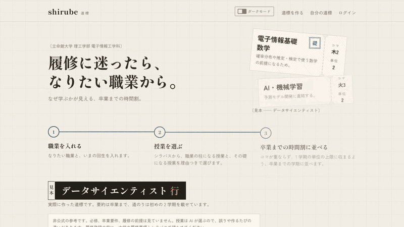
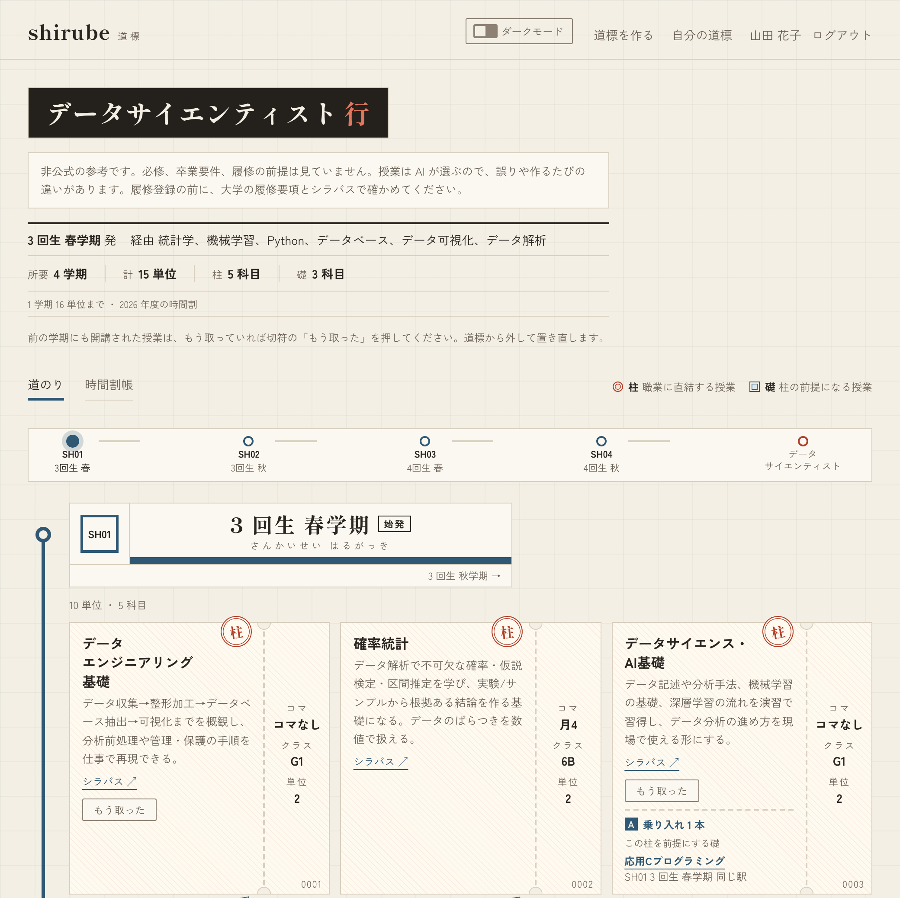
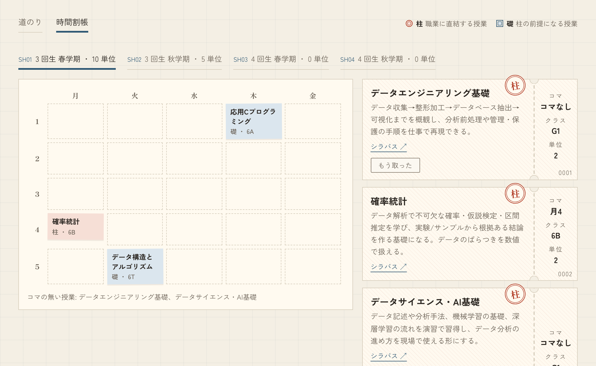
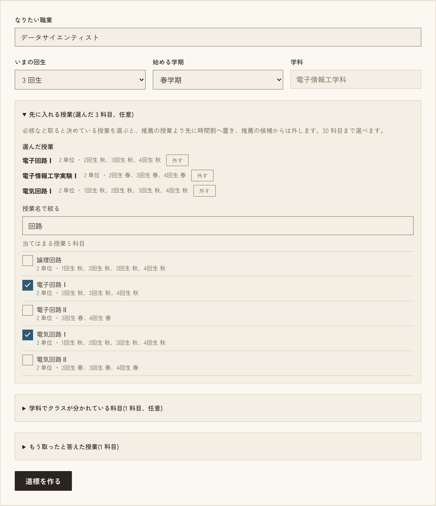
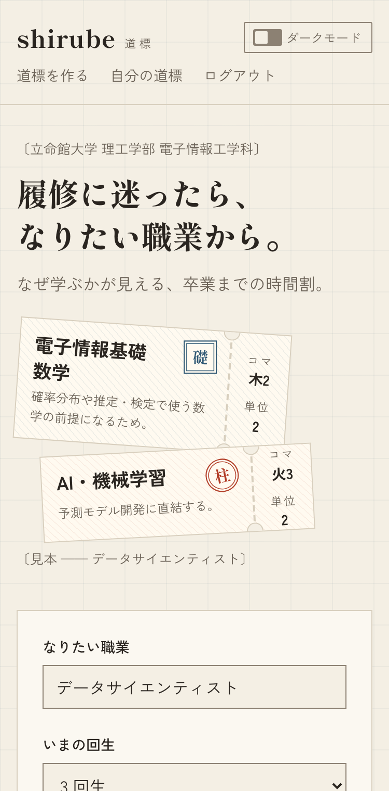
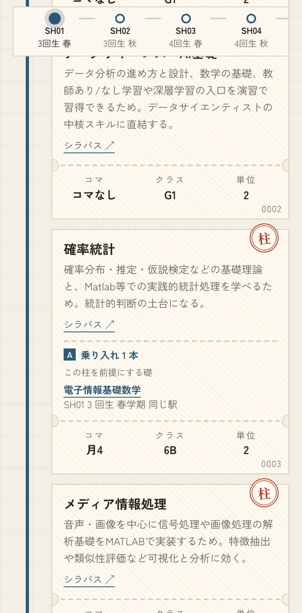
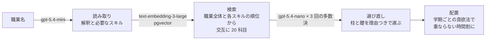
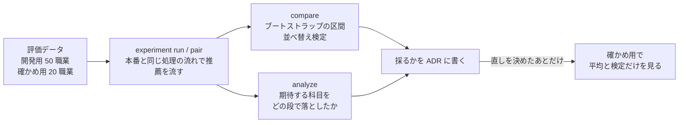
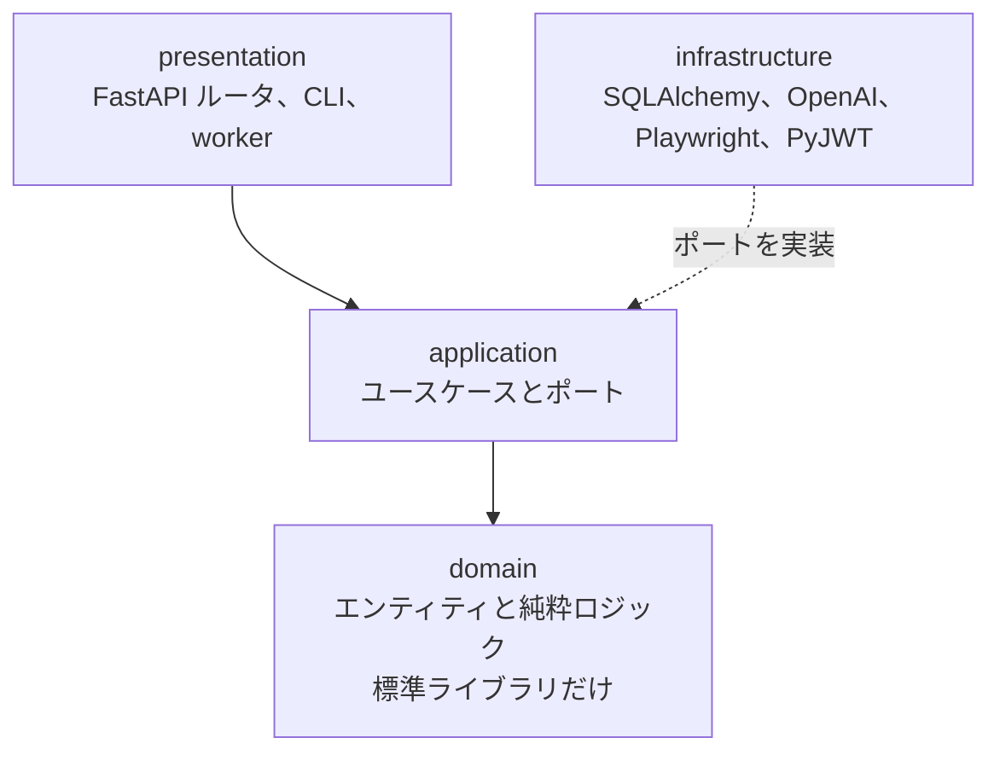
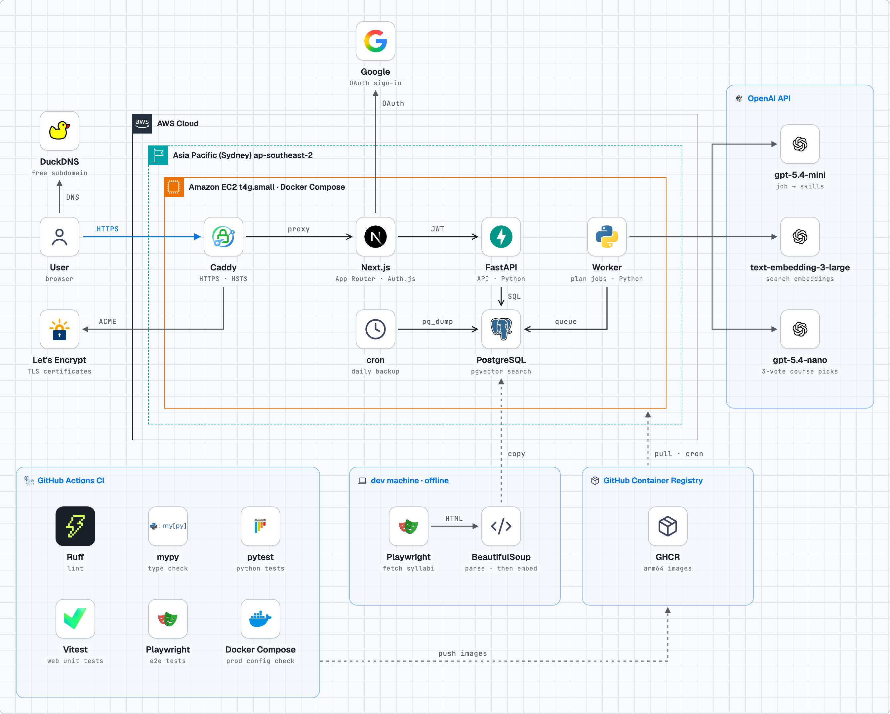

# shirube 道標

なりたい職業と回生(学年)を入れると、大学のシラバスから職業につながる授業を AI が選び、授業ごとに「なぜ取るか」を一文で添えて、卒業までの学期ごとの時間割(道標)を組む Web アプリです。対象は立命館大学 理工学部 電子情報工学科です。LLM の出力は、評価データと検定で測ってから、変更を採るかを決めています。

**デモ: https://shirube.duckdns.org** ・ [English summary](#english-summary)

ログインしなくても、トップで実際の出力の見本の道標を見られます。道標は、Google でログインすれば誰でも作れます(1 人 1 日 3 件まで)。

## 30 秒で

- **作ったもの**: なりたい職業から逆算して履修を組む LLM アプリです。シラバスを RAG で引き、LLM が授業を選んで理由を書き、時間割に並べます。AWS で公開しています
- **今の数字**: 開発用 50 職業で、選んだ授業のうち判定者の誰も関係ありとしなかったものが 15%、期待する科目のうち柱に選んだものが 64% です。推薦 1 件は約 1 円です([指標と今の精度](#指標と今の精度))
- **見どころ**: 指示文(プロンプト)や検索を変えたら、開発用 50 職業で前と後を交互に流し、職業ごとの並べ替え検定で比べます。採る条件は測る前に ADR に書き、採らなかった改善も残しています。見ていない職業への効き目は、取っておいた確かめ用(ホールドアウト)20 職業で、直しを決めたあとに確かめます(これまで 3 回。今の読み取りの文面(ADR 0104)は、開発用だけで採り、確かめ用では測っていません)([評価と改善](#評価と改善))
- **作りの選び方**: エージェントにせず、読み取り → 検索 → 選び直し → 配置の決まった段にしています。段ごとに測れること、1 件で LLM を呼ぶ回数が決まって費用と時間を見積もれること、LLM に道具を渡さずに済むことを優先しました([推薦の仕組み](#推薦の仕組み))
- **作り方**: 2026-10-14 から個人で作り、コードの多くは Claude Code が書きました。何を作るか、評価の設計、改善を採るかは作者が決めています。例えば、ねらいの指標で差が出なかった案を、結果を見てから指標を替えて採ることはせず、採りませんでした([作り方](#作り方))

## 何ができるか

> 大学とは関係のない個人の非公式のアプリです。必修、卒業要件、履修の前提は見ていません。授業は AI が選ぶので、誤りや作るたびの違いがあります。

履修を選ぶ学生は、シラバスを 1 つずつ読んでも、その授業が将来の仕事のどこに効くのかが分かりにくく、時間割の重なりも自分で調べる必要があります。shirube は、なりたい職業から逆算して次のことをまとめて行います。

- **職業から授業を選ぶ**: 職業名は自由に入れられます。LLM が職業に要るスキルを読み取り、学科のシラバスから関係する授業を選びます
- **なぜ取るかを添える**: 授業ごとに、シラバスの抜粋をもとに、仕事のどこで使うかを一文で書きます。シラバスの原ページへのリンクも付けます
- **柱と礎に分ける**: 職業に直結する授業を「柱」、柱の前提になる授業を「礎」と分け、どの礎がどの柱を支えるかを両方の切符に示します
- **重ならない時間割に並べる**: 卒業までの残りの学期に、曜日と時限が重ならず、1 学期の単位の上限に収まるように並べます
- **自分の条件に合わせる**: 始める学期、必修など先に入れる授業、学科で分かれたクラス、もう取った授業を入力の画面で扱えます。職業名は入力のまま読みます。誤字を直したときは作成中の画面で知らせ、意味を選んだときなどの前提も出します。完成の画面は行き先を入力した職業名のまま出し、前提があれば同じ条件のまま別の職業名で作り直せます

画面の画像と動画は、本番と同じビルドに、トップの見本と同じ道標を返して撮りました。この道標は 2026-11-08 に今の設定で作った実際の出力です。同じ条件で 3 回作り、明らかな誤りの無かった 1 つを選んだので、作るたびの出力の平均よりよく見えます(ほかの 2 回で気になったところは [ADR 0031 の追記](docs/adr/0031-route-design.md#追記2026-11-08見本の作り直し))。

### 結果の画面

卒業までを、なりたい職業を終点にした 1 本の路線に見立てています。学期が駅、授業がその学期の切符です。

| 画面の言葉 | 意味 |
|---|---|
| データサイエンティスト 行 | なりたい職業(道標の行き先) |
| 3 回生 春学期 発 | 始める学期 |
| 経由 | 職業に要るスキル(LLM が職業名から読み取ったもの) |
| 所要 / 計 | 卒業までの学期の数 / 単位の合計 |
| SH01、SH02… | 駅の番号。始める学期から順に振る |
| 柱(朱の丸い判子) | 職業に直結する授業 |
| 礎(紺の四角い判子) | 柱の前提になる授業 |
| 乗換 / 乗り入れ | 礎の切符には前提になる柱と何駅先か、柱の切符にはその柱を前提にする礎を載せる。押すと相手の切符へ移る |

### 時間割帳と入力

学期ごとの週の時間割の表で、授業が重ならずに並んでいることを確かめられます。スマホの幅でも同じ表で、時限の時刻と教室も出します。道標に置くのは職業につながる授業と、先に入れた授業だけです。ほかの授業は学生が埋めるので、後の学期が空くこともあります。

必修など先に取ると決めた授業は、開講される授業の一覧から名前で絞って選ぶと、推薦の授業より先に時間割へ置き、推薦の候補から外します([ADR 0093](docs/adr/0093-fixed-courses.md))。

  
  

スマホの幅でも使え、明るい見た目と暗い見た目を切り替えられます。キーボードだけで操作でき、WCAG 2.2 の AA を目安にしています([品質](#品質))。

## 推薦の仕組み

道標は API が待ち行列に入れ、worker が 1 件ずつ作ります。今の設定の実験(開発用 50 職業、1 回)では、推薦 1 件は平均 9.4 秒、1.06 円でした。作成中の画面の「目安 10〜30 秒」は、待ちを含めた目安です。

- **読み取り(クエリの解釈と展開)**: LLM が職業名を、解釈、前提の 1 文、必要なスキル 3〜6 個に直します(構造化出力)。学科の授業に無い応用分野の細かい職種(Web エンジニアなど)は、授業で備えられる広い職業として読み、そう読んだことを前提として画面に出します([ADR 0032](docs/adr/0032-broad-occupation.md))
- **検索(RAG)**: 2026 年度のシラバス 530 ページを、授業概要、到達目標、授業計画の節ごとに 1,589 のチャンクにして埋め込んであります。職業全体のクエリと各スキルのクエリで検索し、それぞれの順位から交互に 20 科目を候補にします([ADR 0063](docs/adr/0063-search-by-skill.md))
- **選び直し(候補の中から LLM が選ぶ段)**: 候補 20 科目のシラバスの抜粋を LLM に読ませ、柱と礎を理由つきで選ばせます。答えは JSON Schema の構造化出力で受け、科目名を候補の enum に限るので、候補に無い授業は出ません。同じ問いを 3 回並べて投げ、2 回以上選ばれた授業だけを残します([ADR 0049](docs/adr/0049-selection-votes.md))。2 回目からは 0.5 秒遅らせて送り、1 回目の入力がキャッシュに入ってから当てることで、費用を 11% 下げました([ADR 0051](docs/adr/0051-vote-delay.md))
- **配置**: 学期ごとに、その授業を取れる回生と開講学期を満たし、コマが重ならず、単位の上限に収まる授業を貪欲法で詰めます([ADR 0007](docs/adr/0007-greedy-timetable.md))

この形にした理由です。

- **検索で絞ってから読ませる**: 学科の授業は 188 科目あり、全科目の抜粋を読ませると入力が 5 倍以上になります。他学部に広げるとさらに増えます。検索で 20 科目に絞れば、入力の大きさは学科の大きさによりません。全科目を読ませる案は測っていません([ADR 0018](docs/adr/0018-llm-pipeline.md))
- **選び直しは小さいモデルを 3 回**: 当時の指示文と候補 30 件で 10 職業を比べると、どの指標でも gpt-5.4-nano が mini と同じか上回り、費用は約 4 分の 1 でした([ADR 0020](docs/adr/0020-course-selection-evaluated.md))。今の指示文では比べ直していません。1 回だけでは選ぶ授業が揺れるので、多数決にしています
- **エージェントにしない**: どの職業でも段の順は同じで、次に何をするかを LLM に決めさせる場面がありません。段を固定すると、期待する授業をどの段で落としたかを数えられ、1 件で LLM を呼ぶ回数(読み取り 1〜2 回と選び直し 3 回)が決まって費用と時間を見積もれ、LLM に道具を渡さずに済みます
- **同じ条件は使い回す**: 同じ職業名と条件の推薦は 7 日残し、LLM を呼ばずに配置から作ります([ADR 0092](docs/adr/0092-recommendation-cache.md))。同じ職業名の読み取りも覚えて使い回します([ADR 0052](docs/adr/0052-reading-cache.md))

将来の学期のシラバスはまだ無いので、当年度のシラバスと時間割を翌年度以降の代理にしています([ADR 0010](docs/adr/0010-graduation-roadmap.md))。

## 評価と改善

LLM の出力はそれらしく見えるので、感覚ではなく数字で直すために、評価データ、実験の CLI、統計の決まりを先に作りました。作りながら分かったことが 3 つあり、どれも今の仕組みに入っています。

- 10 職業で同じ設定を別の時刻に流した 2 組で、「関係なし」が 9 ポイントほど動いた。そこで、比べる 2 つの設定を職業と回ごとに交互に流すようにした([ADR 0055](docs/adr/0055-interleaved-runs.md))
- 開発用の取りこぼしを見て決めた直しが、見ていない職業には効かなかった。そこで確かめ用の 20 職業を分け、直しを ADR に書いたあとにだけ流して、平均と検定だけを見るようにした([ADR 0067](docs/adr/0067-heldout-occupations.md))
- 理由の文を自動で判定する LLM は、正解との一致が測る前に決めた線に届かなかった。そこで採らず、Claude の判定者 3 体の判定を使い続けている([ADR 0088](docs/adr/0088-reason-evaluation.md))

### 正解の作り方

- **期待する科目(正解ラベル)**: 職業ごとに、Claude(Opus 5.5)のサブエージェントを 3 つの立場の判定者にしました。立場は、採用・育成担当のエンジニア、カリキュラムを設計する教員、進路を考える 3 回生です。学科の 188 科目全てを、職業名とシラバスの抜粋だけから判定させ、「中心」か「土台」の票を入れさせました。2 体以上が中心とした授業と、中心の票が 1 つだけで作者が中心に決めた 4 件が、期待する科目です。中心と土台は、画面の柱と礎にあたります。期待する科目は、開発用 50 職業で 151、確かめ用 20 職業で 58 です。期待する科目が 1 つも無かった職業(開発用 8、確かめ用 1)は予備と入れ替えたので、数字は学科の授業が備える職業についてのものです([ADR 0017](docs/adr/0017-eval-judging.md)、[0064](docs/adr/0064-fifty-occupations.md))
- **人が関わった範囲**: 正解は判定者の票から作りました。作者が決めたのは、中心の票が 1 つだけの科目 32 件(開発用 26、確かめ用 6)だけです。うち 23 件は判定者の多数に合わせて一括で土台にし、残る 9 件は 1 件ずつ決めて 4 件を中心にしました。人が一から付けた正解ではなく、人の判断との一致も測っていないので、判定者の癖は正解に残ります。アプリの LLM(OpenAI)とは系統を分け、答え合わせが循環しないようにしています

### 指標と今の精度

| 指標 | 意味 | 今の設定(開発用 50 職業、2026-11-04、1 回) | 前の設定を別の時刻に 3 回(2026-10-31〜11-04) |
|---|---|---|---|
| 候補の再現率 | 期待する科目のうち、検索の候補 20 科目に入った割合 | 88.8% | 88.7〜90.7% |
| 関係なし | 選んだ授業のうち、3 体のどれも中心とも土台ともしなかった割合(誤りの目安。判定者の読み落としも含み、1 体だけが挙げた授業は数えない) | 15.1% | 13.4〜16.7% |
| 期待する科目を柱に選んだ割合 | 期待する科目のうち、柱に選んだ割合(再現率にあたる) | 63.6% | 67.5〜70.2% |
| 柱の適合率 | 柱に選んだ授業のうち、期待する科目の割合 | 37.4% | 36.2〜37.5% |

- 同じ設定でも、少なくとも右の列ほどは動きます(3 回の幅で、10 職業では別の時刻に流して 9 ポイント動いた例もあります)。今の設定の 1 回の値もその幅で読みます。期待する科目を柱に選んだ割合の 63.6% は、この幅より低い値です
- 今の設定は、ADR 0090 で柱の理由の書き方を替え、ADR 0103 と 0104 で職業名の読み方を替えたものです。ADR 0090 では、同じ時刻に交互に流した前の設定と比べると、関係なしは 16.7% → 15.1%(p = 0.478)、期待する科目を柱に選んだ割合は 68.9% → 63.6%(p = 0.204。差ありではないが下がる向き)、1 職業に選んだ柱は 5.74 → 5.14(p = 0.029)でした
- ADR 0103 では、Web やクラウドのような細かい職種がどれも「ITエンジニア」と読まれ、違う職種で道標が似ていたのを、仕事の向きを残して読むよう替えました。読み取りを毎回やり直して交互に流すと、まとめた読みは 100 回のうち 21 回から 0 回になり、関係なしは 17.4% → 18.8%(p = 0.432)、期待する科目を柱に選んだ割合は 70.5% → 69.2%(p = 0.717)で、どれも差はありませんでした。1 回目の文面は関係なしが差ありで増えたので採らず、2 回目は読み取りを覚える設定のまま測っていたのをレビューで見つけて、測り直しています
- ADR 0104 では、入力した職業名を言い換えず、誤字のときだけ直すようにしました。開発用 50 職業は全て入力のまま読まれ、検索の再現率 @20 は前と交互に 3 回ずつ測って 0.85 → 0.91 に上がりました。OpenAI の残高が少ないので、選び直しの指標はまだ測っていません
- 柱の適合率が低めなのは、判定者の中心が「授業の中心テーマが、仕事で直接使う知識・技能そのもの」と狭いのに対し、ADR 0080 で柱を「職業に少しでも役立つ授業」まで広げたためです。今の設定で選んだ柱の半分ほどは、判定では土台です。網羅を取る代わりに、関係なしが 20% を超えたら見直すと決めています([ADR 0080](docs/adr/0080-selection-coverage.md))。決めた測り方(今の既定どうしを交互に 3 回流した平均)はまだ流しておらず、今の 15.1% は 1 回の値です
- 確かめ用 20 職業は、直しを決めたあとに 3 回だけ使いました。いずれも 1 回ずつ流し、採る条件は点の推定の向きだけでした。ADR 0069 では関係なしが 15.0% → 12.2%(p = 0.210)でした。ADR 0080 では 1 職業の柱が 4.35 → 6.15(p = 0.001)、期待する科目を柱に選んだ割合が 69.0% → 89.7% と増えた一方、関係なしは 15.0% → 17.5%(p = 0.337)、柱の適合率は 46.0% → 42.3% でした。この回は読み取りが揺れて、検索の再現率 @20 も +3.5 ポイント動いています。ADR 0103 の 2 回目の文面では期待する科目を柱に選んだ割合が 74.1% → 84.5%(p = 0.176)、関係なしが 13.7% → 16.8%(p = 0.315)でした。今の文面はこれをレビューで直したもので、確かめ用では測り直していません。ADR 0090 は開発用だけで採り、確かめ用では流していません

### 段ごとの取りこぼし

`experiment analyze` が、期待する科目をどの段で落としたかを数えます([ADR 0073](docs/adr/0073-experiment-analysis.md))。読み取りと検索のどちらで落としたかは、評価データに付けた参照用のスキル(Claude が下書きし、作者が確かめた「手書きのスキル」)で検索し直して分けます。科目を知る側が書いたスキルなので、検索には有利になりえます。2 つ前の設定(ADR 0069、2026-10-26)の開発用 50 職業の 151 件では、次のとおりでした。

| 期待する科目の行方 | 件数 |
|---|---|
| 柱に選んだ | 100(66%) |
| 礎に選んだ | 6(4%) |
| 礎に選んだが、柱につながらず外した | 3(2%) |
| 候補にあったが選ばなかった(選び直しで落とした) | 20(13%) |
| 候補に無く、手書きのスキルなら入った(読み取りで落とした) | 18(12%) |
| 手書きのスキルでも候補に入らない(検索で落とした) | 4(3%) |

取りこぼしは検索より、読み取りと選び直しに多いと分かりました。この表より前の調べでも、LLM のスキルで落とした 25 件のうち 17 件は手書きのスキルなら候補に入ったので、読み取りを弱点と見て、読み取りの指示文に学科の分野を書く案を試しました。候補の再現率が下がる向きだったので採りませんでした(下の表の ADR 0065)。

### 実験と統計の決まり

- **実験の CLI**: `experiment run` が評価データの職業に、本番と同じ処理の流れで推薦を流します。精度、揺れ(同じ職業の回どうしの選んだ授業の重なり、Jaccard)、1 件の費用と時間を、設定と生の出力と一緒に JSON に残します([ADR 0048](docs/adr/0048-recommendation-experiments.md))。比べる 2 つの設定は `experiment pair` で、職業と回ごとに交互に流します
- **統計**: 差の 95% 信頼区間は、職業を選び直すブートストラップで出します。差の有無は、職業ごとに前と後を入れ替える並べ替え検定(p < 0.05)で決めます([ADR 0053](docs/adr/0053-paired-bootstrap.md)、[0055](docs/adr/0055-interleaved-runs.md))
- **採る条件を先に書く(事前登録)**: ADR 0054 からは、判定に使う指標と採る条件を、変える前に ADR に書いています。ほかの指標は、区間の悪い側の端でどこまで悪くなりうるかを見ます

### 採った改善と採らなかった改善

| 変えたこと | ねらいの指標 | 結果 | 判断 |
|---|---|---|---|
| 選び直しを 3 回の多数決に([0049](docs/adr/0049-selection-votes.md)) | 関係なし | 23% → 10%(10 職業、別の時刻の比べ)。費用は約 1.9 倍。のちに 30 職業で交互に流し直すと、多数決を含む 4 つの変更をまとめて 27.6% → 21.6%(p = 0.023) | 採った |
| 職業の読み取りを覚える([0052](docs/adr/0052-reading-cache.md)) | 揺れと費用 | 回どうしの重なり 0.56 → 0.73。同じ職業名に同じ読み取りを返す仕組みで揺れを止めたもので、読み取りそのものは揺れたまま。覚えた職業は 1 件 0.59 円 | 採った |
| 埋め込みを 3-large にし、検索を職業全体と各スキルの交互にする。2 つを同時に替えた([0063](docs/adr/0063-search-by-skill.md)) | 候補の再現率 | 50 職業で +3.3 ポイント(p = 0.391)。上がったのは直しを決めるときに見た 30 職業だけ(+6.4 と -1.2) | 採った(注 1) |
| 読み取りに学科の分野を書く([0065](docs/adr/0065-department-fields.md)) | 候補の再現率 @20 | -4.4 ポイント(p = 0.105) | 採らなかった |
| 迷った授業は選ばない([0069](docs/adr/0069-selection-restraint.md)) | 関係なし | 開発用 16.4% → 10.6%(p = 0.004)、確かめ用 15.0% → 12.2%(p = 0.210) | 採った。のちに 0080 で替えた |
| 少しでも役立つ授業は迷っても選ぶ([0080](docs/adr/0080-selection-coverage.md)) | 1 職業の柱と礎の数 | 柱 4.60 → 5.44(p < 0.001)、礎は差なし。期待する科目を柱に選んだ割合は +6.0 ポイント(p = 0.058)、選び直しで落とした期待する科目は 24 → 24 のまま。関係なしは 12.3% → 16.4%(p = 0.027) | 採った(注 2) |
| 3 票のうち 1 票でも選べば残す([0081](docs/adr/0081-selection-min-votes.md)) | 1 職業の柱の数 | 5.66 → 6.20(p = 0.076)。増えたのは礎で、関係なしは 13.4% → 19.7%(p = 0.003) | 採らなかった |
| 柱の理由に、仕事のどの作業に授業のどの内容を使うかを書かせる([0090](docs/adr/0090-reason-wording.md)) | 柱の理由が具体的な割合 | 36.8% → 67.1%(区間 +17.8〜+42.7)。期待する科目を柱に選んだ割合は 68.9% → 63.6%(p = 0.204、下がる向き) | 採った |
| 理由の文を自動で判定する判定器([0088](docs/adr/0088-reason-evaluation.md)) | 正解との κ が 0.6 以上 | 確かめる用の 75 件で 0.54(gpt-5.4-mini) | 採らなかった |

- 行ごとに、流した時刻と職業の数が違うので、比べられるのは各行の前と後だけです。上の 2 行は、交互に流す決まりと、採る条件を先に書く決まりを作る前の判断です
- 注 1: 採ると決めたのは 30 職業の結果を見たときです。ねらいの候補の再現率は差ありに届きませんでした(+7.0 ポイント、p = 0.089)。それでも、3 つの測り方で再現率が同じ向きに上がり、関係なしが下がり(-7.7 ポイント、p = 0.004)、費用も増えないので、作者が条件を満たさないと承知のうえで採りました。50 職業で比べ直しても再現率ははっきりせず(p = 0.391)、悪くなった指標も無いので戻していません
- 注 2: 確かめ用の採る条件は、0069 も 0080 も点の推定の向きだけでした。0080 は選ぶ数を増やす指示文なので、ほぼ必ず通る条件でした。増えた柱の多くは判定では礎か関係なしで、選び直しで落としていた期待する科目を拾う効き目はありませんでした

細かい数字と経緯は[推薦の評価の記録](docs/evaluation-log.md)にあります。

### 理由の文の評価

- 理由の文は、柱なら職業のどの仕事に効くかを、礎なら柱のどの内容の前提かを言えているかを、具体的・ぼんやり・無いの 3 段で判定しています。判定したのは Claude のサブエージェント 3 体で、150 件の 3 票の中央値を正解にしました。3 体の一致は Fleiss の κ で 0.80 です。同じモデルの 3 体なので、これは判定の再現性で、正しさの裏付けではありません([ADR 0088](docs/adr/0088-reason-evaluation.md))
- 最初の測定では、柱の理由のうち具体的だったのは 28% でした。仕事のどこで使うかを書かせる指示文に替え、前と後を同じ時刻に交互に流して同じ判定者で比べると、36.8% → 67.1% に上がりました。前の 36.8% と 28% の違いには、流した時刻、取った 150 件、判定者のモデル(Opus 5.5 → Fable 5.1)の違いが入っています([ADR 0090](docs/adr/0090-reason-wording.md))
- 判定の決まりと指示文が同じ観点なので、上がったのは「書き方が決まりに沿った割合」です。理由がシラバスの抜粋に無いことを言っていないか(作り話)は測っていません

### まず読んでほしい ADR

| ADR | 読みどころ |
|---|---|
| [0018 LLM の流れの全体](docs/adr/0018-llm-pipeline.md) | 段を分けて、段ごとに測って直せる形にした出発点 |
| [0067 確かめ用を分けた理由](docs/adr/0067-heldout-occupations.md) | 直しが、決めるときに見た職業にだけ効いていた |
| [0080 精度と網羅のどちらを取るか](docs/adr/0080-selection-coverage.md) | 関係なしが増えるのを受け入れて網羅を取り、条件が甘かった反省も残した |

## 限界

- 必修、卒業要件、履修の前提は見ていません。必修など先に取ると決めた授業は先に置けますが、要件を満たすかは確かめません
- 前提の授業を前の学期に置く制約は無いので、礎が柱より後の学期に来ることがあります([ADR 0034](docs/adr/0034-taken-courses.md))
- 柱の理由の 3 分の 1 は、まだ仕事のどこに効くかを具体的に言えていません。理由が作り話でないかは測っていません
- 正解は Claude の判定の多数決で、人の判断との一致は測っていません。評価の職業は、学科の授業が備える職業に限っています。今の設定は確かめ用で流していません
- 比べる土台(全科目を読ませる案、キーワードの検索など)は測っていません。最初の作りと今の設定を、同じ時刻に交互に流して比べたこともありません
- 職業の読み取りのスキルは、読むたびに揺れます。職業名は入力のまま読むようにしたので(ADR 0104)、揺れはスキルに出ます。選び直しまで通したときの揺れと関係なしは、この読み方ではまだ測っていません。学科の授業と合わない職業では関係なしが多くなります(ADR 0080 の設定で、テック系スタートアップの起業家は選んだ 13 科目のうち 9 科目)
- 10 職業で同じ設定を別の時刻に流した 2 組では、関係なしが 9 ポイントほど動き、その原因は分かっていません。50 職業で同じ設定を 3 回流すと 13.4〜16.7% でした
- 実際の学生に使ってもらった検証はまだです。ログインは 2026-11-08 に誰でも使えるようにしたばかりで、それまでに本番で作った道標はテストの数件だけです

## 作り方

このリポジトリは Claude Code(Anthropic の AI コーディングエージェント)と作りました。コード、テスト、文書の多くは Claude Code が書きました。作者が決めたのは、何を作るか、設計の選択肢のどれを選ぶか、評価の設計(確かめ用を分ける、採る条件を測る前に書く)、改善を採るかどうかです。ADR の中では、作者を「高橋さん」と書いています。

作者が数字を見て決めた例です。

- 1 票でも選んだ授業を残す案は、ねらいの指標で差が出なかった。結果を見てから指標を替えて採ることはせず、採らなかった([ADR 0081](docs/adr/0081-selection-min-votes.md))
- 本番で作ったデータサイエンティストの道標が少なく見えたので、関係なしが増えるのを受け入れて網羅を取る方針に替え、関係なしが 20% を超えたら見直す線を決めた。きっかけの職業に少し役立つ授業(深層学習の応用)は、変えたあとも選ばれなかった([ADR 0080](docs/adr/0080-selection-coverage.md))
- 検索の改善は、ねらいの指標(候補の再現率)で差が出なかった。それでも、3 つの測り方で同じ向きに上がり、関係なしが下がり、費用も増えないことを見て、条件を満たさないと承知のうえで採った([ADR 0063](docs/adr/0063-search-by-skill.md))

1 つの変更は、次の順に進めます。

1. 選択肢が 2 つ以上ある判断は、Claude Code が選択肢と良し悪しを並べ、作者が選ぶ。決めたことは実装より先に ADR に書く
2. git の worktree の上でブランチを切って作り、PR にする
3. Claude Code にセルフレビューをさせ、新しい指摘が無くなるまで(最大 3 周)直し、CI が通ってからマージする。周ごとの指摘と見送った理由は PR の本文に残す(例: [#122](https://github.com/h11roki/Shirube/pull/122))。LLM の振る舞いを変える PR は、評価の数字と検定の結果も ADR に残す
4. マージすると、CI が作ったイメージをサーバーが取りに行って本番に出る

Claude Code に守らせる決まり(層の依存の向き、ADR を先に書くこと、コメントを書かず経緯はコミットメッセージに書くことなど)は [CLAUDE.md](CLAUDE.md) にあります。

## 品質

| CI の job | 確かめること |
|---|---|
| backend | ruff、mypy(strict)、pytest(DB の結合テストを含む)、カバレッジの下限 |
| frontend | lint、型、Vitest、整形、E2E テスト(Playwright) |
| production | 本番の構成を本番と同じ Arm の runner で組み立てて起動し、HTTPS、HSTS、ログインの戻り先を確かめる |
| scripts | デプロイのスクリプトの shellcheck と、場面ごとのテスト(戻し、マイグレーションの失敗、途中で止まった版のやり直しなど) |
| audit、CodeQL | 依存の既知の脆弱性と、コードの静的解析 |

- main は GitHub の ruleset で保護し、PR を通して必須の check が全て通らないとマージできません([`.github/rulesets/main.json`](.github/rulesets/main.json))
- E2E テストは、全ての画面を幅 375px と 1280px、明るい見た目と暗い見た目で開き、axe で WCAG 2.2 の A と AA の違反が無いか、幅 320px で横にはみ出さないか、文字を 200% にしても切れないかを確かめます。折り返しのテストは、Chromium のほかに WebKit(iPhone のまね)でも流します([ADR 0056](docs/adr/0056-accessibility.md)、[0070](docs/adr/0070-text-resize-test.md))
- テストの数(2026-11-14): backend 941、Vitest 169、E2E 296、デプロイのスクリプトの場面 16
- カバレッジ: backend は行と分岐で 89.0%、frontend の表示の決まり(`src/lib`)は文 99.5%、分岐 95.0% です。下限(backend 87%、frontend は文 97%、分岐 93%)を下回ったら CI が落とします([ADR 0098](docs/adr/0098-coverage.md))

## 安全性

LLM を使う部分の守りは、入口を狭くし、出口を限ることにしています([ADR 0089](docs/adr/0089-llm-safety.md))。

- 利用者の入力のうち LLM に渡るのは職業名(100 字まで)だけです。学科、回生、学期、クラスは決まった値から選びます
- LLM の答えは構造化出力で受け、選ぶ授業は候補の科目名の enum に限ります。LLM の文を SQL の文や道具の呼び出しに組み込みません。読み取ったスキルは埋め込んで検索に使いますが、DB に渡るのはベクトルだけです
- 道標の文は作った本人の画面に出します。ただし、同じ職業名と条件の推薦は 7 日使い回すので、同じ職業名を入れたほかの利用者にも同じ理由の文が出ます
- 指示を混ぜた職業名(プロンプトインジェクション)を 3 件流しました。指示文を出させる、解釈に API キーを書かせる、といった指示です。3 件とも指示には従わず、候補に無い授業も指示文の中身も出ませんでした(API キーはもともと LLM に渡していません)。保証ではなく、その日の振る舞いの記録です。指示文かモデルを替えたら流し直します
- 失敗の文は決まった文だけを返します。道標の受け付けは 1 人 1 日 3 件、全体で 1 日 30 件までで、OpenAI は前払いにして自動の補充を切っています([ADR 0038](docs/adr/0038-plan-quota.md))
- フロントの Route Handler は、送り元を確かめてほかのサイトからの要求を断ります。全てのページと API に CSP などのヘッダーを付けます。health の API を除き、バックエンドは 5 分で切れる JWT でだけ呼べます([ADR 0027](docs/adr/0027-auth-backend.md)、[0039](docs/adr/0039-request-guard.md))
- 依存の既知の脆弱性を CI で止め、Dependabot は出てから 7 日経った版だけを上げ、CodeQL がコードを調べます。脆弱性の報告の仕方は [SECURITY.md](SECURITY.md) にあります([ADR 0096](docs/adr/0096-supply-chain.md))

## 設計

バックエンドはクリーンアーキテクチャの 4 層で、依存は内側にだけ向けています。大学ごとのシラバスの取得元や LLM は application のポート(Protocol)の向こうに置き、infrastructure に実装を足して差し替える形にしています。今は 1 大学だけで、2 つ目の取得元はまだ作っていません。

- フロントは API を呼んで表示するだけで、業務ロジックを置きません。Next.js の Route Handler がログインを確かめ、Google の利用者の番号を入れた JWT を付けて backend に転送します([ADR 0027](docs/adr/0027-auth-backend.md)、[0028](docs/adr/0028-auth-frontend.md))
- API の型は OpenAPI から生成してコミットし、backend のテストが OpenAPI との食い違いを見つけます([ADR 0030](docs/adr/0030-screens.md))

## 本番の構成

<picture>
  <source media="(prefers-color-scheme: dark)" srcset="docs/images/architecture-dark.png">
  
</picture>

- **構成**: AWS EC2 の 1 台(t4g.small、シドニー)で Docker Compose を動かし、Caddy が Let's Encrypt の証明書を取って HTTPS を受けます。ドメインは DuckDNS の無料のサブドメインです。DB と backend のポートは外に出しません([ADR 0075](docs/adr/0075-production-setup.md))
- **デプロイ**: サーバーが取りに行く形です。main にマージすると、CI が全て通った版だけ Arm のイメージを作って GHCR に置きます。サーバーの cron は 5 分おきに新しい版を見つけ、マイグレーション、入れ替え、ヘルスチェックまで行い、応えなければ前の版に戻します。マイグレーションを流した版は戻さず、人が確かめるまで入れ替えを止めます。CI に SSH の入口や鍵を持たせません([ADR 0094](docs/adr/0094-pull-deploy.md))
- **監視**: GitHub Actions の定期実行が 15 分ごとに外から確かめ、落ちたら GitHub のメールで知らせます。見るのは、トップ、ログインせずに呼んだ API の応答、health の API(DB に届くか、待ちの滞り、OpenAI の残高切れ、動いている版)、証明書の残り、本番が main に追いついているかです([ADR 0095](docs/adr/0095-health-monitor.md))
- **バックアップ**: 毎日取って 7 日分を残し、毎週、使い捨てのコンテナに戻して、本番のスキーマと科目の表と合うかを確かめます。初めの演習で、戻しの手順にマイグレーションが抜けていたのを見つけて直しました([ADR 0097](docs/adr/0097-restore-drill.md))
- **取り込み**: シラバスの取得、解析、埋め込みは手元の開発機で行い、科目の表の中身だけを本番の DB へ移します。取得は 2〜3 秒の間隔で 1 本ずつ行い、取った HTML を保存して取り直しません
- **記録**: 道標を作るごとに、費用、待ちと作る時間、失敗の種類(残高切れを見分ける)を、利用者の番号も入力も持たない形で残し、日ごとに集計します([ADR 0087](docs/adr/0087-build-records.md))

図は [stack-diagram](https://github.com/caru-ini/stack-diagram) で描いた [`docs/images/architecture.html`](docs/images/architecture.html) を撮ったものです。

## 使った技術

| 領域 | 技術 |
|---|---|
| フロント | Next.js(App Router、TypeScript)、Tailwind CSS、Auth.js、pnpm、Vitest、Playwright + axe |
| バックエンド | Python 3.13、FastAPI、SQLAlchemy、Alembic、LangChain、uv、ruff、mypy |
| DB | PostgreSQL + pgvector |
| LLM / 埋め込み | OpenAI API(gpt-5.4-mini、gpt-5.4-nano、text-embedding-3-large) |
| 評価データの判定 | Claude のサブエージェント |
| シラバスの取り込み | Playwright、BeautifulSoup |
| 本番 | AWS EC2、Docker Compose、Caddy、DuckDNS |
| CI / CD / 監視 | GitHub Actions、GHCR、サーバーの cron が取りに行くデプロイ、Actions の定期実行による外からの監視 |

## 関連文書

- [開発と本番の手順](docs/development.md): 手元での起動、本番の用意とデプロイと更新とバックアップ、データの取り扱い、開発のルール
- [推薦の評価の記録](docs/evaluation-log.md): 基準、改善ごとの数字、30 職業と 50 職業での比べ、取りこぼしの内訳
- [ADR の一覧](docs/adr/README.md)

## English summary

shirube ("signpost") helps university students plan their courses by working backwards from the job they want. Given an occupation and the student's year, it retrieves related courses from the university's syllabi (RAG over pgvector), has an LLM choose courses and explain how each one matters for that job, and lays them out as a clash-free timetable until graduation. It covers one department at Ritsumeikan University and is live at https://shirube.duckdns.org (anyone with a Google account can sign in and create up to 3 plans a day; the landing page shows a real sample plan).

- **Evaluation-driven**: changes to prompts and retrieval are compared on 50 development occupations with interleaved runs and permutation tests, and acceptance criteria are written in an ADR before measuring. The labels come from three Claude judges (a different model family from the OpenAI models the app uses) and have not been checked against human judgement. A 20-occupation held-out set is used only after a change is decided; it has been used twice, with direction-only criteria, and the current configuration was adopted on the development set alone. Rejected changes are documented too.
- **A staged pipeline, not an agent**: occupation interpretation with structured output, retrieval, selection by a three-vote majority, and greedy timetable placement. Each stage is measured on its own, course names are constrained to the candidates by an enum, and a recommendation costs about 1 JPY.
- **In production**: FastAPI and Next.js on one AWS EC2 instance, pull-based deployment with rollback (a version that ran migrations is held for a person instead), external monitoring every 15 minutes, and daily quotas with prepaid billing as cost limits.
- **How it was built**: most of the code was written by Claude Code. The author made the product and design decisions, designed the evaluation and chose which changes to adopt, as recorded in 99 ADRs.

The rest of the documentation is in Japanese.

## ライセンス

コードは [MIT License](LICENSE) です。取り込んだシラバスと時間割表の内容(`backend/data/`、git 管理外)と画面に出す引用は、このライセンスの対象外です(大学と担当教員のもの)。テストには実ページを置かず、科目名、教員名、本文が架空の合成のページと PDF を使います([ADR 0043](docs/adr/0043-license-and-fixtures.md))。
