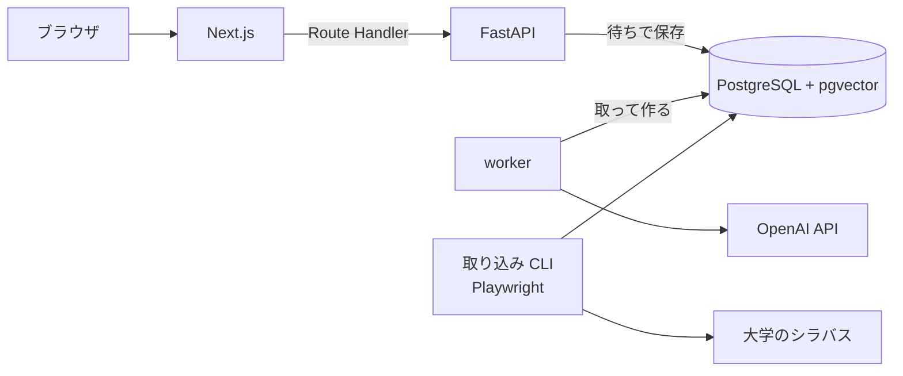
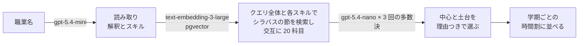

# shirube

なりたい職業から、卒業までの履修の道標を描く。

大学のシラバスをもとに、入力した職業に必要なスキルを満たす授業を選び、取るべき理由を添えて、曜日・時限が重ならない学期ごとの時間割を自動で組む Web アプリ。最初の対象は立命館大学 理工学部 電子情報工学科。他学部・他大学へ広げる前提で設計している。

## できること

- 職業と回生を入力すると、その職業に必要なスキルを提示する
- シラバスから関連する授業を選び、授業ごとに取るべき理由を添える
- 卒業までの残り学期ごとに、曜日・時限が重ならない時間割を組む
- Google ログインで自分の道標を保存し、後から見返す
- キーボードだけで操作でき、作成の段と完成を読み上げの枠で伝え、スマートフォンの幅では時間割を曜日ごとの一覧で読める(WCAG 2.2 の AA を目安にした。ADR 0056)

## 構成



| 領域 | 技術 |
|---|---|
| フロント | Next.js (App Router, TypeScript), Auth.js, pnpm, Vitest, Playwright + axe(画面の通しの試験) |
| バックエンド | Python, FastAPI, SQLAlchemy, Alembic, LangChain |
| DB | PostgreSQL + pgvector |
| LLM / 埋め込み | OpenAI API |
| 取り込み | Playwright, BeautifulSoup |
| 開発環境 | Docker Compose |
| CI | GitHub Actions |
| 本番 | AWS EC2 |

## 起動

```sh
docker compose up
```

- フロント: http://localhost:3000
- バックエンド: http://localhost:8000 (OpenAPI: http://localhost:8000/docs)

ポートが使用中のときは `FRONTEND_PORT` / `BACKEND_PORT` / `DB_PORT` で手元側のポートを変えられる。道標は API が「待ち」で受け付け、worker(`python -m app.presentation.worker`)が 1 件ずつ取って作る(ADR 0029)。画面は道標ができるまで GET を繰り返す。worker と backend は起動に `OPENAI_API_KEY` が要る(無ければログに理由が出て止まる)。道標の API はフロントの Route Handler が作る JWT で利用者を確かめる(ADR 0027)ので、起動に `AUTH_JWT_SECRET`(32 文字以上の乱数。`openssl rand -hex 32` で一度だけ作った値を書く)も要る。backend は外に公開せずフロントからだけ呼ぶので、ポートは手元(127.0.0.1)だけに開ける。`docker compose up` は手元の環境変数の `OPENAI_API_KEY` と `AUTH_JWT_SECRET` を backend に、`OPENAI_API_KEY` を worker に渡す。シラバスの埋め込み(`embed` コマンド)と検索の評価(`evaluate` コマンド)は手元で実行し、同じく `OPENAI_API_KEY` を環境変数で渡す。リポジトリ直下の `.envrc`(direnv、git 管理外)に `export OPENAI_API_KEY=...` と `export AUTH_JWT_SECRET=...`(`openssl rand -hex 32` で一度だけ作った値)を書き、`direnv allow` で有効にする。direnv は一番近い `.envrc` だけを読む。親ディレクトリの `.envrc` で渡している変数があるなら、先頭に `source_up` を書かないとリポジトリの中ではそれが消える。

ログインは Google で行う(Auth.js、ADR 0028)。Google Cloud のコンソールで OAuth クライアント(種類はウェブ アプリケーション)を作り、承認済みのリダイレクト URI に `http://localhost:3000/api/auth/callback/google` を足す(`FRONTEND_PORT` を変えたらそのポートにする)。`.envrc` に、そのクライアントの ID とシークレットを `AUTH_GOOGLE_ID` と `AUTH_GOOGLE_SECRET` として、ログインのクッキーを暗号化する鍵を `AUTH_SECRET`(`openssl rand -hex 32` で一度だけ作った値)として書く。`docker compose up` はこの 3 つと `AUTH_JWT_SECRET` を frontend に渡す。frontend が作った JWT を backend が確かめるので、`AUTH_JWT_SECRET` は両方に同じ値を渡す。

DB のスキーマは Alembic で管理する。初回と、`backend/migrations/versions/` が増えたときに適用する。

```sh
docker compose exec backend uv run --no-sync alembic upgrade head
```

科目データは、時間割表の PDF と保存済みのシラバス(`backend/data/`、git 管理外)から取り込む。手順は `CLAUDE.md` のコマンド一覧にある。

## 設計

ビジネスロジックは全てバックエンドに置き、フロントは API を呼んで表示するだけにする。バックエンドは domain / application / infrastructure / presentation の4層で、依存は presentation → application → domain の一方向。大学ごとのシラバス取得元は infrastructure の実装を足すだけで増やせる。

設計上の判断は [ADR](docs/adr/README.md) に記録している。

前提: 将来の学期のシラバスは存在しないため、当年度のシラバスを翌年度以降の代理として道標を組む。

## 推薦の評価

推薦は 3 段で動く。



評価データは電子情報工学科の 50 職業。3 つの立場の LLM(Claude)が職業と科目の組ごとに中心・土台・関係なしの票を入れ、その多数決で科目を期待・土台・少数・関係なしに分けた(ADR 0017、0023)。期待する科目は計 151 で、1 職業に 1〜10。初めの 10 職業(期待する科目 33)に、学科の公開している進路の職種に合わせて 20 職業を足した(ADR 0054)。足そうとした職業のうち 4 つ(電力会社の電気技術者、鉄道の電気・信号技術者、生産技術エンジニア、予備のデータベースエンジニア)は、学科に中心となる授業が無く再現率を出せないので、予備の職業と入れ替えた。さらに、職業ごとの差を見分けやすくするため、同じ手順で 20 職業を足した(ADR 0064)。このときも 4 つ(UI・UX デザイナー、弁理士・特許技術者、量子コンピュータの研究・開発エンジニア、半導体製造装置のエンジニア)を予備と入れ替え、中心が 1 票だけの 17 件は高橋さんが判定者の多数に合わせて全て土台にした。`experiment run` が評価データの職業に推薦を本番と同じ道で決めた回数だけ流し、精度、揺れ、費用、時間を `backend/eval/runs/` の JSON に残す(ADR 0048)。`experiment compare` は 2 つの結果を職業ごとに対応させて比べ、差の 95% 信頼区間をブートストラップで出し(ADR 0053)、差ありを職業ごとに前と後を入れ替える並べ替え検定で決める(ADR 0055)。比べる 2 つの設定は、`experiment pair` で職業と回の組ごとに交互に流す(ADR 0055)。`experiment analyze` は 1 つの結果から、期待する科目をどの段(読み取り、検索、選び直し)で落としたかと、誤って選んだ科目を数え、次に何を直すかを決める材料にする(ADR 0073)。下の基準と改善の記録は初めの 10 職業で測り、30 職業と 50 職業での比べはそのあとに書く。この 50 職業は直しを調べて試す開発用で、別に確かめ用の 20 職業(期待する科目 58、1 職業に 1〜5)を `backend/eval/heldout/` に取っておき、直しを決めたあとにだけ平均と検定で測る(ADR 0067)。開発用の取りこぼしを見て決めた直しが、見ていない職業では効かなかったことがあったため(ADR 0064、0065)。

基準(2026-10-23、commit 7c4feb5、10 職業 × 3 回の平均 ± 標本標準偏差。`backend/eval/runs/20261023-104015-baseline.json` と `20261023-104147-baseline-handwritten.json`)

| 指標 | 通し(選び直し 1 回) | 読み取りを手書きのスキルに固定 |
|---|---|---|
| 検索の再現率 @10 / @20 | 84% ± 6 / 96% ± 2 | 93% ± 0 / 100% ± 0 |
| 選び直しに渡した候補(30 件)の再現率 | 100% | 100% |
| 中心(柱)の適合率 | 50% ± 5 | 54% ± 2 |
| 期待する科目を中心に選んだ割合 | 76% ± 0 | 81% ± 5 |
| 選んだ科目のうち関係なし | 23% ± 2 | 14% ± 1 |
| 同じ職業の回どうしの選んだ科目の重なり(Jaccard) | 0.45 | 0.65 |
| 1 回の推薦の費用 / 時間 | 0.81 円 / 8.0 秒 | 0.36 円 / 5.6 秒 |

10 職業では、検索は期待する科目を全て候補に入れていて、誤りと揺れは選び直しの段で起きる。LLM の職業の読み取りの揺れがそれを広げている(関係なし 14% → 23%、重なり 0.65 → 0.45)。精度を上げる手は、この基準と `experiment compare` で比べて選ぶ。

### 改善の記録

費用の制約の中で精度を上げる。精度はお金をかければ上がる(大きなモデル、多い回数)ので、1 件あたりの費用と時間も同じ表で比べ、精度を上げた手のあとは同じ精度をより安く出す手を探す。どれも 10 職業 × 3 回の通しで、値は平均(± は標本標準偏差)。

| 設定 | ADR | 関係なし | 中心の適合率 | 期待する科目を中心に | 重なり | 1 件の費用 | 時間 |
|---|---|---|---|---|---|---|---|
| 選び直し 1 回、候補 30 件(基準) | 0048 | 23% ± 2 | 50% ± 5 | 76% ± 0 | 0.45 | 0.81 円 | 8.0 秒 |
| 多数決 3 回、候補 30 件 | 0049 | 10% ± 1 | 55% ± 3 | 74% ± 8 | 0.59 | 1.57 円 | 9.0 秒 |
| 多数決 3 回、候補 20 件 | 0050 | 11% ± 0 | 57% ± 5 | 78% ± 5 | 0.62 | 1.14 円 | 7.8 秒 |
| 多数決 3 回、候補 20 件、2 票目から 0.5 秒遅らせる | 0051 | 15% ± 4 | 56% ± 5 | 76% ± 6 | 0.56 | 1.01 円 | 8.3 秒 |
| ここまで + 職業の読み取りを覚える(今の既定) | 0052 | 16% ± 2 | 60% ± 3 | 79% ± 5 | 0.73 | 0.72 円(初めての職業 1.00 円、覚えた職業 0.59 円) | 7.4 秒 |

- 多数決(選び直しを 3 回並べて呼び、過半数が選んだ科目だけを残す): 関係なしが 23% から 10% に下がった(差あり)。読み取りを手書きのスキルに固定した基準(14%)も下回ったが、この差(-4.8 ポイント、区間 -10.9〜+1.0)は 0 と区別できない。期待する科目は保ったまま関係の薄い科目を落とし、揺れも減る。費用は約 1.9 倍
- 候補 20 件: 選び直しの入力の大半は候補のシラバスの抜粋なので、候補を 3 分の 2 にすると費用が 27% 減る。精度の差はどの指標も区間に 0 を含む。期待する科目 33 のうち 1 つ(ソフトウェア開発エンジニアの「応用Cプログラミング」)が候補から落ちる
- 2 票目から 0.5 秒遅らせる: 同時に送ると 1 票目の指示文が読み込まれる前に後の票が届き、入力のキャッシュ(10 分の 1 の料金)が効かない。遅らせると選び直しの入力のうちキャッシュに当たる割合が 50% から 63% になり、費用が 11% 減る。時間は 0.5 秒増える。送る指示文と回数は同じなので精度は変わらないはずで、差はどの指標も区間に 0 を含む
- 職業の読み取りを覚える: 同じ職業名なら LLM を呼ばずに覚えた読み取りを使う(worker のメモリ、500 件)。同じ職業なら同じ読みになるので、同じ職業の回どうしの重なりが 0.56 から 0.73 に上がり、作り直しても道標がそろう。覚えた職業では読み取りの費用が消えるうえ、選び直しの指示文が前とそっくり同じになり、10 分ほどの間なら入力のキャッシュにも当たる(95%)。初めての職業の費用は 1.00 円で変わらない。実験は職業ごとに 3 回続けて流すので 3 回に 2 回は覚えた職業になり、平均の 0.72 円は本番より安く見える
- ここまでで、同じ職業の回どうしの重なりは 0.45 から 0.73 に、中心の適合率は 50% から 60% になった(どちらも差あり)。関係なしは 23% から 16% で、多数決の直後(10%)から戻っている(下の「前の設定との差」)。1 件の費用は、初めての職業で 1.00 円(基準の 1.2 倍)、覚えた職業で 0.59 円(基準より安い)

結果は `backend/eval/runs/` の `20261023-104015-baseline.json`、`20261023-125956-votes-3.json`、`20261023-131317-votes-3-candidates-20.json`、`20261023-132300-votes-3-candidates-20-delay.json`、`20261023-133440-reading-cache.json`。多数決の決まりを直す前の作りで流した 1 回目(`20261023-121203-votes-3.json`)は、関係なし 14%、適合率 57%、期待する科目を中心に 81% だった。

#### 前の設定との差

`experiment compare` で前の設定と比べた差(割合はポイント)と、10 職業を選び直すブートストラップの 95% 信頼区間(ADR 0053)。この表の判定は ADR 0053 の決まりで、区間が 0 を含まなければ差あり(ADR 0055 からは並べ替え検定で判定する)。判定は各 ADR に書いたねらいの指標で行い、ほかの指標は区間の悪い側の端を、どこまで悪くなりうるかとして読む。

| 変更 | ねらい | 関係なし | 中心の適合率 | 重なり | 1 件の費用 |
|---|---|---|---|---|---|
| 多数決 3 回 | 関係なしと揺れ | -13.6(-25.6〜-3.8)差あり | +4.9(-3.1〜+14.6) | +0.14(+0.05〜+0.22)差あり | 0.81 → 1.57 円 |
| 候補 20 件 | 費用 | +1.8(-3.1〜+7.6) | +1.6(-8.8〜+10.1) | +0.03(-0.01〜+0.07) | 1.57 → 1.14 円 |
| 2 票目から 0.5 秒遅らせる | 費用 | +3.4(-2.8〜+9.4) | -0.8(-7.6〜+8.1) | -0.06(-0.12〜+0.01) | 1.14 → 1.01 円 |
| 職業の読み取りを覚える | 費用と揺れ | +1.2(-4.1〜+9.1) | +3.5(-7.1〜+14.5) | +0.17(+0.07〜+0.27)差あり | 1.01 → 0.72 円 |
| 基準から今の既定まで | | -7.2(-13.7〜+1.0) | +9.2(+2.3〜+17.3)差あり | +0.29(+0.23〜+0.35)差あり | 0.81 → 0.72 円 |

ねらった指標は、多数決の関係なしと重なり、読み取りを覚えたときの重なりで差ありになった。費用を下げた 3 つの段は、どれも精度の差の区間に 0 を含む。ただし関係なしの悪い側の端は +7.6〜+9.4 ポイントあり、点の推定では 3 つの段で計 +6.4 ポイント戻っている。基準から今の既定までの関係なしの差(-7.2)は、95% では 0 と区別できない。10 職業では 5 ポイントほどの差を見分けられない(関係なしで 5 ポイントの差を 8 割の確率で見つけるには 32〜76 職業が要る見積もり、ADR 0053)。そこで評価データを 30 職業に増やした(ADR 0054)。

#### 30 職業での比べ

基準(選び直し 1 回、候補 30 件、読み取りを覚えない)と今の既定を、30 職業 × 3 回で続けて流した(2026-10-23 の 16:51 と 17:03、`20261023-165117-thirty-baseline.json` と `20261023-170337-thirty-default.json`、計 140 円)。差ありかは、結果を見る前に高橋さんが決めた関係なしだけで判定する(ADR 0054)。

| 指標 | 基準 | 今の既定 | 差(95% 区間) |
|---|---|---|---|
| 選んだ科目のうち関係なし(ねらい) | 24.8% | 18.5% | -6.3(-11.0〜-2.2)差あり |
| 中心の適合率 | 42.4% | 44.6% | +2.2(-2.7〜+7.6) |
| 期待する科目を中心に選んだ割合 | 76.7% | 71.3% | -5.4(-12.3〜+2.1) |
| 選び直しに渡した候補の再現率 | 87.7% | 84.4% | -3.2(-7.5〜+0.4) |
| 同じ職業の回どうしの重なり | 0.50 | 0.72 | +0.22(+0.17〜+0.28) |
| 1 件の費用 | 0.81 円 | 0.74 円(初めての職業 1.02 円、覚えた職業 0.60 円) | |
| 1 件の時間 | 8.1 秒 | 8.0 秒 | |

- 関係なしは 6.3 ポイント下がった。職業ごとに前と後を入れ替える並べ替え検定(ADR 0053 の案 3)でも p = 0.01。足した職業で中心が 1 票だけの科目の決定 4 件を土台にしても、-7.3 ポイント(区間 -11.9〜-3.3)で変わらない(技術系公務員は期待する科目が無くなるので外し、29 職業)
- 悪い側の端は、期待する科目を中心に選んだ割合で -12.3 ポイント、候補の再現率で -7.5 ポイント。候補の再現率の差 -3.2 ポイントのうち 2.2 ポイントほどは候補を 30 件から 20 件にした分(基準の 30 件と 20 位までの差)。今の既定は読み取りを使い回すので検索の結果も 3 回同じになり、20 位までに入らなかった科目(センサ開発エンジニアの信号処理、医療機器の開発エンジニアの電子回路Ⅱ、音響エンジニアのメディア情報処理)は 3 回とも候補に入らない。基準の読み取りでは、これらは 3 回のうち多くで 20 位以内だった
- 10 職業では検索が期待する科目を全て候補に入れていたが、30 職業では 12〜16% を入れない。漏れるのは、コーオプ演習、現代の経営、国の行政組織のような、職業のスキルの言葉から遠い科目
- 関係なしは、LLM が職業を広く読むか(ADR 0032)でも動く。基準の 3 回は広く読んだ職業が 8、12、14 で、関係なしが 21%、25%、29% だった

同じ設定どうしの比べ(何も変えていないので、差ありは全て誤り)で、ADR 0053 の誤りの率を 30 職業で確かめ直した。数えたのは 8 つの指標のうち両方が同じ値にならない比べで、今の既定の回どうしは読み取りが同じ。

| 同じ設定どうし | 比べ | ブートストラップの差あり | 並べ替え検定の p < 0.05 |
|---|---|---|---|
| 同じ実験の回どうし(30 職業、1 回と 1 回、6 組) | 39 | 4(10%) | 2(5%) |
| 別の時刻に流した同じ設定(初めの 10 職業、3 回と 3 回、2 組) | 13 | 4 | 2 |

- 30 職業の回どうしで、ブートストラップの誤りは名目の 5% の 2 倍だった。差が一部の職業にしか出ない指標(再現率など)で区間が狭く出る。並べ替え検定は 5% に近い
- 別の時刻に流した 2 組(基準の 10:40 と 16:51、今の既定の 13:34 と 17:03)は、どちらも後の方が関係なしが 9 ポイントほど低く(23.2% → 13.9%、16.0% → 7.3%)、並べ替え検定でも差ありになった。推薦のコード(あいだの変更は振る舞いを変えない整理だけ)、モデル、指示文、正解は同じで、多くの職業で同じ向きに下がっている。職業を選び直す区間にも並べ替え検定にも、流した時刻による揺れは入らない
- 上の 10 職業の改善の記録は、どの設定も別の時刻に流したので、差には時刻による揺れも入っている。30 職業の比べは 2 つを続けて流したので影響は小さいはずだが、関係なしの -6.3 ポイントが設定の効果か時刻の揺れかは、この 1 組では分けきれない(交互に流して確かめた結果は「交互に流した基準と今の既定」)

このため、比べる 2 つの設定を同じ時間に交互に流し(`experiment pair`)、差ありを並べ替え検定で判定するように比べ方を直した(ADR 0055)。

#### 交互に流した同じ設定どうし

直した比べ方を確かめるため、今の既定どうしを `experiment pair` で 30 職業 × 3 回交互に流した(2026-10-23 の 18:47、`20261023-184741-default-aa-before.json` と `-after.json`、151.8 円)。何も変えていないので、差ありは全て誤り。ADR 0055 で先に決めた 2 つを見た。

| 指標 | 前 | 後 | 差(95% 区間、並べ替え検定) |
|---|---|---|---|
| 選んだ科目のうち関係なし | 22.3% | 19.4% | -2.9(-7.6〜+1.5、p = 0.23) |
| 中心の適合率 | 41.9% | 42.3% | +0.4(-3.9〜+4.4、p = 0.86) |
| 期待する科目を中心に選んだ割合 | 70.9% | 66.9% | -4.1(-9.8〜+1.8、p = 0.30) |
| 同じ職業の回どうしの重なり | 0.76 | 0.76 | +0.00(-0.08〜+0.08、p = 0.98) |

- 10 の指標(重なりを含む)で差ありは 0。関係なしの差(-2.9 ポイント)は、別の時刻に流した同じ設定どうしの 9 ポイントより小さい。交互に流すと、流した時刻による揺れが差から消える
- 3 回目の 1 組(通信・ネットワークエンジニア)は、前と後が同じ時間に API のタイムアウトと接続の失敗で落ちた。交互に流しているので、こうした失敗も両方に同じようにかかる。比べは両方で採点した 1・2 回目で行った
- 1 件の費用は 0.84〜0.85 円で、続けて流した今の既定(0.74 円)より高い。同じ職業の次の回までの間がおよそ倍(4 分から 8 分)になり、選び直しの入力のうちキャッシュに当たる割合が 83% から 73% に下がった。pair の前と後には同じようにかかるので組の中の比べは公平だが、run で流した費用とは比べられない

#### 交互に流した基準と今の既定

30 職業の比べの -6.3 ポイントが、流した時刻の揺れではなく設定の効果かを確かめるため、基準と今の既定を `experiment pair` で 30 職業 × 3 回交互に流した(2026-10-24 の 10:59、`20261024-105907-baseline-vs-default-before.json` と `-after.json`、149.5 円、推薦の失敗 0)。差ありかは、前と同じく関係なしだけで判定する(ADR 0054、0055)。

| 指標 | 基準 | 今の既定 | 差(95% 区間、並べ替え検定) |
|---|---|---|---|
| 選んだ科目のうち関係なし(ねらい) | 27.6% | 21.6% | -5.9(-10.9〜-1.2、p = 0.023)差あり |
| 中心の適合率 | 35.7% | 42.1% | +6.4(+2.9〜+9.4、p = 0.004) |
| 期待する科目を中心に選んだ割合 | 70.2% | 69.8% | -0.4(-6.3〜+6.0、p = 1.000) |
| 選び直しに渡した候補の再現率 | 86.9% | 84.9% | -2.1(-4.9〜+0.0、p = 0.244) |
| 1 職業に選んだ中心 / 土台 | 5.63 / 5.78 | 4.76 / 4.51 | -0.88 / -1.27 |
| 同じ職業の回どうしの重なり | 0.52 | 0.72 | +0.20(+0.15〜+0.26、p < 0.001) |
| 1 件の費用 | 0.83 円 | 0.83 円 | |
| 1 件の時間 | 8.1 秒 | 7.6 秒 | |

- 関係なしは 5.9 ポイント下がり、交互に流しても差ありだった。続けて流した比べの -6.3 ポイントとほぼ同じで、流した時刻の揺れを除いても今の既定の効果として残る
- 中心の適合率は 6.4 ポイント上がり、1 職業に選ぶ科目は中心と土台を合わせて 2.2 減った。選び直しの多数決で 3 回のうち 1 回しか選ばれない科目が落ちること(ADR 0049)と、候補を 20 件に絞ったことが効いていると考えられるが、4 つの設定を一度に変えた比べなので、どれの分かは分けられない
- 期待する科目を中心に選んだ割合は、続けて流したときが -5.4 ポイント(区間 -12.3〜+2.1)、交互に流すと -0.4 ポイントで、どちらも差は出ていない。今の既定で期待する科目を中心に選ぶ割合が下がるとは言えない。悪い側の端は -6.3 ポイント
- 候補の再現率の差 -2.1 ポイントは差なし(区間 -4.9〜+0.0)。候補を 30 件から 20 件に絞った分を含む(上の 30 職業の比べでは、-3.2 ポイントのうち 2.2 ポイントほどがその分だった)
- 1 件の費用はどちらも 0.83 円。基準は選び直しが 1 回だが、候補が 30 件で入力が長く、読み取りも毎回する。今の既定は選び直しを 3 回呼ぶが、2 票目から入力のキャッシュに当たる(nano の入力 34,475 トークンのうち 26,470)。交互に流すとキャッシュに当たりにくいので、続けて流した今の既定(0.74 円)より高い

#### 検索をスキルごとにする

上の比べのとおり、30 職業では検索が期待する科目の 12〜16% を候補に入れていなかった。漏れた科目の多くはスキル 1 つだけをクエリにすると上位に来る(応用Cプログラミングは「プログラミング」で 1 位、現代の経営は「業務分析」で 4 位)ので、埋め込みを text-embedding-3-large にし、職業のクエリ全体と各スキルの順位から交互に候補を取るようにした(ADR 0063)。前(3-small、クエリ 1 つ)と後を `experiment pair` で 30 職業 × 3 回交互に流した(2026-10-24 の 18:55、`20261024-185559-search-by-skill-before.json` と `-after.json`、135.6 円)。差ありかは、流す前に ADR 0063 で決めた候補の再現率で判定する。

| 指標 | 前 | 後 | 差(95% 区間、並べ替え検定) |
|---|---|---|---|
| 選び直しに渡した候補の再現率(ねらい) | 84.6% | 91.6% | +7.0(+0.1〜+15.7、p = 0.089) |
| 検索の再現率 @10 | 71.7% | 80.1% | +8.4(-0.4〜+18.1、p = 0.091) |
| 選んだ科目のうち関係なし | 23.7% | 16.0% | -7.7(-12.3〜-2.8、p = 0.004) |
| 中心の適合率 | 42.2% | 39.8% | -2.4(-8.9〜+3.8、p = 0.475) |
| 期待する科目を中心に選んだ割合 | 72.1% | 69.8% | -2.3(-11.5〜+7.1、p = 0.731) |
| 同じ職業の回どうしの重なり | 0.68 | 0.75 | +0.07(-0.01〜+0.14、p = 0.089) |
| 1 件の費用 | 0.77 円 | 0.74 円 | |
| 1 件の時間 | 8.0 秒 | 7.7 秒 | |

- ねらいの候補の再現率は 7.0 ポイント上がったが、並べ替え検定は p = 0.089 で差ありに届かなかった。検索だけを手元で測った 2 つ(LLM のスキル +2.4、手書きのスキル +6.0 ポイント)も同じ向きで、どれも 30 職業では 0 と区別できない。読み取りを使い回すので、回を増やしても再現率の差は見分けやすくならない
- 選んだ科目のうち関係なしは 7.7 ポイント下がり、差ありだった。候補のうち関係なし(手元の測りで 44% → 40%)が減ったことが、選び直しにも効いたと考えられる。ねらいの指標ではないので判定には使わない
- 悪い側の端は、中心の適合率で -8.9 ポイント、期待する科目を中心に選んだ割合で -11.5 ポイント
- 費用と時間は変わらない。埋め込むクエリは 1 つから 1 + スキルの数に増えるが、数十トークンで約 0.002 円(実験の費用は LLM の使用量だけを数えるので、この分は入らない)
- 3 回目の最後の 3 組(フィールドエンジニアの後、音響エンジニアの前と後)は、API への接続の失敗で落ちた。比べは両方で採点した 1・2 回目で行った
- 高橋さんは、ねらいの指標でははっきりしなかったことを承知で採用した。3 つの測り方で再現率が同じ向きに上がり、選んだ科目の関係なしが減り、費用が増えないため

#### 50 職業で比べ直す

ねらいの指標で差ありに届かなかったので、評価データを 50 職業に増やし(ADR 0064)、同じ前と後を `experiment pair` で 50 職業 × 3 回交互に流した(2026-10-26 の 00:26、`20261026-002600-fifty-search-by-skill-before.json` と `-after.json`、281.7 円、推薦の失敗 0)。差ありかは、ADR 0063 と同じ候補の再現率で判定する。

| 指標 | 前 | 後 | 差(95% 区間、並べ替え検定) |
|---|---|---|---|
| 選び直しに渡した候補の再現率(ねらい) | 82.5% | 85.8% | +3.3(-3.0〜+10.8、p = 0.391) |
| 検索の再現率 @10 | 70.0% | 74.2% | +4.3(-2.4〜+11.1、p = 0.222) |
| 選んだ科目のうち関係なし | 23.0% | 15.1% | -7.8(-12.8〜-3.2、p = 0.001) |
| 中心の適合率 | 39.9% | 38.1% | -1.8(-6.0〜+2.4、p = 0.400) |
| 期待する科目を中心に選んだ割合 | 62.0% | 62.5% | +0.4(-6.0〜+6.7、p = 0.945) |
| 同じ職業の回どうしの重なり | 0.69 | 0.73 | +0.03(-0.01〜+0.07、p = 0.129) |
| 1 件の費用 | 0.94 円 | 0.94 円 | |
| 1 件の時間 | 7.8 秒 | 8.0 秒 | |

結果を見てから、初めの 30 職業と足した 20 職業に分けた値(判定には使わない)。手書きのスキルの行は、`evaluate` で読み取りを通さずに検索だけを測った値。

| 指標 | 初めの 30 職業 | 足した 20 職業 |
|---|---|---|
| 候補の再現率(pair) | 81.7% → 88.1%(+6.4) | 83.6% → 82.4%(-1.2) |
| 選んだ科目のうち関係なし(pair) | 24.1% → 13.4%(-10.8) | 21.3% → 17.6%(-3.7) |
| 検索の再現率 @20(手書きのスキル) | 86.3% → 92.2%(+5.9) | 91.1% → 91.2%(+0.1) |

- ねらいの候補の再現率は 3.3 ポイント上がったが、p = 0.391 で、50 職業でもはっきりしなかった(ADR 0064 の再検討する条件にあたる)
- 上がったのは初めの 30 職業で(+6.4、30 職業の pair の +7.0 に近い)、足した 20 職業では上がらなかった(-1.2)。読み取りを通さない手書きのスキルの検索でも同じ形(+5.9 と +0.1)。ADR 0063 の変更は初めの 30 職業の取りこぼしを見て決めたので、その職業に合った分が差に入っていたと考えられる。足した 20 職業は前から検索が期待する科目をよく拾っていて(手書きのスキルの @20 で 91%)、上がる余地も小さかった
- pair の前と後は、職業の読み取りをそれぞれで行うので、同じ職業でもスキルが違う。社内 SE を前は「社内SE」、後は「ITエンジニア」と読み、ソフトウェア工学が候補から落ちたように、読み取りの揺れが再現率の差に混ざる。読み取りを通さない手書きのスキルの検索だけでも、50 職業で @20 が 88.2% → 91.8%(+3.6、職業ごとに前と後を入れ替える並べ替え検定で p = 0.237)、@10 が 78.4% → 82.6%(+4.2、p = 0.205)で、0 と区別できない
- 選んだ科目のうち関係なしは 7.8 ポイント下がり、差ありだった。30 職業の pair(-7.7)と同じ大きさで、足した 20 職業でも下がった。ねらいの指標ではないので判定には使わない
- 悪い側の端は、中心の適合率で -6.0 ポイント、期待する科目を中心に選んだ割合で -6.0 ポイントで、30 職業(-8.9、-11.5)より狭くなった
- 1 件の費用は前と後とも 0.94 円で、30 職業の pair(0.74〜0.77 円)より高い。交互に流すと同じ職業の次の回までの間が約 8 分から約 13 分に延び、選び直しの入力のうちキャッシュに当たる割合が 83% から 61% に下がった
- ADR 0063 の設定は今の既定のまま(戻す理由になる悪化は無い)

#### 読み取りに学科の分野を書く(採らなかった)

残りの取りこぼしを調べると、候補の取り方を替えても(全体の上位 10 + 交互、RRF、類似度の最大と和)今の交互より良くならず、LLM のスキルで取りこぼした 25 件のうち 17 件は手書きのスキルなら 20 位以内に入った。原因は職業の読み取りで、50 職業の pair の読み取りの 300 回のうち 48 回が「ITエンジニア」だった(AI・機械学習エンジニアや起業家まで広く読む)。LLM が学科にどの分野の授業があるかを知らないまま、広く読むかを決めているので、候補の 188 科目の名前からまとめた学科の分野を指示文に書き、分野が当たればそのまま読む指示文を試した(ADR 0065)。

測り方は変える前に決めた。前と後の読み取りを 50 職業ごとに交互に 3 回ずつ動かし、推薦と同じ取り方で検索して、職業ごとの @20 の再現率を 3 回で平均し、職業ごとの並べ替え検定で判定する。読み取りだけなので、選び直し(nano)を通さず、試しも含めて約 80 円で測れた。

| 指標 | 前 | 後 | 差(並べ替え検定) |
|---|---|---|---|
| @20 の再現率(ねらい、50 職業) | 0.910 | 0.865 | -4.4(p = 0.105) |
| @20 の再現率(初めの 30 職業) | 0.955 | 0.884 | -7.1(p = 0.008) |
| @20 の再現率(足した 20 職業) | 0.843 | 0.838 | -0.5(p = 0.969) |
| @10 の再現率(50 職業) | 0.773 | 0.768 | -0.4(p = 0.868) |
| 「ITエンジニア」と読んだ回(153 回のうち) | 35 | 8 | |

- 広く読みすぎることは直り、起業家をそのまま読むと再現率が 0.00 から 0.56 になった。一方で、スキルに分野の一覧の言葉(情報社会と倫理、経営と起業、技術者倫理)を写し、職業に固有のスキル(業務分析、トラブルシュート、プロジェクト管理)が押し出されて、13 職業で下がった
- ねらいの指標で改善が出ず、同じ 50 職業で指示文を 3 度目に直すとその職業に合わせただけになりやすいので、高橋さんは前の文面に戻すことを選んだ。次に読み取りを直すときは、評価データにまだ見ていない職業を足して確かめる
- この調べで、`evaluate --skills llm` が推薦と違う検索文(評価データの職業名 + LLM のスキル)で測っていて、解釈が替わる効き目を測れないことが分かったので、推薦と同じ解釈した職業名とスキルの検索文に直した(ADR 0066)

#### 選び直しで迷った授業を選ばない

50 職業の pair の結果を開発用で調べると、期待する科目の数と選んだ数の相関は 0.17 で、期待する科目が 2 以下の職業でも平均 8.2 科目を選び、関係なしは授業の少ない職業に集まっていた(テック系スタートアップの起業家 84%、技術営業 68%)。選び直しの指示文に「選ぶか迷った授業は選ばず、関係する授業が少なければ少なく選んでよい」を足した(ADR 0069)。指示文の前と後を交互に流すため、指示文を設定 `SELECTION_PROMPT` で替えられるようにした(ADR 0068)。判定は変える前に決めた関係なしで行い、開発用で採る条件を満たしたあとに、確かめ用で初めて測った(ADR 0067)。

| 指標 | 開発用 50 職業(1 回ずつ、2026-10-26 の 15:15、101.9 円) | 確かめ用 20 職業(1 回ずつ、15:29、40.3 円) |
|---|---|---|
| 選んだ科目のうち関係なし(ねらい) | 16.4% → 10.6%、-5.8(-9.2〜-2.4、p = 0.004) | 15.0% → 12.2%、-2.7(-7.1〜+0.8、p = 0.210) |
| 期待する科目を中心に選んだ割合 | 64.9% → 66.2%、+1.3(-5.3〜+8.1) | 72.4% → 70.7%、-1.7(-10.0〜+5.7) |
| 中心の適合率 | 37.8% → 42.6%、+4.7(+1.1〜+8.6、p = 0.015) | 47.7% → 44.6%、-3.2(-8.8〜+2.4、p = 0.324) |
| 1 職業に選んだ中心 / 土台 | 5.18 → 4.70 / 3.98 → 3.04 | 4.40 → 4.60 / 3.95 → 2.75 |
| 1 件の費用 | 1.05 円 → 0.99 円 | 1.04 円 → 0.98 円 |
| 1 件の時間 | 8.4 秒 → 7.3 秒 | 8.2 秒 → 7.4 秒 |

- 開発用で関係なしが差ありで下がり、期待する科目を中心に選んだ割合は下がらなかった。確かめ用でも関係なしは下がる向きだったので、決めた条件どおり高橋さんが採った
- 効き目は、確かめ用(-2.7)が開発用(-5.8)の半分ほどだった。開発用の取りこぼしを見て決めた直しなので、開発用では効き目がよく出たと考えられる。確かめ用を別に取っておいたことで、この割り引きが見えた
- 選ぶ数は、開発用では中心(-0.48、p = 0.049)と土台(-0.94、p = 0.007)の両方が減り、確かめ用では土台だけが減った(-1.20、p = 0.026。中心は +0.20 で差は無し)。確かめ用では中心の適合率が下がる向き(-3.2、差は無し)だった
- 費用と時間はどちらも減った(選ぶ数が減って出力が短くなった)
- 開発用の結果は `backend/eval/runs/20261026-151537-selection-restraint-before.json` と `-after.json`。確かめ用の結果は git の管理外(`backend/data/heldout-runs/`)に置き、平均と検定だけを見た
- 確かめ用を使ったのはこれが 1 回目(ADR 0067 は 5 回で見直す)

#### 取りこぼしの内訳

次に直す段を決めるため、`experiment analyze` で上の開発用の前と後の結果を分析した(ADR 0073)。候補に入らなかった期待する科目は、評価データの手書きのスキルで同じ取り方の検索をし直し、それなら入るものを読み取りで落とした、と数える。前と後は読み取りを別々に行ったので、読み取りと検索の数には読み取りの揺れも入る。

| 期待する科目の行方(151 件) | 前 | 後(今の既定) |
|---|---|---|
| 中心に選んだ | 98(64.9%) | 100(66.2%) |
| 土台に選んだ | 6(4.0%) | 6(4.0%) |
| 土台に選んだが中心につながらず外した | 0 | 3(2.0%) |
| 候補にあったが選ばなかった(選び直しで落とした) | 23(15.2%) | 20(13.2%) |
| 候補に無く、手書きのスキルなら入る(読み取りで落とした) | 18(11.9%) | 18(11.9%) |
| 候補に無く、手書きのスキルでも入らない(検索で落とした) | 6(4.0%) | 4(2.6%) |
| 関係なしで選んだ中心 / 土台 | 25 / 50 | 18 / 23 |

- 選ぶ数を絞っても(ADR 0069)、選び直しで落とした期待する科目は増えなかった。減った関係なしは主に土台だった
- 今の既定で落とした 45 件のうち 18 件は、読み取りのスキルが手書きのスキルほど科目に届かなかったもの。多いのは、計算機科学の研究者(アルゴリズムや計算理論は読めたが、アーキテクチャ、OS、ネットワーク、並列処理を落とした)、テック系スタートアップの起業家(ITエンジニアと読み、アントレプレナーシップの特殊講義とコーオプ演習を落とした)、ロボットのソフトウェアエンジニア(組込みエンジニアと読み、画像と AI の科目を落とした)
- 選んだ中心 235 のうち 111 は、判定者が土台とした科目だった。選び手は判定者より中心を広く取る(ADR 0023 で分かっていた物差しの違い)
- 関係なしで選んだ回数が多いのは、電子情報工学演習(6 職業)と電子回路Ⅱ(5 職業)
- 読み取りか選び直しのモデルを替えて比べるときは、この内訳で、どの段が動いたかを見る

## データの取り扱い

- シラバスは公開ページから、1リクエスト 2〜3 秒以上の間隔、単一スレッド、リポジトリの URL を入れた User-Agent で取得する。取得した HTML は保存し、解析のやり直しで再取得しない
- 画面に出すシラバス本文は短い引用にとどめ、原ページへリンクする
- 教員の連絡先は保存しない
- Google ログインで得たメールアドレスと名前は保存せず、Google の利用者の番号(sub)だけを保存する(ADR 0027)。その扱いは画面のプライバシーポリシー(`/privacy`)に書く(ADR 0042)

## 開発ルール

- コメントは原則書かない。経緯や日付はコミットメッセージに書く
- 1か所でしか使わない短い処理は関数に切り出さない
- 変更は小さな単位で行う
- 設計判断は実装より先に ADR に書く

## ライセンス

コードは [MIT License](LICENSE)。取り込んだシラバスと時間割表の内容(`backend/data/`、git 管理外)と画面に出す引用は、このライセンスの対象外(大学と担当教員のもの)。テストには実ページを置かず、科目名・教員名・本文が架空の合成のページ(`backend/tests/unit/syllabus_pages.py` がテストの中で組み立てる)と PDF(`backend/tests/fixtures/timetable/make_sample.py` が作る)を使う(ADR 0043)。
