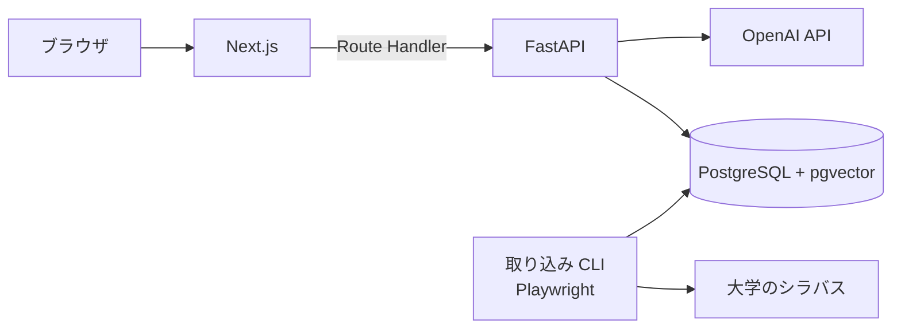

# shirube

なりたい職業から、卒業までの履修の道標を描く。

大学のシラバスをもとに、入力した職業に必要なスキルを満たす授業を選び、取るべき理由を添えて、曜日・時限が重ならない学期ごとの時間割を自動で組む Web アプリ。最初の対象は立命館大学 理工学部 電子情報工学科。他学部・他大学へ広げる前提で設計している。

## できること

- 職業と回生を入力すると、その職業に必要なスキルを提示する
- シラバスから関連する授業を選び、授業ごとに取るべき理由を添える
- 卒業までの残り学期ごとに、曜日・時限が重ならない時間割を組む
- Google ログインで自分の道標を保存し、後から見返す

## 構成



| 領域 | 技術 |
|---|---|
| フロント | Next.js (App Router, TypeScript), pnpm |
| バックエンド | Python, FastAPI, SQLAlchemy, Alembic, LangChain |
| DB | PostgreSQL + pgvector |
| LLM / 埋め込み | OpenAI API |
| 取り込み | Playwright, BeautifulSoup |
| 開発環境 | Docker Compose |
| CI | GitHub Actions |
| 本番 | AWS EC2 |

## 起動

```sh
docker compose up
```

- フロント: http://localhost:3000
- バックエンド: http://localhost:8000 (OpenAPI: http://localhost:8000/docs)

ポートが使用中のときは `FRONTEND_PORT` / `BACKEND_PORT` / `DB_PORT` で手元側のポートを変えられる。シラバスの埋め込み(`embed` コマンド)には `OPENAI_API_KEY` を環境変数で渡す。

DB のスキーマは Alembic で管理する。初回と、`backend/migrations/versions/` が増えたときに適用する。

```sh
docker compose exec backend uv run --no-sync alembic upgrade head
```

科目データは、時間割表の PDF と保存済みのシラバス(`backend/data/`、git 管理外)から取り込む。手順は `CLAUDE.md` のコマンド一覧にある。

## 設計

ビジネスロジックは全てバックエンドに置き、フロントは API を呼んで表示するだけにする。バックエンドは domain / application / infrastructure / presentation の4層で、依存は presentation → application → domain の一方向。大学ごとのシラバス取得元は infrastructure の実装を足すだけで増やせる。

設計上の判断は [ADR](docs/adr/README.md) に記録している。

前提: 将来の学期のシラバスは存在しないため、当年度のシラバスを翌年度以降の代理として道標を組む。

## データの取り扱い

- シラバスは公開ページから、1リクエスト 2〜3 秒以上の間隔、単一スレッド、連絡先入りの User-Agent で取得する。取得した HTML は保存し、解析のやり直しで再取得しない
- 画面に出すシラバス本文は短い引用にとどめ、原ページへリンクする
- 教員の連絡先は保存しない
- Google ログインで得たメールアドレスの扱いはプライバシーポリシーに記す(未作成)

## 開発ルール

- コメントは原則書かない。経緯や日付はコミットメッセージに書く
- 1か所でしか使わない短い処理は関数に切り出さない
- 変更は小さな単位で行う
- 設計判断は実装より先に ADR に書く
