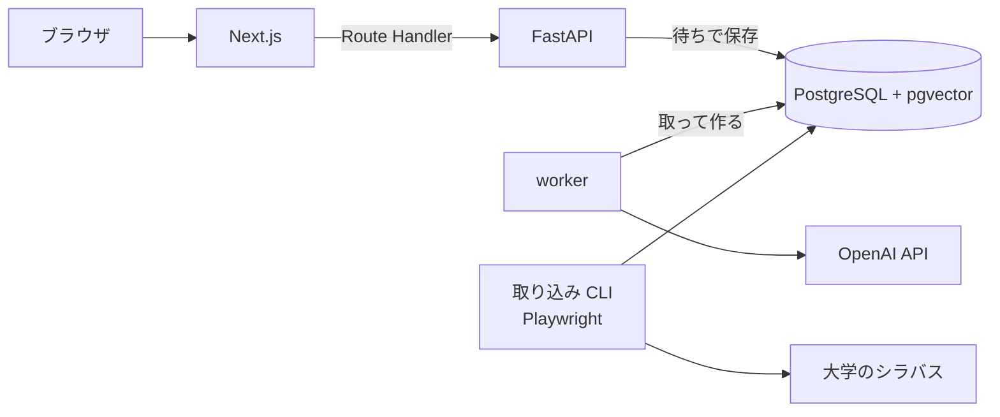

# shirube

なりたい職業から、卒業までの履修の道標を描く。

大学のシラバスをもとに、入力した職業に必要なスキルを満たす授業を選び、取るべき理由を添えて、曜日・時限が重ならない学期ごとの時間割を自動で組む Web アプリ。最初の対象は立命館大学 理工学部 電子情報工学科。他学部・他大学へ広げる前提で設計している。

## できること

- 職業と回生を入力すると、その職業に必要なスキルを提示する
- シラバスから関連する授業を選び、授業ごとに取るべき理由を添える
- 卒業までの残り学期ごとに、曜日・時限が重ならない時間割を組む
- Google ログインで自分の道標を保存し、後から見返す

## 構成



| 領域 | 技術 |
|---|---|
| フロント | Next.js (App Router, TypeScript), Auth.js, pnpm, Vitest |
| バックエンド | Python, FastAPI, SQLAlchemy, Alembic, LangChain |
| DB | PostgreSQL + pgvector |
| LLM / 埋め込み | OpenAI API |
| 取り込み | Playwright, BeautifulSoup |
| 開発環境 | Docker Compose |
| CI | GitHub Actions |
| 本番 | AWS EC2 |

## 起動

```sh
docker compose up
```

- フロント: http://localhost:3000
- バックエンド: http://localhost:8000 (OpenAPI: http://localhost:8000/docs)

ポートが使用中のときは `FRONTEND_PORT` / `BACKEND_PORT` / `DB_PORT` で手元側のポートを変えられる。道標は API が「待ち」で受け付け、worker(`python -m app.presentation.worker`)が 1 件ずつ取って作る(ADR 0029)。画面は道標ができるまで GET を繰り返す。worker と backend は起動に `OPENAI_API_KEY` が要る(無ければログに理由が出て止まる)。道標の API はフロントの Route Handler が作る JWT で利用者を確かめる(ADR 0027)ので、起動に `AUTH_JWT_SECRET`(32 文字以上の乱数。`openssl rand -hex 32` で一度だけ作った値を書く)も要る。backend は外に公開せずフロントからだけ呼ぶので、ポートは手元(127.0.0.1)だけに開ける。`docker compose up` は手元の環境変数の `OPENAI_API_KEY` と `AUTH_JWT_SECRET` を backend に、`OPENAI_API_KEY` を worker に渡す。シラバスの埋め込み(`embed` コマンド)と検索の評価(`evaluate` コマンド)は手元で実行し、同じく `OPENAI_API_KEY` を環境変数で渡す。リポジトリ直下の `.envrc`(direnv、git 管理外)に `export OPENAI_API_KEY=...` と `export AUTH_JWT_SECRET=...`(`openssl rand -hex 32` で一度だけ作った値)を書き、`direnv allow` で有効にする。direnv は一番近い `.envrc` だけを読む。親ディレクトリの `.envrc` で渡している変数があるなら、先頭に `source_up` を書かないとリポジトリの中ではそれが消える。

ログインは Google で行う(Auth.js、ADR 0028)。Google Cloud のコンソールで OAuth クライアント(種類はウェブ アプリケーション)を作り、承認済みのリダイレクト URI に `http://localhost:3000/api/auth/callback/google` を足す(`FRONTEND_PORT` を変えたらそのポートにする)。`.envrc` に、そのクライアントの ID とシークレットを `AUTH_GOOGLE_ID` と `AUTH_GOOGLE_SECRET` として、ログインのクッキーを暗号化する鍵を `AUTH_SECRET`(`openssl rand -hex 32` で一度だけ作った値)として書く。`docker compose up` はこの 3 つと `AUTH_JWT_SECRET` を frontend に渡す。frontend が作った JWT を backend が確かめるので、`AUTH_JWT_SECRET` は両方に同じ値を渡す。

DB のスキーマは Alembic で管理する。初回と、`backend/migrations/versions/` が増えたときに適用する。

```sh
docker compose exec backend uv run --no-sync alembic upgrade head
```

科目データは、時間割表の PDF と保存済みのシラバス(`backend/data/`、git 管理外)から取り込む。手順は `CLAUDE.md` のコマンド一覧にある。

## 設計

ビジネスロジックは全てバックエンドに置き、フロントは API を呼んで表示するだけにする。バックエンドは domain / application / infrastructure / presentation の4層で、依存は presentation → application → domain の一方向。大学ごとのシラバス取得元は infrastructure の実装を足すだけで増やせる。

設計上の判断は [ADR](docs/adr/README.md) に記録している。

前提: 将来の学期のシラバスは存在しないため、当年度のシラバスを翌年度以降の代理として道標を組む。

## 推薦の評価

推薦は 3 段で動く。


評価データは電子情報工学科の 30 職業。3 つの立場の LLM(Claude)が職業と科目の組ごとに中心・土台・関係なしの票を入れ、その多数決で科目を期待・土台・少数・関係なしに分けた(ADR 0017、0023)。期待する科目は計 86 で、1 職業に 1〜8。初めの 10 職業(期待する科目 33)に、学科の公開している進路の職種に合わせて 20 職業を足した(ADR 0054)。足そうとした職業のうち 4 つ(電力会社の電気技術者、鉄道の電気・信号技術者、生産技術エンジニア、予備のデータベースエンジニア)は、学科に中心となる授業が無く再現率を出せないので、予備の職業と入れ替えた。`experiment run` が評価データの職業に推薦を本番と同じ道で決めた回数だけ流し、精度、揺れ、費用、時間を `backend/eval/runs/` の JSON に残す(ADR 0048)。`experiment compare` は 2 つの結果を職業ごとに対応させて比べ、差の 95% 信頼区間をブートストラップで出す(ADR 0053)。下の基準と改善の記録は初めの 10 職業で測り、30 職業での比べは最後に書く。

基準(2026-10-23、commit 7c4feb5、10 職業 × 3 回の平均 ± 標本標準偏差。`backend/eval/runs/20261023-104015-baseline.json` と `20261023-104147-baseline-handwritten.json`)

| 指標 | 通し(選び直し 1 回) | 読み取りを手書きのスキルに固定 |
|---|---|---|
| 検索の再現率 @10 / @20 | 84% ± 6 / 96% ± 2 | 93% ± 0 / 100% ± 0 |
| 選び直しに渡した候補(30 件)の再現率 | 100% | 100% |
| 中心(柱)の適合率 | 50% ± 5 | 54% ± 2 |
| 期待する科目を中心に選んだ割合 | 76% ± 0 | 81% ± 5 |
| 選んだ科目のうち関係なし | 23% ± 2 | 14% ± 1 |
| 同じ職業の回どうしの選んだ科目の重なり(Jaccard) | 0.45 | 0.65 |
| 1 回の推薦の費用 / 時間 | 0.81 円 / 8.0 秒 | 0.36 円 / 5.6 秒 |

10 職業では、検索は期待する科目を全て候補に入れていて、誤りと揺れは選び直しの段で起きる。LLM の職業の読み取りの揺れがそれを広げている(関係なし 14% → 23%、重なり 0.65 → 0.45)。精度を上げる手は、この基準と `experiment compare` で比べて選ぶ。

### 改善の記録

費用の制約の中で精度を上げる。精度はお金をかければ上がる(大きなモデル、多い回数)ので、1 件あたりの費用と時間も同じ表で比べ、精度を上げた手のあとは同じ精度をより安く出す手を探す。どれも 10 職業 × 3 回の通しで、値は平均(± は標本標準偏差)。

| 設定 | ADR | 関係なし | 中心の適合率 | 期待する科目を中心に | 重なり | 1 件の費用 | 時間 |
|---|---|---|---|---|---|---|---|
| 選び直し 1 回、候補 30 件(基準) | 0048 | 23% ± 2 | 50% ± 5 | 76% ± 0 | 0.45 | 0.81 円 | 8.0 秒 |
| 多数決 3 回、候補 30 件 | 0049 | 10% ± 1 | 55% ± 3 | 74% ± 8 | 0.59 | 1.57 円 | 9.0 秒 |
| 多数決 3 回、候補 20 件 | 0050 | 11% ± 0 | 57% ± 5 | 78% ± 5 | 0.62 | 1.14 円 | 7.8 秒 |
| 多数決 3 回、候補 20 件、2 票目から 0.5 秒遅らせる | 0051 | 15% ± 4 | 56% ± 5 | 76% ± 6 | 0.56 | 1.01 円 | 8.3 秒 |
| ここまで + 職業の読み取りを覚える(今の既定) | 0052 | 16% ± 2 | 60% ± 3 | 79% ± 5 | 0.73 | 0.72 円(初めての職業 1.00 円、覚えた職業 0.59 円) | 7.4 秒 |

- 多数決(選び直しを 3 回並べて呼び、過半数が選んだ科目だけを残す): 関係なしが 23% から 10% に下がった(差あり)。読み取りを手書きのスキルに固定した基準(14%)も下回ったが、この差(-4.8 ポイント、区間 -10.9〜+1.0)は 0 と区別できない。期待する科目は保ったまま関係の薄い科目を落とし、揺れも減る。費用は約 1.9 倍
- 候補 20 件: 選び直しの入力の大半は候補のシラバスの抜粋なので、候補を 3 分の 2 にすると費用が 27% 減る。精度の差はどの指標も区間に 0 を含む。期待する科目 33 のうち 1 つ(ソフトウェア開発エンジニアの「応用Cプログラミング」)が候補から落ちる
- 2 票目から 0.5 秒遅らせる: 同時に送ると 1 票目の指示文が読み込まれる前に後の票が届き、入力のキャッシュ(10 分の 1 の料金)が効かない。遅らせると選び直しの入力のうちキャッシュに当たる割合が 50% から 63% になり、費用が 11% 減る。時間は 0.5 秒増える。送る指示文と回数は同じなので精度は変わらないはずで、差はどの指標も区間に 0 を含む
- 職業の読み取りを覚える: 同じ職業名なら LLM を呼ばずに覚えた読み取りを使う(worker のメモリ、500 件)。同じ職業なら同じ読みになるので、同じ職業の回どうしの重なりが 0.56 から 0.73 に上がり、作り直しても道標がそろう。覚えた職業では読み取りの費用が消えるうえ、選び直しの指示文が前とそっくり同じになり、10 分ほどの間なら入力のキャッシュにも当たる(95%)。初めての職業の費用は 1.00 円で変わらない。実験は職業ごとに 3 回続けて流すので 3 回に 2 回は覚えた職業になり、平均の 0.72 円は本番より安く見える
- ここまでで、同じ職業の回どうしの重なりは 0.45 から 0.73 に、中心の適合率は 50% から 60% になった(どちらも差あり)。関係なしは 23% から 16% で、多数決の直後(10%)から戻っている(下の「前の設定との差」)。1 件の費用は、初めての職業で 1.00 円(基準の 1.2 倍)、覚えた職業で 0.59 円(基準より安い)

結果は `backend/eval/runs/` の `20261023-104015-baseline.json`、`20261023-125956-votes-3.json`、`20261023-131317-votes-3-candidates-20.json`、`20261023-132300-votes-3-candidates-20-delay.json`、`20261023-133440-reading-cache.json`。多数決の決まりを直す前の作りで流した 1 回目(`20261023-121203-votes-3.json`)は、関係なし 14%、適合率 57%、期待する科目を中心に 81% だった。

#### 前の設定との差

`experiment compare` で前の設定と比べた差(割合はポイント)と、10 職業を選び直すブートストラップの 95% 信頼区間(ADR 0053)。区間が 0 を含まなければ差あり。判定は各 ADR に書いたねらいの指標で行い、ほかの指標は区間の悪い側の端を、どこまで悪くなりうるかとして読む。

| 変更 | ねらい | 関係なし | 中心の適合率 | 重なり | 1 件の費用 |
|---|---|---|---|---|---|
| 多数決 3 回 | 関係なしと揺れ | -13.6(-25.6〜-3.8)差あり | +4.9(-3.1〜+14.6) | +0.14(+0.05〜+0.22)差あり | 0.81 → 1.57 円 |
| 候補 20 件 | 費用 | +1.8(-3.1〜+7.6) | +1.6(-8.8〜+10.1) | +0.03(-0.01〜+0.07) | 1.57 → 1.14 円 |
| 2 票目から 0.5 秒遅らせる | 費用 | +3.4(-2.8〜+9.4) | -0.8(-7.6〜+8.1) | -0.06(-0.12〜+0.01) | 1.14 → 1.01 円 |
| 職業の読み取りを覚える | 費用と揺れ | +1.2(-4.1〜+9.1) | +3.5(-7.1〜+14.5) | +0.17(+0.07〜+0.27)差あり | 1.01 → 0.72 円 |
| 基準から今の既定まで | | -7.2(-13.7〜+1.0) | +9.2(+2.3〜+17.3)差あり | +0.29(+0.23〜+0.35)差あり | 0.81 → 0.72 円 |

ねらった指標は、多数決の関係なしと重なり、読み取りを覚えたときの重なりで差ありになった。費用を下げた 3 つの段は、どれも精度の差の区間に 0 を含む。ただし関係なしの悪い側の端は +7.6〜+9.4 ポイントあり、点の推定では 3 つの段で計 +6.4 ポイント戻っている。基準から今の既定までの関係なしの差(-7.2)は、95% では 0 と区別できない。10 職業では 5 ポイントほどの差を見分けられない(関係なしで 5 ポイントの差を 8 割の確率で見つけるには 32〜76 職業が要る見積もり、ADR 0053)。そこで評価データを 30 職業に増やした(ADR 0054)。

#### 30 職業での比べ

基準(選び直し 1 回、候補 30 件、読み取りを覚えない)と今の既定を、30 職業 × 3 回で続けて流した(2026-10-23 の 16:51 と 17:03、`20261023-165117-thirty-baseline.json` と `20261023-170337-thirty-default.json`、計 140 円)。差ありかは、結果を見る前に高橋さんが決めた関係なしだけで判定する(ADR 0054)。

| 指標 | 基準 | 今の既定 | 差(95% 区間) |
|---|---|---|---|
| 選んだ科目のうち関係なし(ねらい) | 24.8% | 18.5% | -6.3(-11.0〜-2.2)差あり |
| 中心の適合率 | 42.4% | 44.6% | +2.2(-2.7〜+7.6) |
| 期待する科目を中心に選んだ割合 | 76.7% | 71.3% | -5.4(-12.3〜+2.1) |
| 選び直しに渡した候補の再現率 | 87.7% | 84.4% | -3.2(-7.5〜+0.4) |
| 同じ職業の回どうしの重なり | 0.50 | 0.72 | +0.22(+0.17〜+0.28) |
| 1 件の費用 | 0.81 円 | 0.74 円(初めての職業 1.02 円、覚えた職業 0.60 円) | |
| 1 件の時間 | 8.1 秒 | 8.0 秒 | |

- 関係なしは 6.3 ポイント下がった。職業ごとに前と後を入れ替える並べ替え検定(ADR 0053 の案 3)でも p = 0.01。足した職業で中心が 1 票だけの科目の決定 4 件を土台にしても、-7.3 ポイント(区間 -11.9〜-3.3)で変わらない(技術系公務員は期待する科目が無くなるので外し、29 職業)
- 悪い側の端は、期待する科目を中心に選んだ割合で -12.3 ポイント、候補の再現率で -7.5 ポイント。候補を 20 件に減らしたので、センサ開発エンジニアの信号処理や医療機器の開発エンジニアの電子回路Ⅱが候補から落ちる
- 10 職業では検索が期待する科目を全て候補に入れていたが、30 職業では 1 割ほどを入れない。漏れるのは、コーオプ演習、現代の経営、国の行政組織のような、職業のスキルの言葉から遠い科目
- 関係なしは、LLM が職業を広く読むか(ADR 0032)でも動く。基準の 3 回は広く読んだ職業が 8、12、14 で、関係なしが 21%、25%、29% だった

同じ設定どうしの比べ(何も変えていないので、差ありは全て誤り)で、ADR 0053 の誤りの率を 30 職業で確かめ直した。数えたのは 8 つの指標のうち両方が同じ値にならない比べで、今の既定の回どうしは読み取りが同じ。

| 同じ設定どうし | 比べ | ブートストラップの差あり | 並べ替え検定の p < 0.05 |
|---|---|---|---|
| 同じ実験の回どうし(30 職業、1 回と 1 回、6 組) | 39 | 4(10%) | 2(5%) |
| 別の時刻に流した同じ設定(初めの 10 職業、3 回と 3 回、2 組) | 13 | 4 | 2 |

- 30 職業の回どうしで、ブートストラップの誤りは名目の 5% の 2 倍だった。差が一部の職業にしか出ない指標(再現率など)で区間が狭く出る。並べ替え検定は 5% に近い
- 別の時刻に流した 2 組(基準の 10:40 と 16:51、今の既定の 13:34 と 17:03)は、どちらも後の方が関係なしが 9 ポイントほど低く(23.2% → 13.9%、16.0% → 7.3%)、並べ替え検定でも差ありになった。モデル、指示文、正解は同じで、多くの職業で同じ向きに下がっている。職業を選び直す区間にも並べ替え検定にも、流した時刻による揺れは入らない
- 上の 10 職業の改善の記録は、どの設定も別の時刻に流したので、差には時刻による揺れも入っている。30 職業の比べは 2 つを続けて流したので影響は小さいはずだが、関係なしの -6.3 ポイントが設定の効果か時刻の揺れかは、この 1 組では分けきれない

## データの取り扱い

- シラバスは公開ページから、1リクエスト 2〜3 秒以上の間隔、単一スレッド、リポジトリの URL を入れた User-Agent で取得する。取得した HTML は保存し、解析のやり直しで再取得しない
- 画面に出すシラバス本文は短い引用にとどめ、原ページへリンクする
- 教員の連絡先は保存しない
- Google ログインで得たメールアドレスと名前は保存せず、Google の利用者の番号(sub)だけを保存する(ADR 0027)。その扱いは画面のプライバシーポリシー(`/privacy`)に書く(ADR 0042)

## 開発ルール

- コメントは原則書かない。経緯や日付はコミットメッセージに書く
- 1か所でしか使わない短い処理は関数に切り出さない
- 変更は小さな単位で行う
- 設計判断は実装より先に ADR に書く

## ライセンス

コードは [MIT License](LICENSE)。取り込んだシラバスと時間割表の内容(`backend/data/`、git 管理外)と画面に出す引用は、このライセンスの対象外(大学と担当教員のもの)。テストには実ページを置かず、科目名・教員名・本文が架空の合成のページ(`backend/tests/unit/syllabus_pages.py` がテストの中で組み立てる)と PDF(`backend/tests/fixtures/timetable/make_sample.py` が作る)を使う(ADR 0043)。
