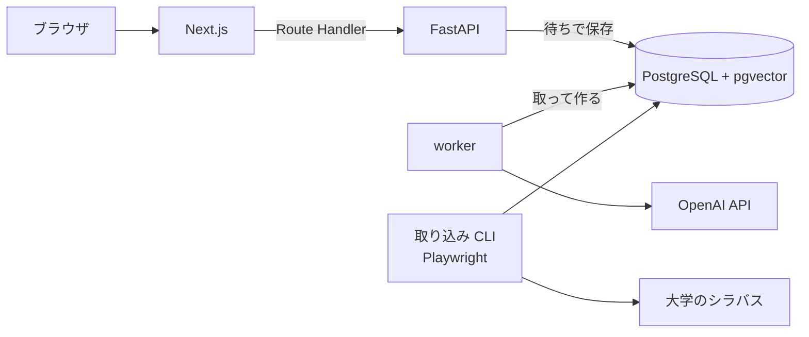

# shirube

なりたい職業から、卒業までの履修の道標を描く。

大学のシラバスをもとに、入力した職業に必要なスキルを満たす授業を選び、取るべき理由を添えて、曜日・時限が重ならない学期ごとの時間割を自動で組む Web アプリ。最初の対象は立命館大学 理工学部 電子情報工学科。他学部・他大学へ広げる前提で設計している。

## できること

- 職業と回生を入力すると、その職業に必要なスキルを提示する
- シラバスから関連する授業を選び、授業ごとに取るべき理由を添える
- 卒業までの残り学期ごとに、曜日・時限が重ならない時間割を組む
- Google ログインで自分の道標を保存し、後から見返す

## 構成



| 領域 | 技術 |
|---|---|
| フロント | Next.js (App Router, TypeScript), Auth.js, pnpm, Vitest |
| バックエンド | Python, FastAPI, SQLAlchemy, Alembic, LangChain |
| DB | PostgreSQL + pgvector |
| LLM / 埋め込み | OpenAI API |
| 取り込み | Playwright, BeautifulSoup |
| 開発環境 | Docker Compose |
| CI | GitHub Actions |
| 本番 | AWS EC2 |

## 起動

```sh
docker compose up
```

- フロント: http://localhost:3000
- バックエンド: http://localhost:8000 (OpenAPI: http://localhost:8000/docs)

ポートが使用中のときは `FRONTEND_PORT` / `BACKEND_PORT` / `DB_PORT` で手元側のポートを変えられる。道標は API が「待ち」で受け付け、worker(`python -m app.presentation.worker`)が 1 件ずつ取って作る(ADR 0029)。画面は道標ができるまで GET を繰り返す。worker と backend は起動に `OPENAI_API_KEY` が要る(無ければログに理由が出て止まる)。道標の API はフロントの Route Handler が作る JWT で利用者を確かめる(ADR 0027)ので、起動に `AUTH_JWT_SECRET`(32 文字以上の乱数。`openssl rand -hex 32` で一度だけ作った値を書く)も要る。backend は外に公開せずフロントからだけ呼ぶので、ポートは手元(127.0.0.1)だけに開ける。`docker compose up` は手元の環境変数の `OPENAI_API_KEY` と `AUTH_JWT_SECRET` を backend に、`OPENAI_API_KEY` を worker に渡す。シラバスの埋め込み(`embed` コマンド)と検索の評価(`evaluate` コマンド)は手元で実行し、同じく `OPENAI_API_KEY` を環境変数で渡す。リポジトリ直下の `.envrc`(direnv、git 管理外)に `export OPENAI_API_KEY=...` と `export AUTH_JWT_SECRET=...`(`openssl rand -hex 32` で一度だけ作った値)を書き、`direnv allow` で有効にする。direnv は一番近い `.envrc` だけを読む。親ディレクトリの `.envrc` で渡している変数があるなら、先頭に `source_up` を書かないとリポジトリの中ではそれが消える。

ログインは Google で行う(Auth.js、ADR 0028)。Google Cloud のコンソールで OAuth クライアント(種類はウェブ アプリケーション)を作り、承認済みのリダイレクト URI に `http://localhost:3000/api/auth/callback/google` を足す(`FRONTEND_PORT` を変えたらそのポートにする)。`.envrc` に、そのクライアントの ID とシークレットを `AUTH_GOOGLE_ID` と `AUTH_GOOGLE_SECRET` として、ログインのクッキーを暗号化する鍵を `AUTH_SECRET`(`openssl rand -hex 32` で一度だけ作った値)として書く。`docker compose up` はこの 3 つと `AUTH_JWT_SECRET` を frontend に渡す。frontend が作った JWT を backend が確かめるので、`AUTH_JWT_SECRET` は両方に同じ値を渡す。

DB のスキーマは Alembic で管理する。初回と、`backend/migrations/versions/` が増えたときに適用する。

```sh
docker compose exec backend uv run --no-sync alembic upgrade head
```

科目データは、時間割表の PDF と保存済みのシラバス(`backend/data/`、git 管理外)から取り込む。手順は `CLAUDE.md` のコマンド一覧にある。

## 設計

ビジネスロジックは全てバックエンドに置き、フロントは API を呼んで表示するだけにする。バックエンドは domain / application / infrastructure / presentation の4層で、依存は presentation → application → domain の一方向。大学ごとのシラバス取得元は infrastructure の実装を足すだけで増やせる。

設計上の判断は [ADR](docs/adr/README.md) に記録している。

前提: 将来の学期のシラバスは存在しないため、当年度のシラバスを翌年度以降の代理として道標を組む。

## データの取り扱い

- シラバスは公開ページから、1リクエスト 2〜3 秒以上の間隔、単一スレッド、リポジトリの URL を入れた User-Agent で取得する。取得した HTML は保存し、解析のやり直しで再取得しない
- 画面に出すシラバス本文は短い引用にとどめ、原ページへリンクする
- 教員の連絡先は保存しない
- Google ログインで得たメールアドレスと名前は保存せず、Google の利用者の番号(sub)だけを保存する(ADR 0027)。その扱いは画面のプライバシーポリシー(`/privacy`)に書く(ADR 0042)

## 開発ルール

- コメントは原則書かない。経緯や日付はコミットメッセージに書く
- 1か所でしか使わない短い処理は関数に切り出さない
- 変更は小さな単位で行う
- 設計判断は実装より先に ADR に書く

## ライセンス

コードは [MIT License](LICENSE)。取り込んだシラバスと時間割表の内容(`backend/data/`、git 管理外)と画面に出す引用は、このライセンスの対象外(大学と担当教員のもの)。テストには実ページを置かず、科目名・教員名・本文が架空の合成のページ(`backend/tests/unit/syllabus_pages.py` がテストの中で組み立てる)と PDF(`backend/tests/fixtures/timetable/make_sample.py` が作る)を使う(ADR 0043)。
