# shirube 道標

**履修に迷ったら、なりたい職業から。** なりたい職業と回生を入れると、大学のシラバスから職業につながる授業を選び、取るべき理由を添えて、卒業までの学期ごとの時間割(道標)を組む Web アプリです。最初の対象は立命館大学 理工学部 電子情報工学科です。

[](https://github.com/h11roki/Shirube/actions/workflows/ci.yml)
[](LICENSE)

**デモ: https://shirube.duckdns.org**

ログイン前のトップで、実際の出力の見本の道標を見られます。道標を作るには Google でのログインが要り、今はテストの利用者に限っています。

## 技術の見どころ

- **LLM を数字で直す**: 開発用 50 職業と確かめ用 20 職業の評価データ、2 つの設定を交互に流す実験の道具、並べ替え検定で、指示文や検索の作りの変更を採るかを決めます。採る条件は測る前に ADR に書き、採らなかった改善も残しています([評価と改善のサイクル](#評価と改善のサイクル))
- **段ごとに測れる推薦**: 職業の読み取り → シラバスのベクトル検索 → LLM が候補から授業を選ぶ段に分け、期待する科目をどの段で落としたかまで数えます([推薦の仕組み](#推薦の仕組み))
- **本番で動かす**: AWS EC2 と Docker Compose で公開し、1 件約 1 円、1 日の上限、前払いで費用を抑えています。バックエンドはクリーンアーキテクチャで作り、型の厳しい検査と画面の通しの試験(axe で WCAG 2.2 AA)を CI で回しています([設計](#設計)、[品質](#品質))

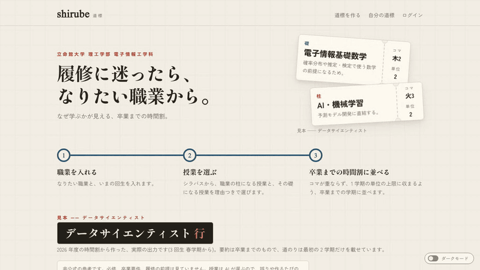

> 大学とは関係のない個人の非公式のアプリです。必修、卒業要件、履修の前提は見ていません。授業は AI が選ぶので、誤りや作るたびの違いがあります。

## 何を解決するか

履修を選ぶ学生は、シラバスを 1 つずつ読んでも「この授業が将来の仕事のどこに効くのか」が分かりにくく、時間割の重なりも自分で調べる必要があります。shirube は、なりたい職業から逆算して、次のことをまとめて行います。

- 職業に必要なスキルを読み取り、シラバスの中身から関係する授業を選ぶ
- 授業ごとに「なぜ取るか」を、シラバスの抜粋をもとに短く書く
- 職業の中心になる授業を「柱」、柱の前提になる授業を「礎」として分け、どの礎がどの柱につながるかを示す
- 卒業までの残りの学期に、曜日と時限が重ならず、1 学期の単位の上限に収まるように並べる

道標に並ぶのは推薦した授業だけで、必修や卒業要件の授業は入りません。前提の授業を前の学期に置く制約もかけていないので、礎が柱より後の学期に来ることがあります([ADR 0007](docs/adr/0007-greedy-timetable.md)、[0034](docs/adr/0034-taken-courses.md))。理由の文の良し悪しは、まだ測っていません。

## 主な機能

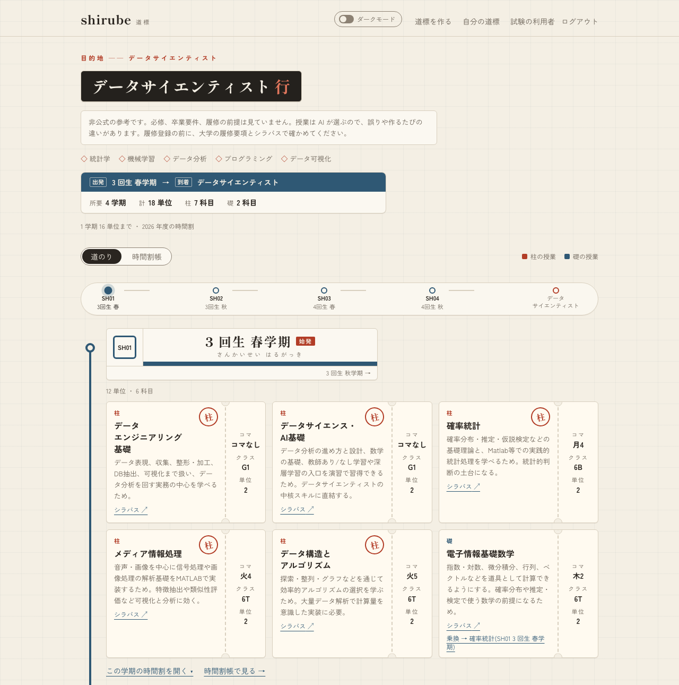

結果の画面は、学期を駅、授業を切符に見立てた路線図です。切符には柱か礎かの印、選んだ理由、コマ、単位、シラバスの原ページへのリンクを載せ、礎の切符に触れると、つながる柱の切符が光ります(礎から柱への乗り換え)。

| 職業と回生を入れる | 学期ごとの時間割帳 |
|---|---|
| 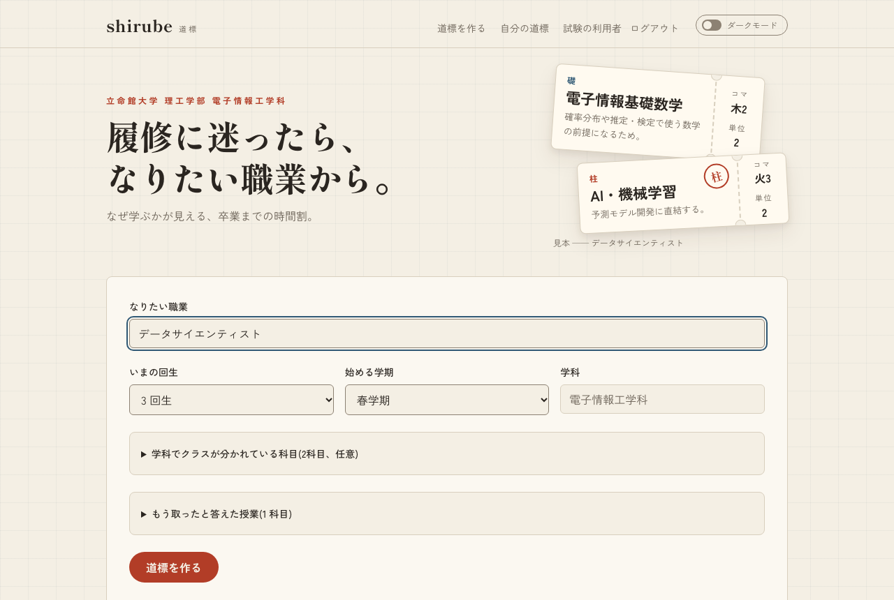 | 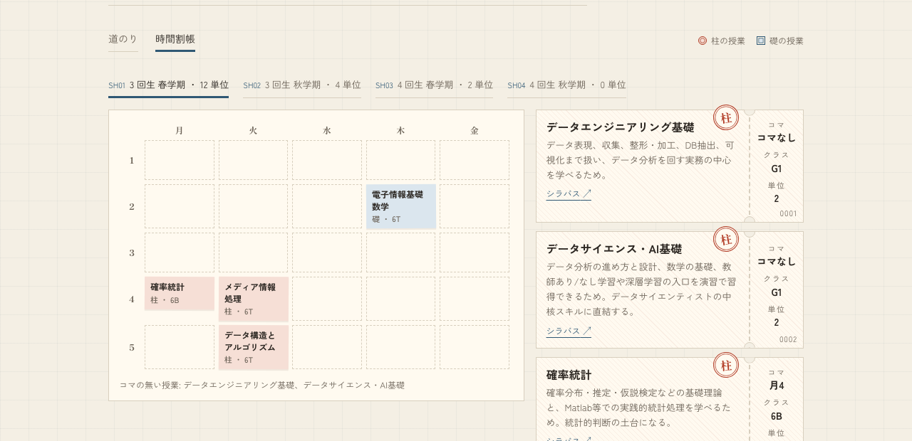 |
| 職業は自由に入れられます。学科で分かれたクラスの選択と、もう取った授業も入力の画面で扱えます | 学期ごとに、週の時間割の表で重なりなく並んでいることを確かめられます |

<p>
  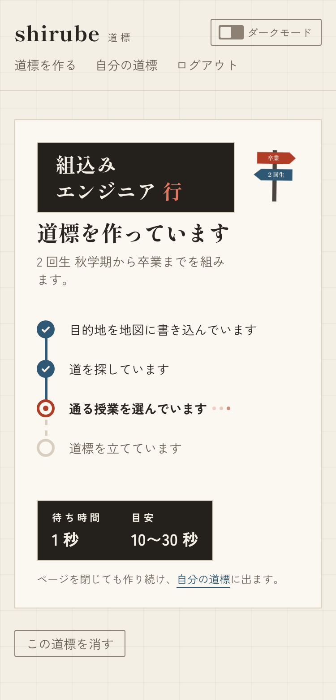
  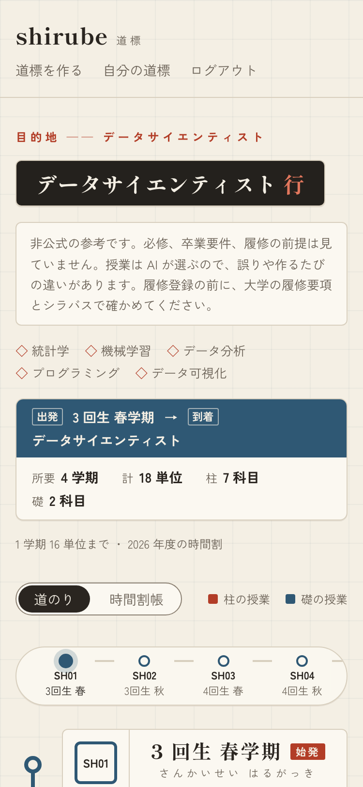
  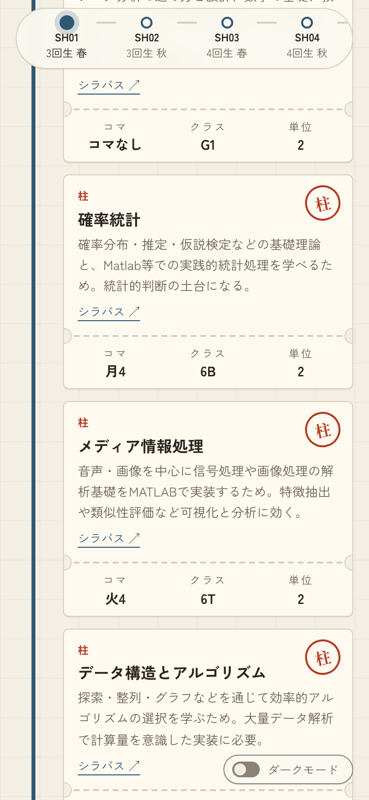
</p>

作成中の画面は、道標を作る 4 つの段(読み取り、検索、選び直し、配置。下の「推薦の仕組み」)の進みを路線の駅のように見せ、駅の発車案内のような板で待ち時間を出します([ADR 0031](docs/adr/0031-route-design.md)、[0079](docs/adr/0079-progress-board.md))。スマホの幅でも読めて、明るい見た目と暗い見た目を切り替えられます。キーボードだけで操作でき、作成の段と完成を読み上げの枠で伝え、WCAG 2.2 の AA を目安にしています([ADR 0056](docs/adr/0056-accessibility.md))。

ほかに、始める学期より前に開講された授業を「もう取った」と答えて道標から外す機能があります。答えた授業は覚えて、次に作る道標の候補からも除きます([ADR 0034](docs/adr/0034-taken-courses.md)、[0035](docs/adr/0035-taken-candidates.md))。自分の道標の一覧と削除、退会もあります。

## 推薦の仕組み

職業名から授業を選ぶまでを、読み取り、検索、選び直しの 3 段に分け、それぞれを別に測って直せるようにしています。選んだ授業は、最後の配置の段で時間割に並べます。道標は API が「待ち」で受け付け、worker が 1 件ずつ作ります(1 件 10〜30 秒、[ADR 0029](docs/adr/0029-plan-jobs.md))。

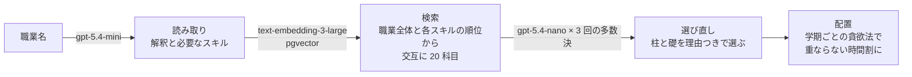

- **読み取り**: LLM が職業名を、その職業の解釈と必要なスキルに直します。学科の授業に無い応用分野で決まる細かい職種(Web エンジニアなど)は、授業で備えられる広い職業として読み、そう読んだことを前提として画面に出します([ADR 0032](docs/adr/0032-broad-occupation.md))。同じ職業名の読み取りは覚えて使い回し、揺れと費用を減らします([ADR 0052](docs/adr/0052-reading-cache.md))
- **検索**: シラバスを節(授業概要、到達目標、授業計画)ごとに埋め込み、職業全体のクエリと各スキルのクエリの順位から交互に 20 件の候補を取ります([ADR 0005](docs/adr/0005-section-chunking.md)、[0063](docs/adr/0063-search-by-skill.md))
- **選び直し**: 検索の候補 20 件のシラバスの抜粋を LLM に読ませ、柱と礎を理由つきで選ばせます。職業に少しでも役立つ授業は、迷っても選ばせます([ADR 0080](docs/adr/0080-selection-coverage.md))。同じ問いを LLM に 3 回並行して投げ、2 回以上選ばれた授業だけを残します。何回で残すかは設定で替えられます([ADR 0049](docs/adr/0049-selection-votes.md)、[0081](docs/adr/0081-selection-min-votes.md))。2 回目からは少し遅らせて入力のキャッシュを効かせ、費用を下げています([ADR 0051](docs/adr/0051-vote-delay.md))
- **配置**: 学期ごとに、配当回生と開講学期を満たし、コマが重ならず、単位の上限に収まる授業を貪欲法で詰めます。前提科目は制約にせず表示だけにしています([ADR 0007](docs/adr/0007-greedy-timetable.md))

将来の学期のシラバスはまだ無いので、当年度のシラバスと時間割を翌年度以降の代理にして組んでいます([ADR 0010](docs/adr/0010-graduation-roadmap.md))。

## 評価と改善のサイクル

LLM の出力は「それらしく見える」ので、感覚ではなく数字で直すために、評価データ、実験の道具、統計の決まりを先に作りました。

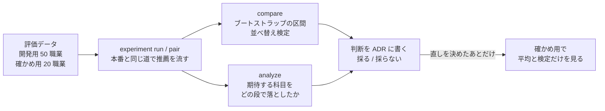

- **期待する科目(正解)**: 職業ごとに、Claude のサブエージェントを判定者にして、科目ごとに中心・土台・関係なし(中心と土台は、画面の柱と礎にあたる)の票を入れさせ、その多数決で作りました。判定者は立場の違う 3 体(採用・育成担当のエンジニア、カリキュラムを設計する教員、進路を考える 3 回生)で、科目が多いので前半と後半を別の判定者に渡しています。中心の票が 1 つだけの科目は、作者が票と根拠を見て決めました(2 回目に足した 20 職業の 17 件は、判定者の多数に合わせて全て土台にしました。[ADR 0017](docs/adr/0017-eval-judging.md)、[0023](docs/adr/0023-foundation-links-core.md)、[0054](docs/adr/0054-thirty-occupations.md)、[0064](docs/adr/0064-fifty-occupations.md))。人が付けた正解ではなく、判定者 3 体は同じ Claude なので、判定者の癖は正解に残ります。アプリの LLM(OpenAI)とは系統を分け、答え合わせが循環しないようにしています
- **実験の道具**: `experiment run` が評価データの職業に本番と同じ道(読み取り → 検索 → 選び直し)で推薦を流し、精度、揺れ、1 件あたりの費用と時間を JSON に残します([ADR 0048](docs/adr/0048-recommendation-experiments.md))。揺れは、同じ職業を何回か作ったときに選んだ授業の重なり(Jaccard)で測ります。比べる 2 つの設定は `experiment pair` で職業と回ごとに交互に流し、流した時刻による指標のずれを差から消します。同じ設定を別の時刻に流すと、関係なしが 9 ポイントほど動くと分かったためです([ADR 0055](docs/adr/0055-interleaved-runs.md))
- **統計の決まり**: 差の 95% 信頼区間は職業を選び直すブートストラップで、差ありは職業ごとに前と後を入れ替える並べ替え検定(p < 0.05)で決めます。判定に使う指標と採る条件は、変える前に ADR に書きます([ADR 0053](docs/adr/0053-paired-bootstrap.md)、[0055](docs/adr/0055-interleaved-runs.md))
- **取りこぼしの内訳**: `experiment analyze` が、期待する科目を読み取り、検索、選び直しのどの段で落としたかを数え、次に直す段を決める材料にします([ADR 0073](docs/adr/0073-experiment-analysis.md))
- **確かめ用を分ける**: 開発用の取りこぼしを見て決めた直しは、決めるときに見た職業にだけ効いていることがありました(下の表の [ADR 0063](docs/adr/0063-search-by-skill.md) の行)。そこで確かめ用の 20 職業を取っておき、直しを決めて ADR に書いたあとに流して、職業ごとの結果は見ずに平均と検定を見ます([ADR 0067](docs/adr/0067-heldout-occupations.md))

| 指標 | 意味 |
|---|---|
| 選んだ科目のうち関係なし | 選んだ授業のうち、判定で関係なしになった授業の割合。誤りの目安 |
| 期待する科目を中心に選んだ割合 | 判定で中心になった授業(期待する科目)のうち、柱に選んだ割合。再現率にあたる |
| 中心の適合率 | 柱に選んだ授業のうち、期待する科目の割合。判定者の中心は選び手より狭く(0080 の前の分析で、柱の半分ほどが判定では土台)、0080 で柱をわざと広げたので、低めに出る |
| 候補の再現率(@20) | 期待する科目のうち、検索が 20 件の候補に入れた割合 |

### 採った改善と採らなかった改善

| 変えたこと | ねらい | 結果 | 判断 |
|---|---|---|---|
| 選び直しを 3 回の多数決に([ADR 0049](docs/adr/0049-selection-votes.md)) | 関係なし | 23% → 10%(差あり)。費用は約 1.9 倍。10 職業を別の時刻に流し、当時のブートストラップの区間で判定した比べで、時刻によるずれも入る | 採った |
| 職業の読み取りを覚える([ADR 0052](docs/adr/0052-reading-cache.md)) | 揺れと費用 | 回どうしの重なり 0.56 → 0.73(差あり)。費用は初めての職業で 1.00 円のまま、覚えた職業で 0.59 円。10 職業を別の時刻に流し、当時のブートストラップの区間で判定した比べ | 採った |
| 検索を職業全体と各スキルの交互に([ADR 0063](docs/adr/0063-search-by-skill.md)) | 候補の再現率 | 50 職業で +3.3 ポイント(p = 0.391、差なし)。上がったのは直しを決めるときに見た 30 職業だけで(+6.4)、足した 20 職業では上がらなかった(-1.2) | 30 職業の時点でねらいが差なし(p = 0.089)のまま、作者が承知で採った。3 つの測り方で再現率が同じ向きに上がり、悪化が無かったため |
| 読み取りに学科の分野を書く([ADR 0065](docs/adr/0065-department-fields.md)) | 候補の再現率(@20) | 0.910 → 0.865(丸める前の値で -4.4 ポイント、p = 0.105) | 採らなかった |
| 選び直しで迷った授業を選ばない([ADR 0069](docs/adr/0069-selection-restraint.md)) | 関係なし | 開発用 16.4% → 10.6%(p = 0.004)、確かめ用 15.0% → 12.2%(p = 0.210、下がる向き) | 採った。効き目は確かめ用で開発用の半分ほど。のちに 0080 で替えた |
| 少しでも役立つ授業は迷っても選ぶ([ADR 0080](docs/adr/0080-selection-coverage.md)) | 1 職業に選ぶ柱と礎の数 | 柱が開発用 4.60 → 5.44(p < 0.001)、確かめ用 4.35 → 6.15(p = 0.001)。関係なしは開発用 12.3% → 16.4%(p = 0.027) | 道標を広く取りたいので採った。増えた柱の多くは判定では土台か関係なしで、きっかけの職業(データサイエンティスト)に少し役立つ授業(深層学習の応用など)は、まだ選ばれなかった。確かめ用の条件は「増える向き」だけで、ほぼ必ず通るものだった |
| 選び直しの 3 回のうち 1 回でも選べば残す([ADR 0081](docs/adr/0081-selection-min-votes.md)) | 1 職業に選ぶ柱 | 5.66 → 6.20(p = 0.076、差なし)。増えたのは礎で、関係なしは 13.4% → 19.7%(p = 0.003) | 採らなかった。設定で切り替えられる形だけ残した |

行ごとに、測った時刻と職業の数が違います。同じ設定でも流した時刻で関係なしが 9 ポイントほど動くので、行と行の数字はつながらず、比べられるのは各行の前と後だけです(上の 2 行は、前と後も別の時刻に流しています)。細かい数字と経緯は、下の「推薦の評価」にあります。

### 今の精度と費用

| 指標 | 開発用 50 職業 | 確かめ用 20 職業 |
|---|---|---|
| 選んだ科目のうち関係なし | 16.4% | 17.5% |
| 期待する科目を中心に選んだ割合 | 67.5% | 89.7% |
| 中心の適合率 | 37.5% | 42.3% |

[ADR 0080](docs/adr/0080-selection-coverage.md) で選ぶ授業を広げた後の pair の、後の側の 1 回ずつの値です。確かめ用の 89.7% は 20 職業を 1 回流しただけの値で、前の側の 69.0% から +20.7 ポイント跳ねた回です。

1 件の推薦は約 1 円です(初めての職業で 1.07 円。同じ職業名の読み取りを覚えると下がります)。道標の受け付けは 1 人 1 日 3 件、全体で 1 日 30 件までにし、OpenAI は前払いで自動の補充を切って、使いすぎの最後の歯止めにしています([ADR 0038](docs/adr/0038-plan-quota.md))。

## 設計

バックエンドはクリーンアーキテクチャの 4 層で、依存は内側にだけ向けています。大学ごとのシラバスの取得元や LLM は application のポート(Protocol)の向こうに置き、infrastructure に実装を足して差し替える形にしています(今は 1 大学だけで、2 つ目の取得元はまだ作っていません)。

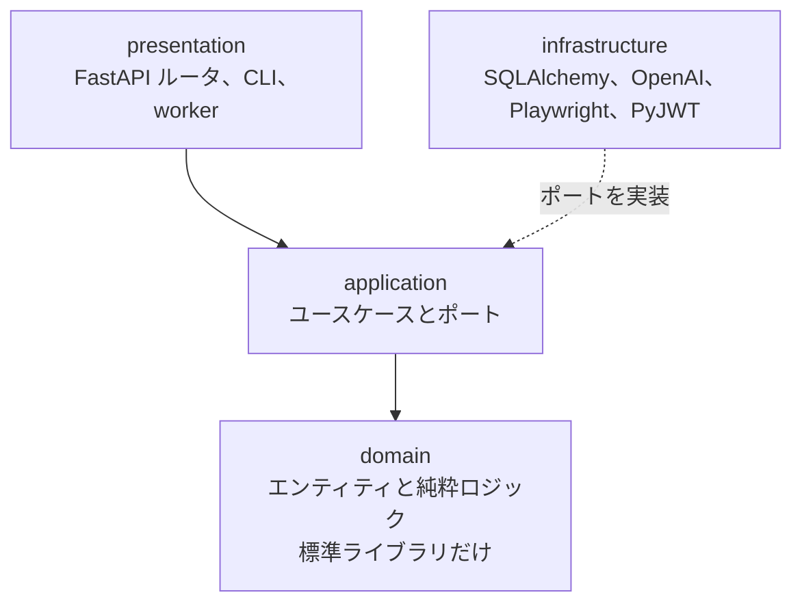

- フロントは API を呼んで表示するだけで、業務ロジックを置きません。Next.js の Route Handler がログインを確かめ、Google の利用者の番号を入れた JWT を付けて backend に転送します([ADR 0027](docs/adr/0027-auth-backend.md)、[0028](docs/adr/0028-auth-frontend.md))
- API の型は OpenAPI から生成してコミットし、backend の試験が OpenAPI との食い違いを見つけます([ADR 0030](docs/adr/0030-screens.md))
- 設計の判断は、選択肢、決定、理由、受け入れたトレードオフ、見直す条件を [ADR](docs/adr/README.md) に書いています(2026-10-31 時点で 82 本)

このリポジトリは Claude Code(Anthropic のコーディングエージェント)と作りました。コード、試験、文書の多くは Claude Code が書き、何を作るか、設計の選択肢からどれを選ぶか、改善を採るかどうかは作者が決めて ADR に残しています。Claude Code に守らせる決まり(層の依存の向き、ADR を先に書くことなど)は [CLAUDE.md](CLAUDE.md) にあります。ADR の中では、作者を「高橋さん」と書いています。

## 品質

- **CI**(GitHub Actions): backend の ruff、mypy(strict)、pytest(DB の結合試験を含む)、frontend の lint、型、Vitest、整形、画面の通しの試験、本番の構成を組み立てて起動し HTTPS とログインの戻り先を確かめる job
- **画面の通しの試験**(Playwright): 全ての画面を幅 375px と 1280px、明るい見た目と暗い見た目で開き、axe で WCAG 2.2 の A と AA の違反が無いか、幅 320px で横にはみ出さないか、文字を 200% にしても切れないかを確かめます([ADR 0056](docs/adr/0056-accessibility.md)、[0070](docs/adr/0070-text-resize-test.md))。Chromium のほかに WebKit(iPhone の幅)でも流します
- 試験の数(2026-10-31): backend 734、Vitest 137、e2e 202

## 本番の構成

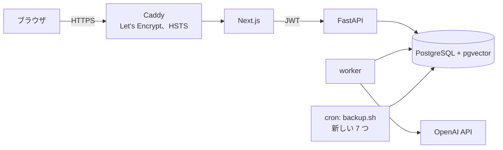

AWS EC2 の 1 台(t4g.small、シドニー)で Docker Compose を動かし、Caddy が証明書を自動で取って HTTPS を受けます。ドメインは DuckDNS の無料のサブドメインです。DB と backend のポートは外に出さず、バックアップは毎日取って 7 日分を残します。手順は下の「本番」、判断は [ADR 0075](docs/adr/0075-production-setup.md)〜[0077](docs/adr/0077-auth-url.md) にあります。

## 技術

| 領域 | 技術 |
|---|---|
| フロント | Next.js(App Router、TypeScript)、Tailwind CSS、Auth.js、pnpm、Vitest、Playwright + axe |
| バックエンド | Python 3.13、FastAPI、SQLAlchemy、Alembic、LangChain、uv、ruff、mypy |
| DB | PostgreSQL + pgvector |
| LLM / 埋め込み | OpenAI API(gpt-5.4-mini、gpt-5.4-nano、text-embedding-3-large) |
| 評価データの判定 | Claude のサブエージェント |
| シラバスの取り込み | Playwright、BeautifulSoup |
| 開発環境 | Docker Compose |
| 本番 | AWS EC2、Docker Compose、Caddy、DuckDNS |
| CI | GitHub Actions |

## 開発者向け

ここから下は、手元で動かす手順、本番の手順、評価の詳しい記録です。

### 起動

```sh
docker compose up
```

- フロント: http://localhost:3000
- バックエンド: http://localhost:8000 (OpenAPI: http://localhost:8000/docs)

ポートが使用中のときは `FRONTEND_PORT` / `BACKEND_PORT` / `DB_PORT` で手元側のポートを変えられる。道標は API が「待ち」で受け付け、worker(`python -m app.presentation.worker`)が 1 件ずつ取って作る(ADR 0029)。画面は道標ができるまで GET を繰り返す。worker と backend は起動に `OPENAI_API_KEY` が要る(無ければログに理由が出て止まる)。道標の API はフロントの Route Handler が作る JWT で利用者を確かめる(ADR 0027)ので、起動に `AUTH_JWT_SECRET`(32 文字以上の乱数。`openssl rand -hex 32` で一度だけ作った値を書く)も要る。backend は外に公開せずフロントからだけ呼ぶので、ポートは手元(127.0.0.1)だけに開ける。`docker compose up` は手元の環境変数の `OPENAI_API_KEY` と `AUTH_JWT_SECRET` を backend に、`OPENAI_API_KEY` を worker に渡す。シラバスの埋め込み(`embed` コマンド)と検索の評価(`evaluate` コマンド)は手元で実行し、同じく `OPENAI_API_KEY` を環境変数で渡す。リポジトリ直下の `.envrc`(direnv、git 管理外)に `export OPENAI_API_KEY=...` と `export AUTH_JWT_SECRET=...`(`openssl rand -hex 32` で一度だけ作った値)を書き、`direnv allow` で有効にする。direnv は一番近い `.envrc` だけを読む。親ディレクトリの `.envrc` で渡している変数があるなら、先頭に `source_up` を書かないとリポジトリの中ではそれが消える。

ログインは Google で行う(Auth.js、ADR 0028)。Google Cloud のコンソールで OAuth クライアント(種類はウェブ アプリケーション)を作り、承認済みのリダイレクト URI に `http://localhost:3000/api/auth/callback/google` を足す(`FRONTEND_PORT` を変えたらそのポートにする)。`.envrc` に、そのクライアントの ID とシークレットを `AUTH_GOOGLE_ID` と `AUTH_GOOGLE_SECRET` として、ログインのクッキーを暗号化する鍵を `AUTH_SECRET`(`openssl rand -hex 32` で一度だけ作った値)として書く。`docker compose up` はこの 3 つと `AUTH_JWT_SECRET` を frontend に渡す。frontend が作った JWT を backend が確かめるので、`AUTH_JWT_SECRET` は両方に同じ値を渡す。

DB のスキーマは Alembic で管理する。初回と、`backend/migrations/versions/` が増えたときに適用する。

```sh
docker compose exec backend uv run --no-sync alembic upgrade head
```

科目データは、時間割表の PDF と保存済みのシラバス(`backend/data/`、git 管理外)から取り込む。手順は `CLAUDE.md` のコマンド一覧にある。

<details>
<summary>本番の手順(用意するもの、初めてのデプロイ、更新、バックアップ)</summary>

### 本番

EC2 1 台で `compose.prod.yaml` を動かし、Caddy が HTTPS を受けて frontend に渡す(ADR 0009、0075)。ドメインは DuckDNS の無料のサブドメインで、Caddy が Let's Encrypt の証明書を自動で取って更新する。DB と backend のポートは外に出さない。ログはサービスごとに 10MB × 3 までで、古いものから消える。Caddy のアクセスログは、プライバシーポリシーに書いたとおり IP、時刻、要求の方法と URL、状態コード、応答の大きさと時間に絞り、要求と応答のヘッダーと、ログインの戻り先の URL の認証の符号(`code`、`state`)は書かない。

#### 初めに用意するもの

1. AWS: 新しい登録の無料プランでアカウントを作り、AWS Settings(https://settings.aws.com)で MFA を付ける。地域はシドニー(`ap-southeast-2`)に決まる。無料プランはクレジットが尽きるか 6 か月で閉じ、その前に AWS からクレジットの残り(50%、25%、10%)と期限(15、7、2 日前)のメールが登録のアドレスに届くので、それを合図に続けるかを決める(時期の見込みは ADR 0076)
2. EC2: シドニーに、Ubuntu の Arm、t4g.small、ディスクは gp3 で 20GB。セキュリティグループは 80 と 443 を全体に、22 を自分の IP だけに開ける。Elastic IP を割り当てる
3. DuckDNS: https://www.duckdns.org でサブドメインを作り、Elastic IP を向ける
4. Google: OAuth クライアントの承認済みのリダイレクト URI に `https://<サブドメイン>/api/auth/callback/google` を足し、同意画面のテストの利用者に自分を足す(誰でも使えるように公開できるかは、そのときの Google の条件で確かめる)
5. OpenAI: 前払いにして自動の補充を切る(ADR 0038)

サーバーでは、スワップを足し(`next build` のメモリの不足を補う)、Docker と compose のプラグインを公式の手順で入れて今の利用者を docker のグループに足し(sudo なしで `docker compose` と cron のバックアップを動かすため。足したら入り直す)、リポジトリを置いて `.env` を書く。

```sh
sudo fallocate -l 2G /swapfile && sudo chmod 600 /swapfile && sudo mkswap /swapfile && sudo swapon /swapfile
echo '/swapfile none swap sw 0 0' | sudo tee -a /etc/fstab
sudo usermod -aG docker "$USER"
sudo timedatectl set-timezone Asia/Tokyo
git clone https://github.com/h11roki/Shirube.git && cd Shirube
cp .env.example .env && chmod 600 .env
```

`.env` には、`SITE_DOMAIN`(サブドメイン)、`POSTGRES_PASSWORD`(`openssl rand -hex 24`)、`OPENAI_API_KEY`、`AUTH_JWT_SECRET` と `AUTH_SECRET`(どちらも `openssl rand -hex 32` で別々に作る)、`AUTH_GOOGLE_ID`、`AUTH_GOOGLE_SECRET` を書く。足りなければ compose がどれが無いかを言って止まる。推薦の設定(`EMBEDDING_MODEL`、`SEARCH_BY_SKILL`、`SELECTION_VOTES`、`SELECTION_MIN_VOTES`、`SELECTION_VOTE_DELAY_SECONDS`、`OCCUPATION_READING_CACHE_SIZE`)は、書けば backend と worker に渡り、書かなければ既定で動く。埋め込みのモデルを既定から替えるなら、手元で埋め込んだモデルと同じにする。サーバーの時刻は日本時間にする(cron のバックアップの時刻とファイル名の日付のため)。

#### 初めてのデプロイ

DB だけを起動してスキーマを作り、科目データを手元の DB から移してから全体を起動する。本番のイメージには取り込みの依存が無いので、科目データは本番では取り込まない。

```sh
docker compose -f compose.prod.yaml build
docker compose -f compose.prod.yaml up -d db
docker compose -f compose.prod.yaml run --rm backend uv run --no-sync alembic upgrade head
```

手元で科目の表の中身だけを出してサーバーに送り(利用者と道標の表は移さない)、サーバーで戻す。出す前に、手元の DB を本番と同じスキーマにし(main で `alembic upgrade head`)、今のモデル以外の埋め込みを消しておく(`embed --prune`。比べのために前のモデルの埋め込みを残していると、それも送ってしまう)。

```sh
docker compose exec -T db pg_dump -U shirube -Fc --data-only -t course_sections -t syllabi -t syllabus_codes -t syllabus_chunks -t embeddings shirube > courses.dump
scp courses.dump ubuntu@<サブドメイン>:~/
```

```sh
docker compose -f compose.prod.yaml exec -T db pg_restore -U shirube -d shirube --data-only --single-transaction < ~/courses.dump
docker compose -f compose.prod.yaml up -d
```

`https://<サブドメイン>/` が開き、ログインして道標を作れれば終わり。

#### 更新するとき

先にイメージを作り(動いている版はそのまま応える)、backend と worker を止めてからマイグレーションを流して入れ替える(古い版が新しいスキーマで動かないように)。メモリが足りずにビルドが落ちるときは、ビルドのあいだも worker を止める。

```sh
git pull
docker compose -f compose.prod.yaml build
docker compose -f compose.prod.yaml stop backend worker
docker compose -f compose.prod.yaml run --rm backend uv run --no-sync alembic upgrade head
docker compose -f compose.prod.yaml up -d
```

手元で取り込み直しや埋め込み直しをしたら、backend と worker を止めて、本番の科目の表を空にしてから同じように戻す(止めずに空にすると、戻すまでのあいだの道標が候補なしで失敗する)。利用者と道標の表は科目の表を参照していないので、そのまま残る。

```sh
docker compose -f compose.prod.yaml stop backend worker
docker compose -f compose.prod.yaml exec -T db psql -U shirube -d shirube -c "TRUNCATE course_sections, syllabi, syllabus_codes, syllabus_chunks, embeddings"
docker compose -f compose.prod.yaml exec -T db pg_restore -U shirube -d shirube --data-only --single-transaction < ~/courses.dump
docker compose -f compose.prod.yaml up -d
```

#### バックアップ

サーバーの cron で毎日 `backup.sh` を流し、DB 全体の `pg_dump` を `~/backups` に新しい 7 つだけ残す(`mkdir ~/backups` のあと `crontab -e` に書く)。7 日より古いものは、失敗が続いてもサーバーを止めていても、次に流れたときに初めに消す。ファイルは本人だけが読める権限で作り、同時には 1 つしか流れない。途中で失敗すると `.partial` のまま残り、`backup.log` に理由が出る。退会した人の情報もバックアップには最長 7 日残ることを、プライバシーポリシーに書いている。サーバーの中にだけ残るので、ディスクごと失うと消える(ADR 0075)。

```
0 4 * * * ~/Shirube/backup.sh >> ~/backups/backup.log 2>&1
```

戻すときは、backend と worker を止めてから 1 つのトランザクションで戻す。そのバックアップのあとに消した道標や退会した人の情報も戻るので、プライバシーポリシーに書いたとおり、戻したことをポリシーのページで知らせ、もう一度消すか退会するよう書く。

```sh
docker compose -f compose.prod.yaml stop backend worker
docker compose -f compose.prod.yaml exec -T db pg_restore -U shirube -d shirube --clean --if-exists --single-transaction < ~/backups/shirube-<日付>.dump
docker compose -f compose.prod.yaml up -d
```

</details>

<details>
<summary>推薦の評価の詳しい記録(基準、改善ごとの数字、30 職業と 50 職業での比べ、取りこぼしの内訳)</summary>

### 推薦の評価

推薦は 3 段で動く。

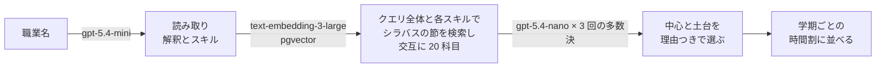

評価データは電子情報工学科の 50 職業。3 つの立場の LLM(Claude)が職業と科目の組ごとに中心・土台・関係なしの票を入れ、その多数決で科目を期待・土台・少数・関係なしに分けた(ADR 0017、0023)。期待する科目は計 151 で、1 職業に 1〜10。初めの 10 職業(期待する科目 33)に、学科の公開している進路の職種に合わせて 20 職業を足した(ADR 0054)。足そうとした職業のうち 4 つ(電力会社の電気技術者、鉄道の電気・信号技術者、生産技術エンジニア、予備のデータベースエンジニア)は、学科に中心となる授業が無く再現率を出せないので、予備の職業と入れ替えた。さらに、職業ごとの差を見分けやすくするため、同じ手順で 20 職業を足した(ADR 0064)。このときも 4 つ(UI・UX デザイナー、弁理士・特許技術者、量子コンピュータの研究・開発エンジニア、半導体製造装置のエンジニア)を予備と入れ替え、中心が 1 票だけの 17 件は作者が判定者の多数に合わせて全て土台にした。`experiment run` が評価データの職業に推薦を本番と同じ道で決めた回数だけ流し、精度、揺れ、費用、時間を `backend/eval/runs/` の JSON に残す(ADR 0048)。`experiment compare` は 2 つの結果を職業ごとに対応させて比べ、差の 95% 信頼区間をブートストラップで出し(ADR 0053)、差ありを職業ごとに前と後を入れ替える並べ替え検定で決める(ADR 0055)。比べる 2 つの設定は、`experiment pair` で職業と回の組ごとに交互に流す(ADR 0055)。`experiment analyze` は 1 つの結果から、期待する科目をどの段(読み取り、検索、選び直し)で落としたかと、誤って選んだ科目を数え、次に何を直すかを決める材料にする(ADR 0073)。下の基準と改善の記録は初めの 10 職業で測り、30 職業と 50 職業での比べはそのあとに書く。この 50 職業は直しを調べて試す開発用で、別に確かめ用の 20 職業(期待する科目 58、1 職業に 1〜5)を `backend/eval/heldout/` に取っておき、直しを決めたあとにだけ平均と検定で測る(ADR 0067)。開発用の取りこぼしを見て決めた直しが、見ていない職業では効かなかったことがあったため(ADR 0064、0065)。

基準(2026-10-23、commit 7c4feb5、10 職業 × 3 回の平均 ± 標本標準偏差。`backend/eval/runs/20261023-104015-baseline.json` と `20261023-104147-baseline-handwritten.json`)

| 指標 | 通し(選び直し 1 回) | 読み取りを手書きのスキルに固定 |
|---|---|---|
| 検索の再現率 @10 / @20 | 84% ± 6 / 96% ± 2 | 93% ± 0 / 100% ± 0 |
| 選び直しに渡した候補(30 件)の再現率 | 100% | 100% |
| 中心(柱)の適合率 | 50% ± 5 | 54% ± 2 |
| 期待する科目を中心に選んだ割合 | 76% ± 0 | 81% ± 5 |
| 選んだ科目のうち関係なし | 23% ± 2 | 14% ± 1 |
| 同じ職業の回どうしの選んだ科目の重なり(Jaccard) | 0.45 | 0.65 |
| 1 回の推薦の費用 / 時間 | 0.81 円 / 8.0 秒 | 0.36 円 / 5.6 秒 |

10 職業では、検索は期待する科目を全て候補に入れていて、誤りと揺れは選び直しの段で起きる。LLM の職業の読み取りの揺れがそれを広げている(関係なし 14% → 23%、重なり 0.65 → 0.45)。精度を上げる手は、この基準と `experiment compare` で比べて選ぶ。

#### 改善の記録

費用の制約の中で精度を上げる。精度はお金をかければ上がる(大きなモデル、多い回数)ので、1 件あたりの費用と時間も同じ表で比べ、精度を上げた手のあとは同じ精度をより安く出す手を探す。どれも 10 職業 × 3 回の通しで、値は平均(± は標本標準偏差)。

| 設定 | ADR | 関係なし | 中心の適合率 | 期待する科目を中心に | 重なり | 1 件の費用 | 時間 |
|---|---|---|---|---|---|---|---|
| 選び直し 1 回、候補 30 件(基準) | 0048 | 23% ± 2 | 50% ± 5 | 76% ± 0 | 0.45 | 0.81 円 | 8.0 秒 |
| 多数決 3 回、候補 30 件 | 0049 | 10% ± 1 | 55% ± 3 | 74% ± 8 | 0.59 | 1.57 円 | 9.0 秒 |
| 多数決 3 回、候補 20 件 | 0050 | 11% ± 0 | 57% ± 5 | 78% ± 5 | 0.62 | 1.14 円 | 7.8 秒 |
| 多数決 3 回、候補 20 件、2 票目から 0.5 秒遅らせる | 0051 | 15% ± 4 | 56% ± 5 | 76% ± 6 | 0.56 | 1.01 円 | 8.3 秒 |
| ここまで + 職業の読み取りを覚える(今の既定) | 0052 | 16% ± 2 | 60% ± 3 | 79% ± 5 | 0.73 | 0.72 円(初めての職業 1.00 円、覚えた職業 0.59 円) | 7.4 秒 |

- 多数決(選び直しを 3 回並べて呼び、過半数が選んだ科目だけを残す): 関係なしが 23% から 10% に下がった(差あり)。読み取りを手書きのスキルに固定した基準(14%)も下回ったが、この差(-4.8 ポイント、区間 -10.9〜+1.0)は 0 と区別できない。期待する科目は保ったまま関係の薄い科目を落とし、揺れも減る。費用は約 1.9 倍
- 候補 20 件: 選び直しの入力の大半は候補のシラバスの抜粋なので、候補を 3 分の 2 にすると費用が 27% 減る。精度の差はどの指標も区間に 0 を含む。期待する科目 33 のうち 1 つ(ソフトウェア開発エンジニアの「応用Cプログラミング」)が候補から落ちる
- 2 票目から 0.5 秒遅らせる: 同時に送ると 1 票目の指示文が読み込まれる前に後の票が届き、入力のキャッシュ(10 分の 1 の料金)が効かない。遅らせると選び直しの入力のうちキャッシュに当たる割合が 50% から 63% になり、費用が 11% 減る。時間は 0.5 秒増える。送る指示文と回数は同じなので精度は変わらないはずで、差はどの指標も区間に 0 を含む
- 職業の読み取りを覚える: 同じ職業名なら LLM を呼ばずに覚えた読み取りを使う(worker のメモリ、500 件)。同じ職業なら同じ読みになるので、同じ職業の回どうしの重なりが 0.56 から 0.73 に上がり、作り直しても道標がそろう。覚えた職業では読み取りの費用が消えるうえ、選び直しの指示文が前とそっくり同じになり、10 分ほどの間なら入力のキャッシュにも当たる(95%)。初めての職業の費用は 1.00 円で変わらない。実験は職業ごとに 3 回続けて流すので 3 回に 2 回は覚えた職業になり、平均の 0.72 円は本番より安く見える
- ここまでで、同じ職業の回どうしの重なりは 0.45 から 0.73 に、中心の適合率は 50% から 60% になった(どちらも差あり)。関係なしは 23% から 16% で、多数決の直後(10%)から戻っている(下の「前の設定との差」)。1 件の費用は、初めての職業で 1.00 円(基準の 1.2 倍)、覚えた職業で 0.59 円(基準より安い)

結果は `backend/eval/runs/` の `20261023-104015-baseline.json`、`20261023-125956-votes-3.json`、`20261023-131317-votes-3-candidates-20.json`、`20261023-132300-votes-3-candidates-20-delay.json`、`20261023-133440-reading-cache.json`。多数決の決まりを直す前の作りで流した 1 回目(`20261023-121203-votes-3.json`)は、関係なし 14%、適合率 57%、期待する科目を中心に 81% だった。

##### 前の設定との差

`experiment compare` で前の設定と比べた差(割合はポイント)と、10 職業を選び直すブートストラップの 95% 信頼区間(ADR 0053)。この表の判定は ADR 0053 の決まりで、区間が 0 を含まなければ差あり(ADR 0055 からは並べ替え検定で判定する)。判定は各 ADR に書いたねらいの指標で行い、ほかの指標は区間の悪い側の端を、どこまで悪くなりうるかとして読む。

| 変更 | ねらい | 関係なし | 中心の適合率 | 重なり | 1 件の費用 |
|---|---|---|---|---|---|
| 多数決 3 回 | 関係なしと揺れ | -13.6(-25.6〜-3.8)差あり | +4.9(-3.1〜+14.6) | +0.14(+0.05〜+0.22)差あり | 0.81 → 1.57 円 |
| 候補 20 件 | 費用 | +1.8(-3.1〜+7.6) | +1.6(-8.8〜+10.1) | +0.03(-0.01〜+0.07) | 1.57 → 1.14 円 |
| 2 票目から 0.5 秒遅らせる | 費用 | +3.4(-2.8〜+9.4) | -0.8(-7.6〜+8.1) | -0.06(-0.12〜+0.01) | 1.14 → 1.01 円 |
| 職業の読み取りを覚える | 費用と揺れ | +1.2(-4.1〜+9.1) | +3.5(-7.1〜+14.5) | +0.17(+0.07〜+0.27)差あり | 1.01 → 0.72 円 |
| 基準から今の既定まで | | -7.2(-13.7〜+1.0) | +9.2(+2.3〜+17.3)差あり | +0.29(+0.23〜+0.35)差あり | 0.81 → 0.72 円 |

ねらった指標は、多数決の関係なしと重なり、読み取りを覚えたときの重なりで差ありになった。費用を下げた 3 つの段は、どれも精度の差の区間に 0 を含む。ただし関係なしの悪い側の端は +7.6〜+9.4 ポイントあり、点の推定では 3 つの段で計 +6.4 ポイント戻っている。基準から今の既定までの関係なしの差(-7.2)は、95% では 0 と区別できない。10 職業では 5 ポイントほどの差を見分けられない(関係なしで 5 ポイントの差を 8 割の確率で見つけるには 32〜76 職業が要る見積もり、ADR 0053)。そこで評価データを 30 職業に増やした(ADR 0054)。

##### 30 職業での比べ

基準(選び直し 1 回、候補 30 件、読み取りを覚えない)と今の既定を、30 職業 × 3 回で続けて流した(2026-10-23 の 16:51 と 17:03、`20261023-165117-thirty-baseline.json` と `20261023-170337-thirty-default.json`、計 140 円)。差ありかは、結果を見る前に作者が決めた関係なしだけで判定する(ADR 0054)。

| 指標 | 基準 | 今の既定 | 差(95% 区間) |
|---|---|---|---|
| 選んだ科目のうち関係なし(ねらい) | 24.8% | 18.5% | -6.3(-11.0〜-2.2)差あり |
| 中心の適合率 | 42.4% | 44.6% | +2.2(-2.7〜+7.6) |
| 期待する科目を中心に選んだ割合 | 76.7% | 71.3% | -5.4(-12.3〜+2.1) |
| 選び直しに渡した候補の再現率 | 87.7% | 84.4% | -3.2(-7.5〜+0.4) |
| 同じ職業の回どうしの重なり | 0.50 | 0.72 | +0.22(+0.17〜+0.28) |
| 1 件の費用 | 0.81 円 | 0.74 円(初めての職業 1.02 円、覚えた職業 0.60 円) | |
| 1 件の時間 | 8.1 秒 | 8.0 秒 | |

- 関係なしは 6.3 ポイント下がった。職業ごとに前と後を入れ替える並べ替え検定(ADR 0053 の案 3)でも p = 0.01。足した職業で中心が 1 票だけの科目の決定 4 件を土台にしても、-7.3 ポイント(区間 -11.9〜-3.3)で変わらない(技術系公務員は期待する科目が無くなるので外し、29 職業)
- 悪い側の端は、期待する科目を中心に選んだ割合で -12.3 ポイント、候補の再現率で -7.5 ポイント。候補の再現率の差 -3.2 ポイントのうち 2.2 ポイントほどは候補を 30 件から 20 件にした分(基準の 30 件と 20 位までの差)。今の既定は読み取りを使い回すので検索の結果も 3 回同じになり、20 位までに入らなかった科目(センサ開発エンジニアの信号処理、医療機器の開発エンジニアの電子回路Ⅱ、音響エンジニアのメディア情報処理)は 3 回とも候補に入らない。基準の読み取りでは、これらは 3 回のうち多くで 20 位以内だった
- 10 職業では検索が期待する科目を全て候補に入れていたが、30 職業では 12〜16% を入れない。漏れるのは、コーオプ演習、現代の経営、国の行政組織のような、職業のスキルの言葉から遠い科目
- 関係なしは、LLM が職業を広く読むか(ADR 0032)でも動く。基準の 3 回は広く読んだ職業が 8、12、14 で、関係なしが 21%、25%、29% だった

同じ設定どうしの比べ(何も変えていないので、差ありは全て誤り)で、ADR 0053 の誤りの率を 30 職業で確かめ直した。数えたのは 8 つの指標のうち両方が同じ値にならない比べで、今の既定の回どうしは読み取りが同じ。

| 同じ設定どうし | 比べ | ブートストラップの差あり | 並べ替え検定の p < 0.05 |
|---|---|---|---|
| 同じ実験の回どうし(30 職業、1 回と 1 回、6 組) | 39 | 4(10%) | 2(5%) |
| 別の時刻に流した同じ設定(初めの 10 職業、3 回と 3 回、2 組) | 13 | 4 | 2 |

- 30 職業の回どうしで、ブートストラップの誤りは名目の 5% の 2 倍だった。差が一部の職業にしか出ない指標(再現率など)で区間が狭く出る。並べ替え検定は 5% に近い
- 別の時刻に流した 2 組(基準の 10:40 と 16:51、今の既定の 13:34 と 17:03)は、どちらも後の方が関係なしが 9 ポイントほど低く(23.2% → 13.9%、16.0% → 7.3%)、並べ替え検定でも差ありになった。推薦のコード(あいだの変更は振る舞いを変えない整理だけ)、モデル、指示文、正解は同じで、多くの職業で同じ向きに下がっている。職業を選び直す区間にも並べ替え検定にも、流した時刻による揺れは入らない
- 上の 10 職業の改善の記録は、どの設定も別の時刻に流したので、差には時刻による揺れも入っている。30 職業の比べは 2 つを続けて流したので影響は小さいはずだが、関係なしの -6.3 ポイントが設定の効果か時刻の揺れかは、この 1 組では分けきれない(交互に流して確かめた結果は「交互に流した基準と今の既定」)

このため、比べる 2 つの設定を同じ時間に交互に流し(`experiment pair`)、差ありを並べ替え検定で判定するように比べ方を直した(ADR 0055)。

##### 交互に流した同じ設定どうし

直した比べ方を確かめるため、今の既定どうしを `experiment pair` で 30 職業 × 3 回交互に流した(2026-10-23 の 18:47、`20261023-184741-default-aa-before.json` と `-after.json`、151.8 円)。何も変えていないので、差ありは全て誤り。ADR 0055 で先に決めた 2 つを見た。

| 指標 | 前 | 後 | 差(95% 区間、並べ替え検定) |
|---|---|---|---|
| 選んだ科目のうち関係なし | 22.3% | 19.4% | -2.9(-7.6〜+1.5、p = 0.23) |
| 中心の適合率 | 41.9% | 42.3% | +0.4(-3.9〜+4.4、p = 0.86) |
| 期待する科目を中心に選んだ割合 | 70.9% | 66.9% | -4.1(-9.8〜+1.8、p = 0.30) |
| 同じ職業の回どうしの重なり | 0.76 | 0.76 | +0.00(-0.08〜+0.08、p = 0.98) |

- 10 の指標(重なりを含む)で差ありは 0。関係なしの差(-2.9 ポイント)は、別の時刻に流した同じ設定どうしの 9 ポイントより小さい。交互に流すと、流した時刻による揺れが差から消える
- 3 回目の 1 組(通信・ネットワークエンジニア)は、前と後が同じ時間に API のタイムアウトと接続の失敗で落ちた。交互に流しているので、こうした失敗も両方に同じようにかかる。比べは両方で採点した 1・2 回目で行った
- 1 件の費用は 0.84〜0.85 円で、続けて流した今の既定(0.74 円)より高い。同じ職業の次の回までの間がおよそ倍(4 分から 8 分)になり、選び直しの入力のうちキャッシュに当たる割合が 83% から 73% に下がった。pair の前と後には同じようにかかるので組の中の比べは公平だが、run で流した費用とは比べられない

##### 交互に流した基準と今の既定

30 職業の比べの -6.3 ポイントが、流した時刻の揺れではなく設定の効果かを確かめるため、基準と今の既定を `experiment pair` で 30 職業 × 3 回交互に流した(2026-10-24 の 10:59、`20261024-105907-baseline-vs-default-before.json` と `-after.json`、149.5 円、推薦の失敗 0)。差ありかは、前と同じく関係なしだけで判定する(ADR 0054、0055)。

| 指標 | 基準 | 今の既定 | 差(95% 区間、並べ替え検定) |
|---|---|---|---|
| 選んだ科目のうち関係なし(ねらい) | 27.6% | 21.6% | -5.9(-10.9〜-1.2、p = 0.023)差あり |
| 中心の適合率 | 35.7% | 42.1% | +6.4(+2.9〜+9.4、p = 0.004) |
| 期待する科目を中心に選んだ割合 | 70.2% | 69.8% | -0.4(-6.3〜+6.0、p = 1.000) |
| 選び直しに渡した候補の再現率 | 86.9% | 84.9% | -2.1(-4.9〜+0.0、p = 0.244) |
| 1 職業に選んだ中心 / 土台 | 5.63 / 5.78 | 4.76 / 4.51 | -0.88 / -1.27 |
| 同じ職業の回どうしの重なり | 0.52 | 0.72 | +0.20(+0.15〜+0.26、p < 0.001) |
| 1 件の費用 | 0.83 円 | 0.83 円 | |
| 1 件の時間 | 8.1 秒 | 7.6 秒 | |

- 関係なしは 5.9 ポイント下がり、交互に流しても差ありだった。続けて流した比べの -6.3 ポイントとほぼ同じで、流した時刻の揺れを除いても今の既定の効果として残る
- 中心の適合率は 6.4 ポイント上がり、1 職業に選ぶ科目は中心と土台を合わせて 2.2 減った。選び直しの多数決で 3 回のうち 1 回しか選ばれない科目が落ちること(ADR 0049)と、候補を 20 件に絞ったことが効いていると考えられるが、4 つの設定を一度に変えた比べなので、どれの分かは分けられない
- 期待する科目を中心に選んだ割合は、続けて流したときが -5.4 ポイント(区間 -12.3〜+2.1)、交互に流すと -0.4 ポイントで、どちらも差は出ていない。今の既定で期待する科目を中心に選ぶ割合が下がるとは言えない。悪い側の端は -6.3 ポイント
- 候補の再現率の差 -2.1 ポイントは差なし(区間 -4.9〜+0.0)。候補を 30 件から 20 件に絞った分を含む(上の 30 職業の比べでは、-3.2 ポイントのうち 2.2 ポイントほどがその分だった)
- 1 件の費用はどちらも 0.83 円。基準は選び直しが 1 回だが、候補が 30 件で入力が長く、読み取りも毎回する。今の既定は選び直しを 3 回呼ぶが、2 票目から入力のキャッシュに当たる(nano の入力 34,475 トークンのうち 26,470)。交互に流すとキャッシュに当たりにくいので、続けて流した今の既定(0.74 円)より高い

##### 検索をスキルごとにする

上の比べのとおり、30 職業では検索が期待する科目の 12〜16% を候補に入れていなかった。漏れた科目の多くはスキル 1 つだけをクエリにすると上位に来る(応用Cプログラミングは「プログラミング」で 1 位、現代の経営は「業務分析」で 4 位)ので、埋め込みを text-embedding-3-large にし、職業のクエリ全体と各スキルの順位から交互に候補を取るようにした(ADR 0063)。前(3-small、クエリ 1 つ)と後を `experiment pair` で 30 職業 × 3 回交互に流した(2026-10-24 の 18:55、`20261024-185559-search-by-skill-before.json` と `-after.json`、135.6 円)。差ありかは、流す前に ADR 0063 で決めた候補の再現率で判定する。

| 指標 | 前 | 後 | 差(95% 区間、並べ替え検定) |
|---|---|---|---|
| 選び直しに渡した候補の再現率(ねらい) | 84.6% | 91.6% | +7.0(+0.1〜+15.7、p = 0.089) |
| 検索の再現率 @10 | 71.7% | 80.1% | +8.4(-0.4〜+18.1、p = 0.091) |
| 選んだ科目のうち関係なし | 23.7% | 16.0% | -7.7(-12.3〜-2.8、p = 0.004) |
| 中心の適合率 | 42.2% | 39.8% | -2.4(-8.9〜+3.8、p = 0.475) |
| 期待する科目を中心に選んだ割合 | 72.1% | 69.8% | -2.3(-11.5〜+7.1、p = 0.731) |
| 同じ職業の回どうしの重なり | 0.68 | 0.75 | +0.07(-0.01〜+0.14、p = 0.089) |
| 1 件の費用 | 0.77 円 | 0.74 円 | |
| 1 件の時間 | 8.0 秒 | 7.7 秒 | |

- ねらいの候補の再現率は 7.0 ポイント上がったが、並べ替え検定は p = 0.089 で差ありに届かなかった。検索だけを手元で測った 2 つ(LLM のスキル +2.4、手書きのスキル +6.0 ポイント)も同じ向きで、どれも 30 職業では 0 と区別できない。読み取りを使い回すので、回を増やしても再現率の差は見分けやすくならない
- 選んだ科目のうち関係なしは 7.7 ポイント下がり、差ありだった。候補のうち関係なし(手元の測りで 44% → 40%)が減ったことが、選び直しにも効いたと考えられる。ねらいの指標ではないので判定には使わない
- 悪い側の端は、中心の適合率で -8.9 ポイント、期待する科目を中心に選んだ割合で -11.5 ポイント
- 費用と時間は変わらない。埋め込むクエリは 1 つから 1 + スキルの数に増えるが、数十トークンで約 0.002 円(実験の費用は LLM の使用量だけを数えるので、この分は入らない)
- 3 回目の最後の 3 組(フィールドエンジニアの後、音響エンジニアの前と後)は、API への接続の失敗で落ちた。比べは両方で採点した 1・2 回目で行った
- 作者は、ねらいの指標でははっきりしなかったことを承知で採用した。3 つの測り方で再現率が同じ向きに上がり、選んだ科目の関係なしが減り、費用が増えないため

##### 50 職業で比べ直す

ねらいの指標で差ありに届かなかったので、評価データを 50 職業に増やし(ADR 0064)、同じ前と後を `experiment pair` で 50 職業 × 3 回交互に流した(2026-10-26 の 00:26、`20261026-002600-fifty-search-by-skill-before.json` と `-after.json`、281.7 円、推薦の失敗 0)。差ありかは、ADR 0063 と同じ候補の再現率で判定する。

| 指標 | 前 | 後 | 差(95% 区間、並べ替え検定) |
|---|---|---|---|
| 選び直しに渡した候補の再現率(ねらい) | 82.5% | 85.8% | +3.3(-3.0〜+10.8、p = 0.391) |
| 検索の再現率 @10 | 70.0% | 74.2% | +4.3(-2.4〜+11.1、p = 0.222) |
| 選んだ科目のうち関係なし | 23.0% | 15.1% | -7.8(-12.8〜-3.2、p = 0.001) |
| 中心の適合率 | 39.9% | 38.1% | -1.8(-6.0〜+2.4、p = 0.400) |
| 期待する科目を中心に選んだ割合 | 62.0% | 62.5% | +0.4(-6.0〜+6.7、p = 0.945) |
| 同じ職業の回どうしの重なり | 0.69 | 0.73 | +0.03(-0.01〜+0.07、p = 0.129) |
| 1 件の費用 | 0.94 円 | 0.94 円 | |
| 1 件の時間 | 7.8 秒 | 8.0 秒 | |

結果を見てから、初めの 30 職業と足した 20 職業に分けた値(判定には使わない)。手書きのスキルの行は、`evaluate` で読み取りを通さずに検索だけを測った値。

| 指標 | 初めの 30 職業 | 足した 20 職業 |
|---|---|---|
| 候補の再現率(pair) | 81.7% → 88.1%(+6.4) | 83.6% → 82.4%(-1.2) |
| 選んだ科目のうち関係なし(pair) | 24.1% → 13.4%(-10.8) | 21.3% → 17.6%(-3.7) |
| 検索の再現率 @20(手書きのスキル) | 86.3% → 92.2%(+5.9) | 91.1% → 91.2%(+0.1) |

- ねらいの候補の再現率は 3.3 ポイント上がったが、p = 0.391 で、50 職業でもはっきりしなかった(ADR 0064 の再検討する条件にあたる)
- 上がったのは初めの 30 職業で(+6.4、30 職業の pair の +7.0 に近い)、足した 20 職業では上がらなかった(-1.2)。読み取りを通さない手書きのスキルの検索でも同じ形(+5.9 と +0.1)。ADR 0063 の変更は初めの 30 職業の取りこぼしを見て決めたので、その職業に合った分が差に入っていたと考えられる。足した 20 職業は前から検索が期待する科目をよく拾っていて(手書きのスキルの @20 で 91%)、上がる余地も小さかった
- pair の前と後は、職業の読み取りをそれぞれで行うので、同じ職業でもスキルが違う。社内 SE を前は「社内SE」、後は「ITエンジニア」と読み、ソフトウェア工学が候補から落ちたように、読み取りの揺れが再現率の差に混ざる。読み取りを通さない手書きのスキルの検索だけでも、50 職業で @20 が 88.2% → 91.8%(+3.6、職業ごとに前と後を入れ替える並べ替え検定で p = 0.237)、@10 が 78.4% → 82.6%(+4.2、p = 0.205)で、0 と区別できない
- 選んだ科目のうち関係なしは 7.8 ポイント下がり、差ありだった。30 職業の pair(-7.7)と同じ大きさで、足した 20 職業でも下がった。ねらいの指標ではないので判定には使わない
- 悪い側の端は、中心の適合率で -6.0 ポイント、期待する科目を中心に選んだ割合で -6.0 ポイントで、30 職業(-8.9、-11.5)より狭くなった
- 1 件の費用は前と後とも 0.94 円で、30 職業の pair(0.74〜0.77 円)より高い。交互に流すと同じ職業の次の回までの間が約 8 分から約 13 分に延び、選び直しの入力のうちキャッシュに当たる割合が 83% から 61% に下がった
- ADR 0063 の設定は今の既定のまま(戻す理由になる悪化は無い)

##### 読み取りに学科の分野を書く(採らなかった)

残りの取りこぼしを調べると、候補の取り方を替えても(全体の上位 10 + 交互、RRF、類似度の最大と和)今の交互より良くならず、LLM のスキルで取りこぼした 25 件のうち 17 件は手書きのスキルなら 20 位以内に入った。原因は職業の読み取りで、50 職業の pair の読み取りの 300 回のうち 48 回が「ITエンジニア」だった(AI・機械学習エンジニアや起業家まで広く読む)。LLM が学科にどの分野の授業があるかを知らないまま、広く読むかを決めているので、候補の 188 科目の名前からまとめた学科の分野を指示文に書き、分野が当たればそのまま読む指示文を試した(ADR 0065)。

測り方は変える前に決めた。前と後の読み取りを 50 職業ごとに交互に 3 回ずつ動かし、推薦と同じ取り方で検索して、職業ごとの @20 の再現率を 3 回で平均し、職業ごとの並べ替え検定で判定する。読み取りだけなので、選び直し(nano)を通さず、試しも含めて約 80 円で測れた。

| 指標 | 前 | 後 | 差(並べ替え検定) |
|---|---|---|---|
| @20 の再現率(ねらい、50 職業) | 0.910 | 0.865 | -4.4(p = 0.105) |
| @20 の再現率(初めの 30 職業) | 0.955 | 0.884 | -7.1(p = 0.008) |
| @20 の再現率(足した 20 職業) | 0.843 | 0.838 | -0.5(p = 0.969) |
| @10 の再現率(50 職業) | 0.773 | 0.768 | -0.4(p = 0.868) |
| 「ITエンジニア」と読んだ回(153 回のうち) | 35 | 8 | |

- 広く読みすぎることは直り、起業家をそのまま読むと再現率が 0.00 から 0.56 になった。一方で、スキルに分野の一覧の言葉(情報社会と倫理、経営と起業、技術者倫理)を写し、職業に固有のスキル(業務分析、トラブルシュート、プロジェクト管理)が押し出されて、13 職業で下がった
- ねらいの指標で改善が出ず、同じ 50 職業で指示文を 3 度目に直すとその職業に合わせただけになりやすいので、作者は前の文面に戻すことを選んだ。次に読み取りを直すときは、評価データにまだ見ていない職業を足して確かめる
- この調べで、`evaluate --skills llm` が推薦と違う検索文(評価データの職業名 + LLM のスキル)で測っていて、解釈が替わる効き目を測れないことが分かったので、推薦と同じ解釈した職業名とスキルの検索文に直した(ADR 0066)

##### 選び直しで迷った授業を選ばない

50 職業の pair の結果を開発用で調べると、期待する科目の数と選んだ数の相関は 0.17 で、期待する科目が 2 以下の職業でも平均 8.2 科目を選び、関係なしは授業の少ない職業に集まっていた(テック系スタートアップの起業家 84%、技術営業 68%)。選び直しの指示文に「選ぶか迷った授業は選ばず、関係する授業が少なければ少なく選んでよい」を足した(ADR 0069)。指示文の前と後を交互に流すため、指示文を設定 `SELECTION_PROMPT` で替えられるようにした(ADR 0068)。判定は変える前に決めた関係なしで行い、開発用で採る条件を満たしたあとに、確かめ用で初めて測った(ADR 0067)。

| 指標 | 開発用 50 職業(1 回ずつ、2026-10-26 の 15:15、101.9 円) | 確かめ用 20 職業(1 回ずつ、15:29、40.3 円) |
|---|---|---|
| 選んだ科目のうち関係なし(ねらい) | 16.4% → 10.6%、-5.8(-9.2〜-2.4、p = 0.004) | 15.0% → 12.2%、-2.7(-7.1〜+0.8、p = 0.210) |
| 期待する科目を中心に選んだ割合 | 64.9% → 66.2%、+1.3(-5.3〜+8.1) | 72.4% → 70.7%、-1.7(-10.0〜+5.7) |
| 中心の適合率 | 37.8% → 42.6%、+4.7(+1.1〜+8.6、p = 0.015) | 47.7% → 44.6%、-3.2(-8.8〜+2.4、p = 0.324) |
| 1 職業に選んだ中心 / 土台 | 5.18 → 4.70 / 3.98 → 3.04 | 4.40 → 4.60 / 3.95 → 2.75 |
| 1 件の費用 | 1.05 円 → 0.99 円 | 1.04 円 → 0.98 円 |
| 1 件の時間 | 8.4 秒 → 7.3 秒 | 8.2 秒 → 7.4 秒 |

- 開発用で関係なしが差ありで下がり、期待する科目を中心に選んだ割合は下がらなかった。確かめ用でも関係なしは下がる向きだったので、決めた条件どおり作者が採った
- 効き目は、確かめ用(-2.7)が開発用(-5.8)の半分ほどだった。開発用の取りこぼしを見て決めた直しなので、開発用では効き目がよく出たと考えられる。確かめ用を別に取っておいたことで、この割り引きが見えた
- 選ぶ数は、開発用では中心(-0.48、p = 0.049)と土台(-0.94、p = 0.007)の両方が減り、確かめ用では土台だけが減った(-1.20、p = 0.026。中心は +0.20 で差は無し)。確かめ用では中心の適合率が下がる向き(-3.2、差は無し)だった
- 費用と時間はどちらも減った(選ぶ数が減って出力が短くなった)
- 開発用の結果は `backend/eval/runs/20261026-151537-selection-restraint-before.json` と `-after.json`。確かめ用の結果は git の管理外(`backend/data/heldout-runs/`)に置き、平均と検定だけを見た
- 確かめ用を使ったのはこれが 1 回目(ADR 0067 は 5 回で見直す)

##### 取りこぼしの内訳

次に直す段を決めるため、`experiment analyze` で上の開発用の前と後の結果を分析した(ADR 0073)。候補に入らなかった期待する科目は、評価データの手書きのスキルで同じ取り方の検索をし直し、それなら入るものを読み取りで落とした、と数える。前と後は読み取りを別々に行ったので、読み取りと検索の数には読み取りの揺れも入る。

| 期待する科目の行方(151 件) | 前 | 後(ADR 0069 の文面) |
|---|---|---|
| 中心に選んだ | 98(64.9%) | 100(66.2%) |
| 土台に選んだ | 6(4.0%) | 6(4.0%) |
| 土台に選んだが中心につながらず外した | 0 | 3(2.0%) |
| 候補にあったが選ばなかった(選び直しで落とした) | 23(15.2%) | 20(13.2%) |
| 候補に無く、手書きのスキルなら入る(読み取りで落とした) | 18(11.9%) | 18(11.9%) |
| 候補に無く、手書きのスキルでも入らない(検索で落とした) | 6(4.0%) | 4(2.6%) |
| 関係なしで選んだ中心 / 土台 | 25 / 50 | 18 / 23 |

- 選ぶ数を絞っても(ADR 0069)、選び直しで落とした期待する科目は増えなかった。減った関係なしは主に土台だった
- ADR 0069 の文面で落とした 45 件のうち 18 件は、読み取りのスキルが手書きのスキルほど科目に届かなかったもの。多いのは、計算機科学の研究者(アルゴリズムや計算理論は読めたが、アーキテクチャ、OS、ネットワーク、並列処理を落とした)、テック系スタートアップの起業家(ITエンジニアと読み、アントレプレナーシップの特殊講義とコーオプ演習を落とした)、ロボットのソフトウェアエンジニア(組込みエンジニアと読み、画像と AI の科目を落とした)
- 選んだ中心 235 のうち 111 は、判定者が土台とした科目だった。選び手は判定者より中心を広く取る(ADR 0023 で分かっていた物差しの違い)
- 関係なしで選んだ回数が多いのは、電子情報工学演習(6 職業)と電子回路Ⅱ(5 職業)
- 読み取りか選び直しのモデルを替えて比べるときは、この内訳で、どの段が動いたかを見る

#### 少しでも役立つ授業は迷っても選ぶ

本番で作ったデータサイエンティストの道標が 7 科目で少なく見え、職業に少し役立つ授業(特殊講義(深層学習の応用)、数理計画法など)も選んでいなかった。作者の「多少かすっていたら採用」を受け、選び直しの指示文の「選ぶか迷った授業は答えに含めません。…少なく選んで構いません」を「職業の仕事に少しでも役立つ授業は、選ぶか迷っても core か foundation に当てはめて選びます」に替えた(ADR 0080)。ねらいは 1 職業に選んだ中心か土台の数、条件は期待する科目を中心に選んだ割合が 5 ポイントより下がらないことで、変える前に ADR に書いた。

| 指標 | 開発用 50 職業(1 回ずつ、2026-10-31 の 11:20、103.6 円) | 確かめ用 20 職業(1 回ずつ、11:35、41.1 円) |
|---|---|---|
| 1 職業に選んだ中心(ねらい) | 4.60 → 5.44、+0.84(+0.42〜+1.26、p < 0.001) | 4.35 → 6.15、+1.80(+0.95〜+2.75、p = 0.001) |
| 1 職業に選んだ土台(ねらい) | 3.52 → 3.96、+0.44(-0.10〜+0.98、p = 0.136) | 3.00 → 3.00、+0.00(p = 1.000) |
| 期待する科目を中心に選んだ割合 | 61.6% → 67.5%、+6.0(+0.7〜+11.4、p = 0.058) | 69.0% → 89.7%、+20.7(+9.7〜+32.0、p = 0.004) |
| 選んだ科目のうち関係なし | 12.3% → 16.4%、+4.1(+0.6〜+7.7、p = 0.027) | 15.0% → 17.5%、+2.5(-2.0〜+7.0、p = 0.337) |
| 中心の適合率 | 40.4% → 37.5%、-2.9(-6.7〜+0.7、p = 0.128) | 46.0% → 42.3%、-3.7(-12.5〜+4.4、p = 0.376) |
| 1 件の費用 | 1.00 円 → 1.07 円 | 0.96 円 → 1.09 円 |

- 開発用でねらいの中心が差ありで増え、期待する科目を中心に選んだ割合も下がらず、確かめ用でも選ぶ数が増える向きだったので、決めた条件どおり採った。ねらいを中心と土台の 2 つにして、どちらかが差ありなら差ありとしたので、偶然の差ありの割合は 5% を超えうる。中心は p < 0.001 で、2 つに割った 0.025 の線でも差あり
- 確かめ用の採る条件(選ぶ数が増える向き)は、選ぶ数を増やす指示文ならほぼ必ず通り、確かめ用で拒めなかった。確かめ用には、関係なしや期待する科目を中心に選んだ割合にも条件を付けるべきだった
- `experiment analyze` では、期待する科目を中心に選んだのが 93 → 102、選び直しで落としたのは 24 → 24 のまま。増えた中心は判定者が土台や関係なしとした授業が主で(中心のうち関係なし 19 → 28)、選び直しで落としていた期待する科目を拾う効き目は無かった
- 関係なしの増えは学科の授業と合わない職業に集まる(選んだ数 / うち関係なし): テック系スタートアップの起業家 6 / 4 → 13 / 9、ソフトウェアテストエンジニア 2 / 0 → 7 / 4、社内 SE 8 / 0 → 13 / 3、情報セキュリティエンジニア 4 / 0 → 10 / 2。ADR 0069 が直した職業に関係なしが戻った。作者が受け入れたことで、開発用の関係なしが 20% を超えたら見直す(時刻による揺れを避けるため、今の既定どうしを `experiment pair` で 3 回ずつ交互に流した平均で見る)
- きっかけのデータサイエンティストは開発用で 6 → 7 科目にしか増えず、特殊講義(深層学習の応用)と数理計画法は後でも選ばれなかった。選び直しを 1 票にして 5 回流すと、深層学習の応用と信号処理はそれぞれ 1 回だけ選ばれ、3 票の多数決ではそろわない。指示文の 1 文より中心の定義が強く効いていて、きっかけの職業は直っていない
- 開発用でも読み取りが揺れて検索の再現率 @20 が +2.9 動き、期待する科目を中心に選んだ割合の +6.0 には、候補の違いと土台から中心へ移った分も入っている
- 確かめ用の期待する科目の +20.7 は、前と後で読み取りの揺れがあり検索の再現率 @20 も +3.5 動いた回なので、全てが指示文の効き目とは限らない
- 確かめ用を使ったのはこれが 2 回目(ADR 0067 は 5 回で見直す)
- 開発用の結果は `backend/eval/runs/20261031-112041-selection-coverage-before.json` と `-after.json`(結果が指す commit 57fff77 は、ADR の番号を付け替える前の同じコードのコミットで、`runs/selection-coverage` のタグでたどれる)。確かめ用の結果は git の管理外に置き、平均と検定だけを見た

#### 1 票でも選んだ授業を採る案(採らなかった)

ADR 0080 のあとも、データサイエンティストの特殊講義(深層学習の応用)は、選び手が 5 回に 1 回ほどしか選ばず、3 票の多数決ではそろわなかった。作者が次の案として、3 票のうち 1 票でも選んだ授業を採る案を測ることを選んだ。何票以上で残すかを設定 `SELECTION_MIN_VOTES`(省けば過半数)にし、`experiment pair` で切り替えて比べた(ADR 0081)。ねらいは 1 職業に選んだ中心で、ADR 0080 の反省から、ねらい以外にも条件(期待する科目を中心に選んだ割合の下がりが 5 ポイント以内、関係なしが 20% 以下)を付けて、流す前に ADR に書いた。

| 指標 | 開発用 50 職業(1 回ずつ、2026-10-31 の 12:08、108.6 円) |
|---|---|
| 1 職業に選んだ中心(ねらい) | 5.66 → 6.20、+0.54(+0.00〜+1.10、p = 0.076) |
| 1 職業に選んだ土台 | 3.86 → 5.68、+1.82(+1.10〜+2.56、p < 0.001) |
| 期待する科目を中心に選んだ割合 | 70.2% → 73.5%、+3.3 |
| 選んだ科目のうち関係なし | 13.4% → 19.7%、+6.3(p = 0.003) |
| 中心の適合率 | 37.5% → 35.8% |
| 1 件の費用 | 1.08 円 → 1.09 円 |

- ねらいの中心は差ありにならず、決めた条件どおりなら採らない。増えたのは土台で、増えた授業の判定は土台 +54、関係なし +53、期待 +4、少数 +7 だった
- きっかけのデータサイエンティストは 9 → 12 科目になり、特殊講義(深層学習の応用)が入った
- 結果を見てからねらいを土台に替えて採ると後出しになるので、ねらいを替えた測り直しの条件を ADR に書いてから流し直した。費用を抑えるために 100 件のうち 4 件で止め、途中の結果は判定に使っていない
- 作者が、追加の測定をせずに採らないことを選んだ。設定は過半数を既定として残し、要るときは本番の `.env` に `SELECTION_MIN_VOTES=1` を書けば切り替えられる(関係なしが 20% 近くまで上がりうる)
- 結果は `backend/eval/runs/20261031-120812-selection-min-votes-before.json` と `-after.json`

</details>

### データの取り扱い

- シラバスは公開ページから、1リクエスト 2〜3 秒以上の間隔、単一スレッド、リポジトリの URL を入れた User-Agent で取得する。取得した HTML は保存し、解析のやり直しで再取得しない
- 画面に出すシラバス本文は短い引用にとどめ、原ページへリンクする
- 教員の連絡先は保存しない
- Google ログインで得たメールアドレスと名前は保存せず、Google の利用者の番号(sub)だけを保存する(ADR 0027)。その扱いは画面のプライバシーポリシー(`/privacy`)に書く(ADR 0042)

### 開発ルール

- コメントは原則書かない。経緯や日付はコミットメッセージに書く
- 1か所でしか使わない短い処理は関数に切り出さない
- 変更は小さな単位で行う
- 設計判断は実装より先に ADR に書く

### ライセンス

コードは [MIT License](LICENSE)。取り込んだシラバスと時間割表の内容(`backend/data/`、git 管理外)と画面に出す引用は、このライセンスの対象外(大学と担当教員のもの)。テストには実ページを置かず、科目名・教員名・本文が架空の合成のページ(`backend/tests/unit/syllabus_pages.py` がテストの中で組み立てる)と PDF(`backend/tests/fixtures/timetable/make_sample.py` が作る)を使う(ADR 0043)。
