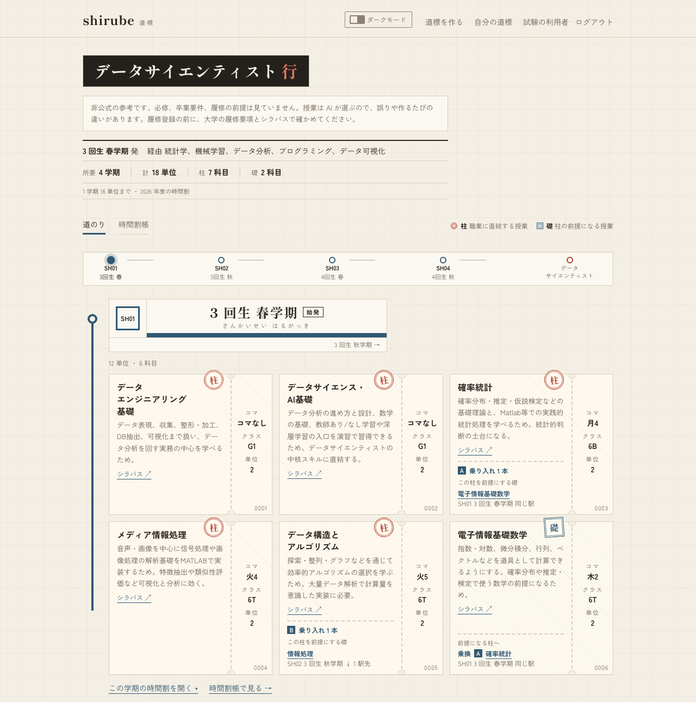
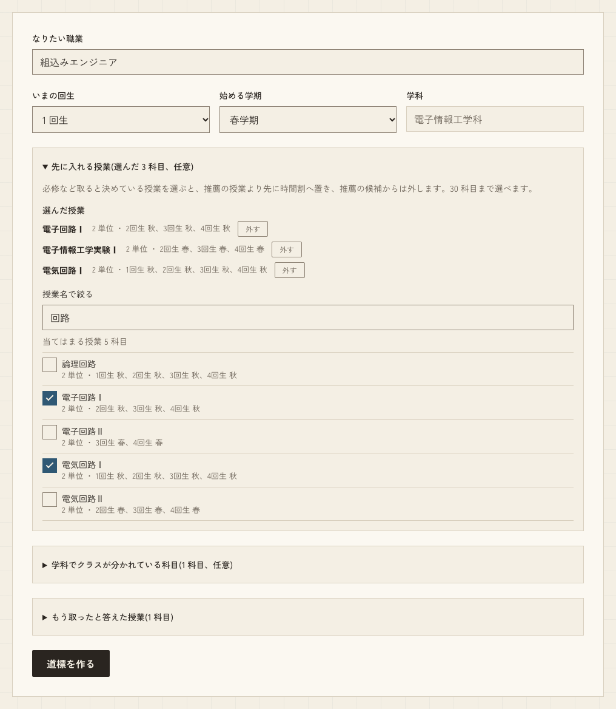
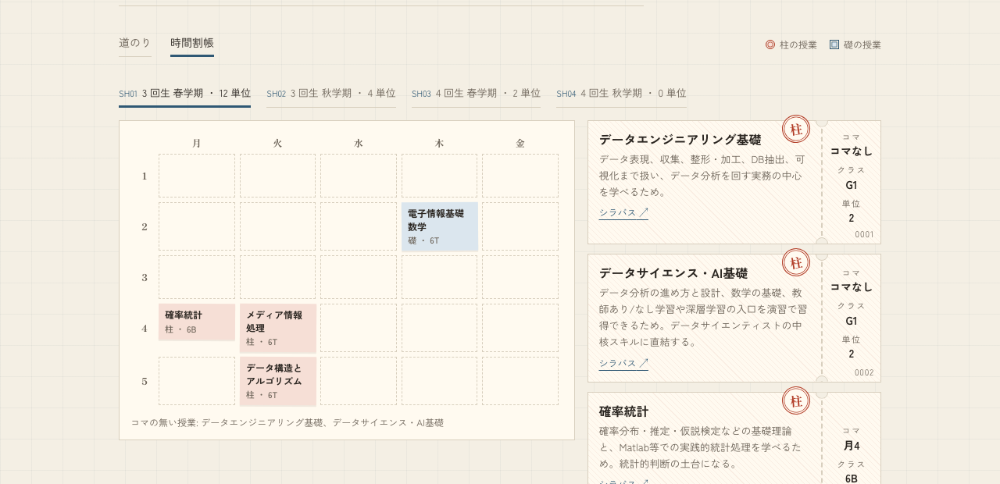
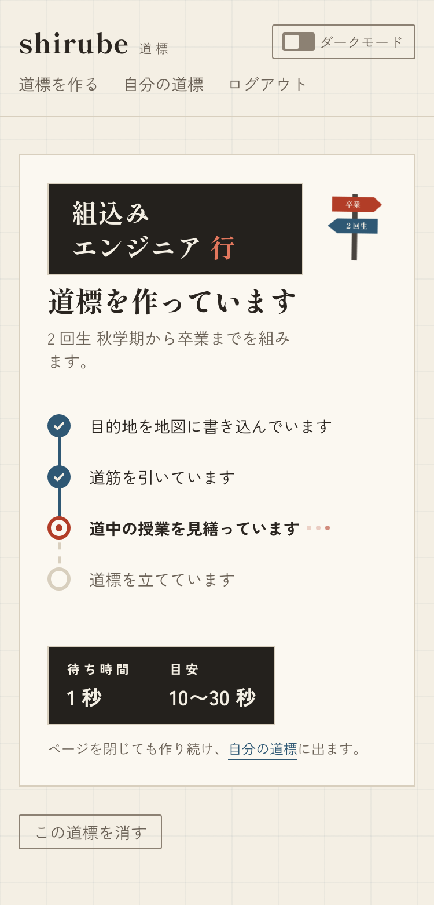
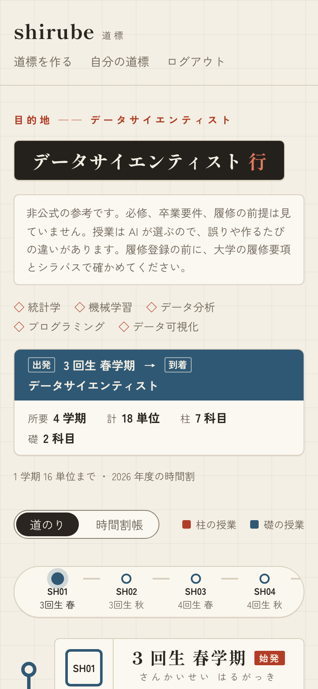
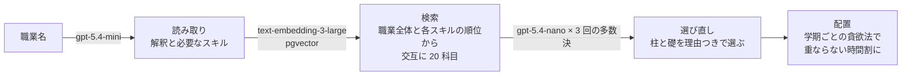
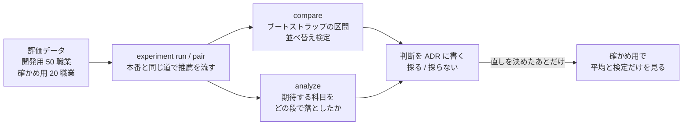
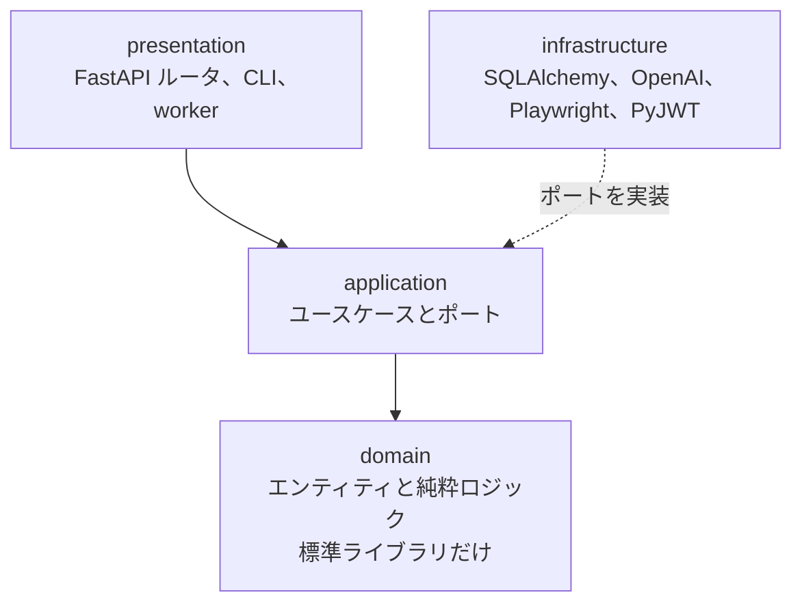

# shirube 道標

**履修に迷ったら、なりたい職業から。** なりたい職業と回生を入れると、大学のシラバスから職業につながる授業を選び、取るべき理由を添えて、卒業までの学期ごとの時間割(道標)を組む Web アプリです。最初の対象は立命館大学 理工学部 電子情報工学科です。

**デモ: https://shirube.duckdns.org**

ログイン前のトップで、実際の出力の見本の道標を見られます。道標を作るには Google でのログインが要り、今はテストの利用者に限っています。

## 技術の見どころ

- **LLM を数字で直す**: 開発用 50 職業と確かめ用 20 職業の評価データ、2 つの設定を交互に流す実験の道具、並べ替え検定で、指示文や検索の作りの変更を採るかを決めます。採る条件は測る前に ADR に書き、採らなかった改善も残しています([評価と改善のサイクル](#評価と改善のサイクル))
- **段ごとに測れる推薦**: 職業の読み取り → シラバスのベクトル検索 → LLM が候補から授業を選ぶ段に分け、期待する科目をどの段で落としたかまで数えます([推薦の仕組み](#推薦の仕組み))
- **本番で動かす**: AWS EC2 と Docker Compose で公開し、1 件約 1 円、1 日の上限、前払いで費用を抑えています。バックエンドはクリーンアーキテクチャで作り、型の厳しい検査と画面の通しの試験(axe で WCAG 2.2 AA)を CI で回しています([設計](#設計)、[品質](#品質))

## 今の精度と費用

| 指標 | 開発用 50 職業 | 確かめ用 20 職業 |
|---|---|---|
| 選んだ科目のうち関係なし(誤りの目安) | 16.4% | 17.5% |
| 期待する科目を中心に選んだ割合(再現率にあたる) | 67.5% | 89.7% |
| 中心の適合率 | 37.5% | 42.3% |

- 正解(期待する科目)は、職業ごとに立場の違う 3 体の判定者が科目を判定した多数決で作りました。中心は画面の「柱」にあたります。指標と作り方は下の[評価と改善のサイクル](#評価と改善のサイクル)にあります
- どちらも [ADR 0080](docs/adr/0080-selection-coverage.md) で選ぶ授業を広げたあとに、1 回ずつ流した値です。確かめ用の 89.7% は、同じ時に流した前の設定の 69.0% から +20.7 ポイント跳ねた 1 回だけの値で、読み取りの揺れも入っています
- 中心の適合率が低めなのは、判定者の中心が選び手より狭いうえに、ADR 0080 で柱をわざと広げたためです
- 推薦 1 件は約 1 円(初めての職業で 1.07 円。同じ職業名の読み取りを覚えると下がります)、道標 1 件を作るのは 10〜30 秒です。道標の受け付けは 1 人 1 日 3 件、全体で 1 日 30 件までにし、OpenAI は前払いで自動の補充を切って、使いすぎの最後の歯止めにしています([ADR 0038](docs/adr/0038-plan-quota.md))

> 大学とは関係のない個人の非公式のアプリです。必修、卒業要件、履修の前提は見ていません。授業は AI が選ぶので、誤りや作るたびの違いがあります。

## 何を解決するか

履修を選ぶ学生は、シラバスを 1 つずつ読んでも「この授業が将来の仕事のどこに効くのか」が分かりにくく、時間割の重なりも自分で調べる必要があります。shirube は、なりたい職業から逆算して、次のことをまとめて行います。

- 職業に必要なスキルを読み取り、シラバスの中身から関係する授業を選ぶ
- 授業ごとに「なぜ取るか」を、シラバスの抜粋をもとに短く書く
- 職業の中心になる授業を「柱」、柱の前提になる授業を「礎」として分け、どの礎がどの柱につながるかを示す
- 卒業までの残りの学期に、曜日と時限が重ならず、1 学期の単位の上限に収まるように並べる

道標に並ぶのは推薦した授業だけで、必修や卒業要件の授業は入りません。前提の授業を前の学期に置く制約もかけていないので、礎が柱より後の学期に来ることがあります([ADR 0007](docs/adr/0007-greedy-timetable.md)、[0034](docs/adr/0034-taken-courses.md))。理由の文は、150 件を Claude の判定者 3 体で測ると、柱の理由のうち職業のどの仕事に効くかを具体的に言えていたのは 28% で、半分は「実務に直結」のようにぼんやりしていました(礎の理由で柱のどの内容の前提かを言えていたのは 82%。[ADR 0088](docs/adr/0088-reason-evaluation.md))。

## 主な機能

結果の画面は、学期を駅、授業を切符に見立てた路線図です。切符には柱か礎かの判子、選んだ理由、コマ、単位、シラバスの原ページへのリンクを載せ、礎から柱への乗り換えは、駅の路線記号のような英字の印を両方の切符に刷り、礎の切符の下の乗換の欄に柱の授業名、学期、何駅先かを、柱の切符の下に乗り入れる礎の一覧を載せます。欄を押すと相手の切符へ移り、戻るで元の切符に帰れます。動きは題材から出した 3 つ(駅名標の帯、完成の瞬間の方向幕、「もう取った」で半券が裂ける)に絞り、動きを減らす設定では止めます([ADR 0083](docs/adr/0083-ruled-refinement.md)、[0084](docs/adr/0084-route-motions.md)、[0086](docs/adr/0086-transfer-marks.md))。

| 職業と回生を入れる | 学期ごとの時間割帳 |
|---|---|
|  |  |
| 職業は自由に入れられます。学科で分かれたクラスの選択と、もう取った授業も入力の画面で扱えます | 学期ごとに、週の時間割の表で重なりなく並んでいることを確かめられます |

  
  
  

作成中の画面は、道標を作る 4 つの段(読み取り、検索、選び直し、配置。下の「推薦の仕組み」)の進みを路線の駅のように見せ、駅の発車案内のような板で待ち時間を出します([ADR 0031](docs/adr/0031-route-design.md)、[0079](docs/adr/0079-progress-board.md))。スマホの幅でも読めて、明るい見た目と暗い見た目を切り替えられます。キーボードだけで操作でき、作成の段と完成を読み上げの枠で伝え、WCAG 2.2 の AA を目安にしています([ADR 0056](docs/adr/0056-accessibility.md))。

ほかに、始める学期より前に開講された授業を「もう取った」と答えて道標から外す機能があります。答えた授業は覚えて、次に作る道標の候補からも除きます([ADR 0034](docs/adr/0034-taken-courses.md)、[0035](docs/adr/0035-taken-candidates.md))。自分の道標の一覧と削除、退会もあります。

## 推薦の仕組み

職業名から授業を選ぶまでを、読み取り、検索、選び直しの 3 段に分け、それぞれを別に測って直せるようにしています。選んだ授業は、最後の配置の段で時間割に並べます。道標は API が「待ち」で受け付け、worker が 1 件ずつ作ります(1 件 10〜30 秒、[ADR 0029](docs/adr/0029-plan-jobs.md))。

- **読み取り**: LLM が職業名を、その職業の解釈と必要なスキルに直します。学科の授業に無い応用分野で決まる細かい職種(Web エンジニアなど)は、授業で備えられる広い職業として読み、そう読んだことを前提として画面に出します([ADR 0032](docs/adr/0032-broad-occupation.md))。同じ職業名の読み取りは覚えて使い回し、揺れと費用を減らします([ADR 0052](docs/adr/0052-reading-cache.md))
- **検索**: シラバスを節(授業概要、到達目標、授業計画)ごとに埋め込み、職業全体のクエリと各スキルのクエリの順位から交互に 20 件の候補を取ります([ADR 0005](docs/adr/0005-section-chunking.md)、[0063](docs/adr/0063-search-by-skill.md))
- **選び直し**: 検索の候補 20 件のシラバスの抜粋を LLM に読ませ、柱と礎を理由つきで選ばせます。職業に少しでも役立つ授業は、迷っても選ばせます([ADR 0080](docs/adr/0080-selection-coverage.md))。同じ問いを LLM に 3 回並行して投げ、2 回以上選ばれた授業だけを残します。何回で残すかは設定で替えられます([ADR 0049](docs/adr/0049-selection-votes.md)、[0081](docs/adr/0081-selection-min-votes.md))。2 回目からは少し遅らせて入力のキャッシュを効かせ、費用を下げています([ADR 0051](docs/adr/0051-vote-delay.md))
- **配置**: 学期ごとに、配当回生と開講学期を満たし、コマが重ならず、単位の上限に収まる授業を貪欲法で詰めます。前提科目は制約にせず表示だけにしています([ADR 0007](docs/adr/0007-greedy-timetable.md))

将来の学期のシラバスはまだ無いので、当年度のシラバスと時間割を翌年度以降の代理にして組んでいます([ADR 0010](docs/adr/0010-graduation-roadmap.md))。

## 評価と改善のサイクル

LLM の出力は「それらしく見える」ので、感覚ではなく数字で直すために、評価データ、実験の道具、統計の決まりを先に作りました。

- **期待する科目(正解)**: 職業ごとに、Claude のサブエージェントを判定者にして、科目ごとに中心・土台・関係なし(中心と土台は、画面の柱と礎にあたる)の票を入れさせ、その多数決で作りました。判定者は立場の違う 3 体(採用・育成担当のエンジニア、カリキュラムを設計する教員、進路を考える 3 回生)で、科目が多いので前半と後半を別の判定者に渡しています。中心の票が 1 つだけの科目は、作者が票と根拠を見て決めました(2 回目に足した 20 職業の 17 件は、判定者の多数に合わせて全て土台にしました。[ADR 0017](docs/adr/0017-eval-judging.md)、[0023](docs/adr/0023-foundation-links-core.md)、[0054](docs/adr/0054-thirty-occupations.md)、[0064](docs/adr/0064-fifty-occupations.md))。人が付けた正解ではなく、判定者 3 体は同じ Claude なので、判定者の癖は正解に残ります。アプリの LLM(OpenAI)とは系統を分け、答え合わせが循環しないようにしています
- **実験の道具**: `experiment run` が評価データの職業に本番と同じ道(読み取り → 検索 → 選び直し)で推薦を流し、精度、揺れ、1 件あたりの費用と時間を JSON に残します([ADR 0048](docs/adr/0048-recommendation-experiments.md))。揺れは、同じ職業を何回か作ったときに選んだ授業の重なり(Jaccard)で測ります。比べる 2 つの設定は `experiment pair` で職業と回ごとに交互に流し、流した時刻による指標のずれを差から消します。同じ設定を別の時刻に流すと、関係なしが 9 ポイントほど動くと分かったためです([ADR 0055](docs/adr/0055-interleaved-runs.md))
- **統計の決まり**: 差の 95% 信頼区間は職業を選び直すブートストラップで、差ありは職業ごとに前と後を入れ替える並べ替え検定(p < 0.05)で決めます。判定に使う指標と採る条件は、変える前に ADR に書きます([ADR 0053](docs/adr/0053-paired-bootstrap.md)、[0055](docs/adr/0055-interleaved-runs.md))
- **取りこぼしの内訳**: `experiment analyze` が、期待する科目を読み取り、検索、選び直しのどの段で落としたかを数え、次に直す段を決める材料にします([ADR 0073](docs/adr/0073-experiment-analysis.md))
- **確かめ用を分ける**: 開発用の取りこぼしを見て決めた直しは、決めるときに見た職業にだけ効いていることがありました(下の表の [ADR 0063](docs/adr/0063-search-by-skill.md) の行)。そこで確かめ用の 20 職業を取っておき、直しを決めて ADR に書いたあとに流して、職業ごとの結果は見ずに平均と検定を見ます([ADR 0067](docs/adr/0067-heldout-occupations.md))

| 指標 | 意味 |
|---|---|
| 選んだ科目のうち関係なし | 選んだ授業のうち、判定で関係なしになった授業の割合。誤りの目安 |
| 期待する科目を中心に選んだ割合 | 判定で中心になった授業(期待する科目)のうち、柱に選んだ割合。再現率にあたる |
| 中心の適合率 | 柱に選んだ授業のうち、期待する科目の割合。判定者の中心は選び手より狭く(0080 の前の分析で、柱の半分ほどが判定では土台)、0080 で柱をわざと広げたので、低めに出る |
| 候補の再現率(@20) | 期待する科目のうち、検索が 20 件の候補に入れた割合 |

### 採った改善と採らなかった改善

| 変えたこと | ねらい | 結果 | 判断 |
|---|---|---|---|
| 選び直しを 3 回の多数決に([ADR 0049](docs/adr/0049-selection-votes.md)) | 関係なし | 23% → 10%(差あり)。費用は約 1.9 倍。10 職業を別の時刻に流し、当時のブートストラップの区間で判定した比べで、時刻によるずれも入る | 採った |
| 職業の読み取りを覚える([ADR 0052](docs/adr/0052-reading-cache.md)) | 揺れと費用 | 回どうしの重なり 0.56 → 0.73(差あり)。費用は初めての職業で 1.00 円のまま、覚えた職業で 0.59 円。10 職業を別の時刻に流し、当時のブートストラップの区間で判定した比べ | 採った |
| 検索を職業全体と各スキルの交互に([ADR 0063](docs/adr/0063-search-by-skill.md)) | 候補の再現率 | 50 職業で +3.3 ポイント(p = 0.391、差なし)。上がったのは直しを決めるときに見た 30 職業だけで(+6.4)、足した 20 職業では上がらなかった(-1.2) | 30 職業の時点でねらいが差なし(p = 0.089)のまま、作者が承知で採った。3 つの測り方で再現率が同じ向きに上がり、悪化が無かったため |
| 読み取りに学科の分野を書く([ADR 0065](docs/adr/0065-department-fields.md)) | 候補の再現率(@20) | 0.910 → 0.865(丸める前の値で -4.4 ポイント、p = 0.105) | 採らなかった |
| 選び直しで迷った授業を選ばない([ADR 0069](docs/adr/0069-selection-restraint.md)) | 関係なし | 開発用 16.4% → 10.6%(p = 0.004)、確かめ用 15.0% → 12.2%(p = 0.210、下がる向き) | 採った。効き目は確かめ用で開発用の半分ほど。のちに 0080 で替えた |
| 少しでも役立つ授業は迷っても選ぶ([ADR 0080](docs/adr/0080-selection-coverage.md)) | 1 職業に選ぶ柱と礎の数 | 柱が開発用 4.60 → 5.44(p < 0.001)、確かめ用 4.35 → 6.15(p = 0.001)。関係なしは開発用 12.3% → 16.4%(p = 0.027) | 道標を広く取りたいので採った。増えた柱の多くは判定では土台か関係なしで、きっかけの職業(データサイエンティスト)に少し役立つ授業(深層学習の応用など)は、まだ選ばれなかった。確かめ用の条件は「増える向き」だけで、ほぼ必ず通るものだった |
| 選び直しの 3 回のうち 1 回でも選べば残す([ADR 0081](docs/adr/0081-selection-min-votes.md)) | 1 職業に選ぶ柱 | 5.66 → 6.20(p = 0.076、差なし)。増えたのは礎で、関係なしは 13.4% → 19.7%(p = 0.003) | 採らなかった。設定で切り替えられる形だけ残した |

行ごとに、測った時刻と職業の数が違います。同じ設定でも流した時刻で関係なしが 9 ポイントほど動くので、行と行の数字はつながらず、比べられるのは各行の前と後だけです(上の 2 行は、前と後も別の時刻に流しています)。細かい数字と経緯は[推薦の評価の記録](docs/evaluation-log.md)に、今の値は上の[今の精度と費用](#今の精度と費用)にあります。

## まず読んでほしい ADR

設計の判断は 88 本の ADR に残しています。評価と改善の考え方をつかむなら、次の 5 本から読んでください。

| ADR | 読みどころ |
|---|---|
| [0018 LLM の流れの全体](docs/adr/0018-llm-pipeline.md) | 職業をスキルに直し、検索の候補を LLM が読み直して理由つきで選ぶ、と段を分けた。段ごとに測って直せる形の出発点 |
| [0017 評価の正解の作り方](docs/adr/0017-eval-judging.md) | 検索の候補の全科目を、立場の違う 3 体が職業名だけから独立に判定し、その多数決を正解にした |
| [0067 確かめ用を分けた理由](docs/adr/0067-heldout-occupations.md) | 開発用の取りこぼしを見て決めた直しが、決めるときに見た職業にだけ効いていた。確かめ用の 20 職業を取っておき、直しを決めて ADR に書いたあとにだけ、平均と検定で測る |
| [0065 測って採らなかった案](docs/adr/0065-department-fields.md) | 職業の読み取りに学科の分野を書く案を、変える前に決めた測り方で比べ、候補の再現率が下がる向き(-4.4 ポイント)だったので前の文面に戻した |
| [0080 精度と網羅のどちらを取るか](docs/adr/0080-selection-coverage.md) | 「迷ったら選ばない」を「少しでも役立てば選ぶ」に替え、関係なしが増えるのを受け入れて網羅を取った。確かめ用の採る条件が甘かった反省も残した |

## 設計

バックエンドはクリーンアーキテクチャの 4 層で、依存は内側にだけ向けています。大学ごとのシラバスの取得元や LLM は application のポート(Protocol)の向こうに置き、infrastructure に実装を足して差し替える形にしています(今は 1 大学だけで、2 つ目の取得元はまだ作っていません)。

- フロントは API を呼んで表示するだけで、業務ロジックを置きません。Next.js の Route Handler がログインを確かめ、Google の利用者の番号を入れた JWT を付けて backend に転送します([ADR 0027](docs/adr/0027-auth-backend.md)、[0028](docs/adr/0028-auth-frontend.md))
- API の型は OpenAPI から生成してコミットし、backend の試験が OpenAPI との食い違いを見つけます([ADR 0030](docs/adr/0030-screens.md))
- 設計の判断は、選択肢、決定、理由、受け入れたトレードオフ、見直す条件を [ADR](docs/adr/README.md) に書いています(2026-11-04 時点で 88 本)

このリポジトリは Claude Code(Anthropic のコーディングエージェント)と作りました。コード、試験、文書の多くは Claude Code が書き、何を作るか、設計の選択肢からどれを選ぶか、改善を採るかどうかは作者が決めて ADR に残しています。Claude Code に守らせる決まり(層の依存の向き、ADR を先に書くことなど)は [CLAUDE.md](CLAUDE.md) にあります。ADR の中では、作者を「高橋さん」と書いています。

## 品質

- **CI**(GitHub Actions): backend の ruff、mypy(strict)、pytest(DB の結合試験を含む)、frontend の lint、型、Vitest、整形、画面の通しの試験、本番の構成を組み立てて起動し HTTPS とログインの戻り先を確かめる job
- **画面の通しの試験**(Playwright): 全ての画面を幅 375px と 1280px、明るい見た目と暗い見た目で開き、axe で WCAG 2.2 の A と AA の違反が無いか、幅 320px で横にはみ出さないか、文字を 200% にしても切れないかを確かめます([ADR 0056](docs/adr/0056-accessibility.md)、[0070](docs/adr/0070-text-resize-test.md))。Chromium のほかに WebKit(iPhone の幅)でも流します
- 試験の数(2026-11-04): backend 794、Vitest 148、e2e 232

## 本番の構成

<picture>
  <source media="(prefers-color-scheme: dark)" srcset="docs/images/architecture-dark.png">
  
</picture>

AWS EC2 の 1 台(t4g.small、シドニー)で Docker Compose を動かし、Caddy が証明書を自動で取って HTTPS を受けます。ドメインは DuckDNS の無料のサブドメインです。DB と backend のポートは外に出さず、バックアップは毎日取って 7 日分を残します。シラバスの取得、解析、埋め込みは手元の開発機で行い、科目の表の中身だけを本番の DB へ移すので、本番のイメージには取り込みの依存がありません。道標を作るごとに、費用、待ちと作る時間、失敗の種類(残高切れを見分ける)を、利用者の番号も入力も持たない形で残し、サーバーの CLI で日ごとに見ます([ADR 0087](docs/adr/0087-build-records.md))。手順は[開発と本番の手順](docs/development.md#本番)、判断は [ADR 0075](docs/adr/0075-production-setup.md)〜[0077](docs/adr/0077-auth-url.md) にあります。図は [stack-diagram](https://github.com/caru-ini/stack-diagram) で描いた [`docs/images/architecture.html`](docs/images/architecture.html) を撮ったものです。

## 技術

| 領域 | 技術 |
|---|---|
| フロント | Next.js(App Router、TypeScript)、Tailwind CSS、Auth.js、pnpm、Vitest、Playwright + axe |
| バックエンド | Python 3.13、FastAPI、SQLAlchemy、Alembic、LangChain、uv、ruff、mypy |
| DB | PostgreSQL + pgvector |
| LLM / 埋め込み | OpenAI API(gpt-5.4-mini、gpt-5.4-nano、text-embedding-3-large) |
| 評価データの判定 | Claude のサブエージェント |
| シラバスの取り込み | Playwright、BeautifulSoup |
| 開発環境 | Docker Compose |
| 本番 | AWS EC2、Docker Compose、Caddy、DuckDNS |
| CI | GitHub Actions |

## 開発者向け

- [開発と本番の手順](docs/development.md): 手元での起動、本番の用意とデプロイと更新とバックアップ、データの取り扱い、開発のルール
- [推薦の評価の記録](docs/evaluation-log.md): 基準、改善ごとの数字、30 職業と 50 職業での比べ、取りこぼしの内訳
- コマンドの一覧と、Claude Code に守らせる決まりは [CLAUDE.md](CLAUDE.md) にあります

前の ADR が「README の「本番」」「README の「50 職業で比べ直す」」のように書いている節は、見出しの名前のまま、この 2 つの文書に移しました。

## ライセンス

コードは [MIT License](LICENSE) です。取り込んだシラバスと時間割表の内容(`backend/data/`、git 管理外)と画面に出す引用は、このライセンスの対象外です(大学と担当教員のもの)。テストには実ページを置かず、科目名・教員名・本文が架空の合成のページ(`backend/tests/unit/syllabus_pages.py` がテストの中で組み立てる)と PDF(`backend/tests/fixtures/timetable/make_sample.py` が作る)を使います([ADR 0043](docs/adr/0043-license-and-fixtures.md))。
