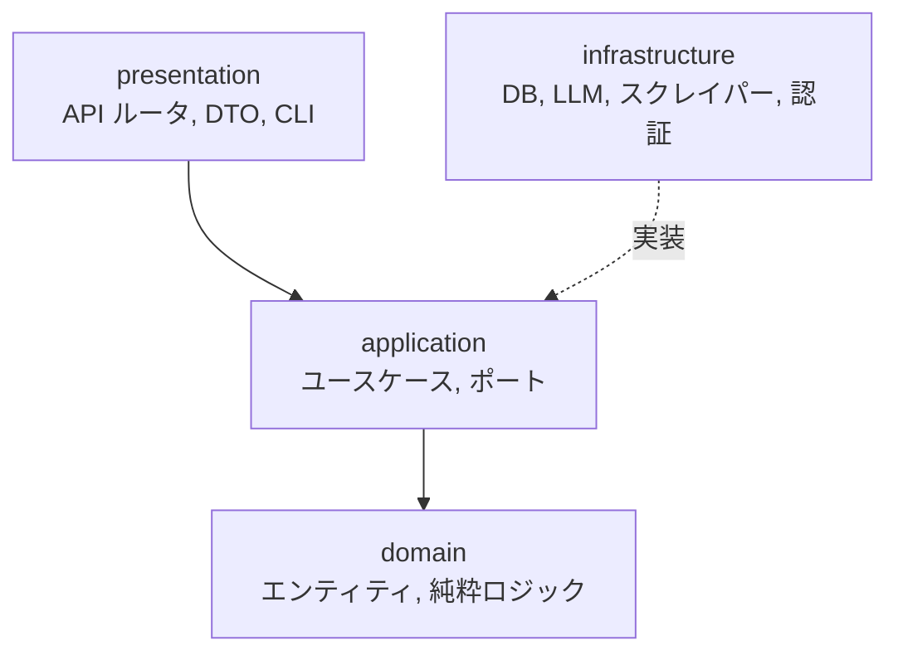

# 0002. バックエンドをクリーンアーキテクチャの4層で構成する

- ステータス: 承認
- 日付: 2026-10-14

## 文脈

他学部・他大学への拡張で、シラバスの取得元が増える。LLM や埋め込みモデルも切り替える可能性がある。設計そのものが成果物として評価される。

## 検討した選択肢

1. 4層: domain / application / infrastructure / presentation
2. レイヤード3層: api / services / models

## 決定

4層にする。依存は presentation → application → domain の一方向。infrastructure は application が定義するポート(Protocol)を実装する。domain は何にも依存しない。

ポートは差し替え先が実在するものにだけ切る: LLM、埋め込み、科目リポジトリ、道標(Plan)リポジトリ、シラバス取得元。時間割生成は domain の純粋関数として置く。

## 理由

- 取得元の追加が `SyllabusSource` の実装を1つ足す作業になる
- ユースケースを HTTP や DB なしで単体テストできる
- 層の責務が読み手に伝わる

## 受け入れたトレードオフ

- 定型コード(DTO とエンティティの詰め替え、Protocol 定義)が増える
- ファイル数が3層より多い

## 再検討する条件

- ポートの実装が1つしか無い状態が長く続く部分は、ポートを外して直接依存に戻す
