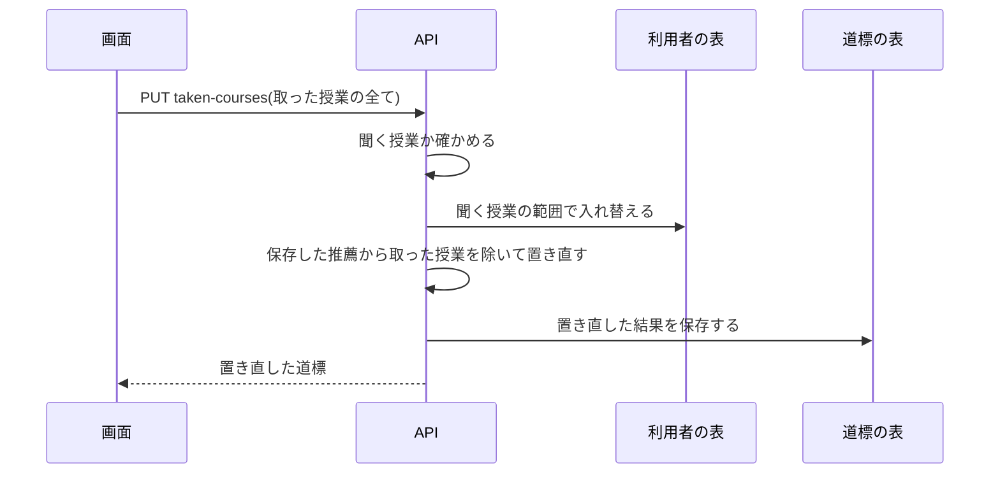

# 0034. 前の学期に開講された授業は結果の画面で取ったかを聞き、取った授業は利用者ごとに覚えて道標から外す

- ステータス: 承認
- 日付: 2026-10-19

## 文脈

ADR 0033 で、柱と同じ学期や柱より後の学期に置かれた礎に「柱と同じ学期です」「柱より後の学期です」と注意を出した。見本の道標(データサイエンティスト)では、礎 8 つのうち 5 つが柱より後、2 つが柱と同じ学期だった。高橋さんは最初、配置の柔らかい決まりでこれを避けると決めた。

決まりを作る前に、保存した道標 15 件を、保存した推薦のまま API を呼ばずに置き直して測った。

- 礎から柱へのつながりは 75 本あり、今の配置では柱より前が 23 本、同じ学期が 25 本、後が 27 本
- 礎だけを柱より前の学期へ動かす直し方では、動かせる礎が 1 つも無かった。礎はもう置ける最も早い学期にあり、柱と同じか後になるのは、その礎が柱より前の学期に開講されないから(単位やコマの取り合いではない)
- 避けるには柱を遅らせるしかない。礎を先に置き、柱をその後へずらすと、柱より前は 65 本になるが、柱 80 個のうち 27 個が遅れる。春だけ、秋だけの授業が多いので、遅れはたいてい 1 年(2 学期)。柱を遅らせるのを 1 学期までにすると、柱より前は 32 本にしか増えない
- 柱と同じか後の 52 本のうち 32 本は、下の回生から取れる授業(情報処理、電子情報基礎数学、電子情報工学実験Ⅰ など)だった。3 回生から始める利用者は、もう取っているかもしれない

shirube は利用者がもう何を取ったかを知らない。推薦された授業のうち、始める学期より前の学期にも開講されている授業は、1 件あたり平均 4.9 個(推薦は平均 10.5 個、多いもので 12 個)で、そのうち柱が平均 1.9 個だった。

## 検討した選択肢

柱より後の礎の扱い

1. 柱を後ろへずらし、礎を先に置く
2. 配置は変えず、注意の文で理由を伝える
3. もう取ったかを聞き、取った授業を外す

聞く時

1. 道標ができたあと、結果の画面で聞く
2. 推薦のあと、配置の前に止めて聞く(作る流れに答え待ちの状態を足す)
3. 作る前に入力の画面で聞く(推薦がまだ無いので、前の学期に開講された学科の授業を全て並べる)

取ったと答えた授業

1. 道標から外して置き直す
2. 外さず、取得済みの印だけを付ける

覚える場所

1. 利用者ごと
2. 道標ごと(あとで利用者ごとへ移す)

授業の指し方

1. 科目名
2. 年度と授業コード

## 決定

高橋さんが選んだ。柱を遅らせる配置の決まりは作らず(ADR 0007 の、前提科目を制約にしないのはそのまま)、取ったかを聞く。聞く時は 1、取った授業は 1、覚える場所は 1、指し方は 1。

- 聞く授業: 推薦された授業(柱も礎も、置けなかった授業も)のうち、始める学期より前のどれかの学期に開講される授業。開講されるかは、置く処理と同じ判定(`opens_in`)を始める学期より前の学期で見る(今年度の時間割を前の年度の代わりにする。ADR 0010)
- 結果の画面で、聞く授業の切符に「もう取った」を出す
- 取ったと答えた授業は、利用者ごとに科目名で覚える(利用者に紐づく表)
- 答えたら、その道標を保存した推薦で置き直す。LLM は呼ばない。置き直しは今の配置(ADR 0025)から取った授業を除いたもので、柱を遅らせる決まりは足さない
- 外した授業は道標に「もう取った授業」として残し、押すと戻して置き直す。推薦の科目は、置いた授業、置けなかった授業、もう取った授業のどれか 1 つに入る
- ほかの道標は置き直さない。その道標を開いて答えたときに置き直す
- 道標の結果に、聞く授業と外した授業を持つ。結果の JSON は版 3 にし、版 2 の道標は聞く授業も外した授業も無いものとして移す
- 取らずに残った礎の注意(柱と同じ学期、柱より後の学期)には「前の学期には置けませんでした」と理由を添える
- API は `PUT /api/v1/plans/{id}/taken-courses` で、本文はその道標で聞く授業のうち取った授業の全て(`{"names": [...]}`)。利用者の覚えを、その道標で聞く授業の範囲で入れ替え、置き直した道標を 200 で返す。聞く授業でない名前は 422、完了していない道標は 409、他人の道標は 404
- 作業は 2 つの PR に分ける。1 つ目で上の全て(聞く、覚える、置き直す、戻す)を作る。2 つ目で、道標を作るときに覚えた授業を推薦の候補から除き、入力の画面に取ったと答えた授業の一覧と取り消しを出す

## 理由

- 礎はもう置ける最も早い学期にあるので、配置で避けるには柱を遅らせるしかなく、柱の 3 分の 1 がたいてい 1 年遅れる。後ろの礎の 6 割は下の回生から取れる授業で、もう取っているかもしれない授業のために、仕事に直接使う柱を遅らせることになる
- 取ったかを知れば、取った礎は外れ、その注意も要らなくなる。残る注意は、まだ取っていない礎についてのものだけになる
- 結果の画面で聞くと、聞くのは推薦された中の平均 4.9 個だけで済み、作る流れ(ADR 0029 の worker と状態)を変えない。置き直しは LLM を呼ばないので費用が掛からず、すぐ返せる
- 利用者ごとに覚えると、2 つ目の PR のあと、次の道標では初めから取った授業を除ける。聞き直す手間は初回だけになる。利用者の表は ADR 0027 ですでにある
- 科目名は、推薦と配置が授業をまとめる鍵で、どのクラスで取っても同じ名前になる。授業コードはクラスごと、年度ごとに違う
- 取った授業の全てを送る PUT にすると、押した順番に左右されず、同じ要求を繰り返しても結果が変わらない
- 外した授業を道標に残すと、何を外したかが見え、押せば戻せる。推薦の科目がどれか 1 つに入るという道標の決まりも保てる

## 受け入れたトレードオフ

- 最初の道標には、取った授業も入って見える(利用者ごとの覚えを推薦の候補に使う 2 つ目の PR のあとは、初回だけ)
- 前の学期に開講されたかは今年度の時間割で見るので、利用者が実際にいた年度の開講と違うことがある
- 科目名で覚えるので、年度で名前が変わると引き継げず、同じ名前の別の授業を区別できない
- 取ったと答えても、ほかの道標は開いて答えるまで置き直さない
- 版 2 の道標(本番はまだ無く、手元の道標だけ)では聞けない
- 置き直すと、空いた単位とコマに置けなかった授業が入り、ほかの授業の学期も変わることがある(貪欲法のため)
- まだ取っていない礎が柱と同じか後になる注意は残る

## 再検討する条件

- 年度をまたいで同じ授業を指せる ID が手に入ったとき
- 聞く数が多すぎるという声が出たとき
- 必修科目や、成績・履修の記録を取り込めるようになったとき(聞かずに分かる)
- 柱を遅らせてでも礎を先に取りたいという声が出たとき(この ADR の選択肢 1)
