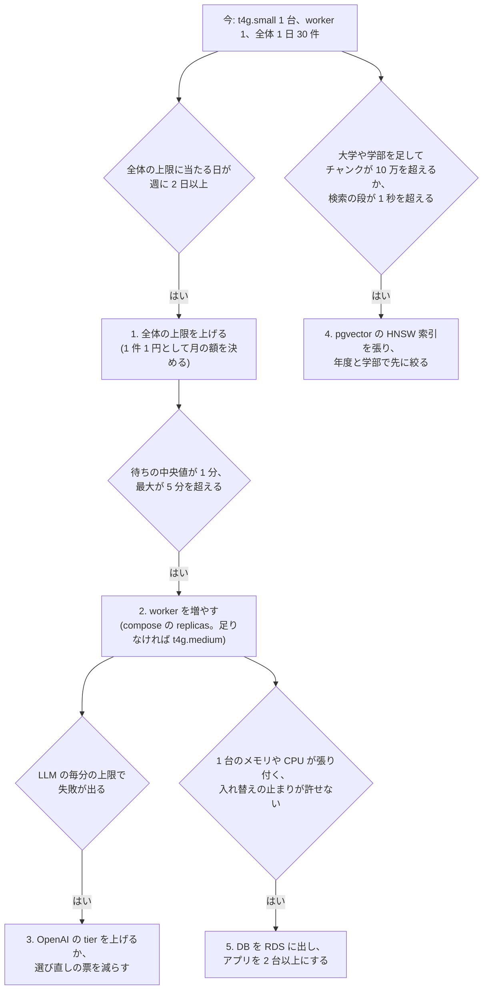

# 0102. 利用者が増えたら、構成を先に変えず、記録の合図を見て上限、worker、索引、台数の順に広げる

- ステータス: 承認
- 日付: 2026-11-13

## 文脈

- 本番は EC2 の t4g.small 1 台に compose で、db(pgvector)、backend、worker 1 つ、frontend、caddy を動かしている(ADR 0075、0076)。月の費用は EC2 が 21 ドルほどで、LLM は前払いの残高から引かれる(自動の補充は切ってある。ADR 0038)
- 道標の受け付けには、1 人 1 日 3 件、全体で 1 日 30 件、待ちと作成中は 1 人 1 件の上限がある(ADR 0038)。全体の上限は費用の上限として置いたもので、最悪で 1 日 100 円ほど
- 道標は worker が待ちから古い順に 1 件ずつ取って作る(ADR 0029)。取るときは `FOR UPDATE SKIP LOCKED` で行を押さえるので、worker を増やしても同じ道標を 2 つが作ることは無い
- 1 件を作る時間は 8〜11 秒で、ほとんどは LLM の選び直しの段(手元の作った記録 3 件で、読み取り 1.2〜2.2 秒、検索 0.7〜2.5 秒、選び直し 5.3〜8.1 秒、配置 0.01 秒。50 職業の実験では推薦 1 件 8.0 秒。`docs/evaluation-log.md`)。worker 1 つで 1 時間に 300 件ほど作れ、全体の上限の 30 件は 1 日の作れる量の 1% に満たない
- 費用は 1 件 1 円ほどで(同じ職業名の読み取りを覚えたあとは 0.65 円ほど)、同じ職業名と条件の推薦は 7 日のあいだ LLM を呼ばずに使い回す(ADR 0092)
- 科目のデータは 2026 年度の理工学部の 530 頁を 1,589 のチャンクに分けたもので、DB は 45MB ほど。検索は索引を張らずに全てのチャンクとの距離を測っている
- 見る手段はそろっている。`report` が日ごとの件数、費用、待ちと作る時間の中央値と最大、失敗の種類を出し(ADR 0087)、health が待ちの滞り(1 時間)と残高切れを返し、GitHub Actions が 15 分ごとに見て落ちたら知らせる(ADR 0095)
- 今の利用者は数えるほどで、どこが先に詰まるかは数字が出るまで分からない。高橋さんは、お金のかかることは今はしないと決めている

## 検討した選択肢

1. 今のうちに広げられる構成にしておく(ECS や App Runner に載せ替え、RDS、キューに SQS、自動のスケール)
2. 構成は今のままにし、詰まりの合図を先に決めておいて、合図が出た所だけを段階に分けて広げる
3. 何も決めず、詰まってから考える

## 決定

2 を採る。詰まる所の順と、それぞれの合図、打つ手を先に決めておく。打つ手のうち費用が増えるもの(上限を上げる、台を大きくする、台を増やす)は、合図が出たときに高橋さんが額を見て決める。

段階ごとの合図と打つ手

| 段階 | 詰まる所 | 合図(見る所) | 打つ手 | 費用 |
|---|---|---|---|---|
| 1 | 全体の 1 日の上限 | 日ごとの件数が 30 に届く日が週に 2 日以上(`report`) | 全体の上限(`DAILY_PLAN_LIMIT_TOTAL`)を上げる。1 人の上限は変えない | 1 日 100 件で月 3,000 円ほど。使い回しが当たる分だけ減る |
| 2 | worker の数 | 待ちの中央値が 1 分、最大が 5 分を超える(`report`)。health の待ちが stalled | `compose.prod.yaml` の worker に `deploy.replicas` を書く(`--scale` で増やしても、次の入れ替えの `up` で 1 つに戻る)。メモリが足りなければ t4g.medium に上げる | worker は 0 円。t4g.medium で EC2 が月 35〜40 ドルほど |
| 3 | LLM の毎分の上限 | 失敗の原因に `rate_limit_exceeded` が出る(`report`) | 支払いの累計で tier が上がるのを待つか、`SELECTION_VOTES` を下げる(精度とのかね合いは pair で測る) | tier は支払い次第。票を減らすと 1 件の費用も減る |
| 4 | 検索 | チャンクが 10 万を超えるか、作った記録(`plan_builds` の段ごとの秒)で検索の段の中央値が 1 秒を超える | HNSW 索引を張り、年度と学部の条件を距離の計算より先に効かせる。評価の再現率を測り直す | 0 円(DB のメモリが増える) |
| 5 | 1 台 | メモリや CPU が常に張り付く。入れ替えの数十秒の止まりや、1 台が壊れたときの戻し(バックアップから)が許せない規模になる | DB を RDS(自動のバックアップと時点の戻し)に出し、backend、worker、frontend を 2 台以上と ALB にする(このとき IaC を先に作る) | 月 50〜100 ドルほど増える |

決めておくこと

- 待ちの仕組みは Postgres のまま増やす。worker を増やしても `SKIP LOCKED` で取り合わず、数十までは SQS や Redis を足さない
- 自動のスケールは入れない。費用の上限を先に決めて受け付けで断る作りなので、台が増えても作る件数は増えない
- 1 人 1 日 3 件と、待ちと作成中は 1 人 1 件の上限は、どの段階でも外さない(1 人がまとめて使うのを防ぐため)
- 段階を進めたら、合図の数字と打った手を `docs/development.md` の「本番」と、この ADR の追記に残す

## 理由

- 今の詰まりは計算の力でなく、わざと置いた費用の上限にある。構成を先に広げても作れる件数は増えず、費用と動かす部品だけが増える
- 合図に使う数字は、もう `report` と health で取っている。新しい監視を作らずに、詰まる前に気づける
- 段階 1〜4 は設定と索引の変更で済み、同じ 1 台のまま 1 日数千件まで広げられる。台を分けるのは、止まりやデータを失うことが許せなくなったときで、それは件数より利用者の数と頼られ方で決まる
- 1 にすると、ECS と RDS と SQS で月の費用が今の数倍になり、無料プランのクレジットが早く尽きる。3 だと、詰まったときに何を見て何を変えるかをその場で調べることになる

## 受け入れたトレードオフ

- 合図が出てから手を打つので、急に人が増えた日は、全体の上限で断られる人が出る。断りの文は出るが、その日は作れない
- 段階 5 までは 1 台なので、EC2 が止まればサービスも止まる。戻しはサーバーの中のバックアップ(毎日 1 回、7 日分)からで、最後のバックアップのあとの道標は失い、ディスクごと失えばバックアップも失う(ADR 0075)。利用者のデータを失えない規模になったら、段階 5 を待たずにバックアップをサーバーの外(S3 など)にも置く
- 合図の数字(週 2 日、1 分と 5 分、10 万、1 秒)は今の 1 件の時間と費用から決めた目安で、実際に詰まりかけたときに見直す

## 再検討する条件

- 段階のどれかの合図が出たとき(打つ手の額を決めて、この ADR に追記する)
- 対象の大学や学部を広げるとき(段階 4 と、取り込みの時間)
- AWS のクレジットが尽きるか無料プランの期限が来て、置き場を選び直すとき(ADR 0076)
