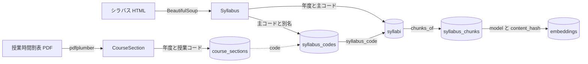

# データモデル

取り込み元は2系統(ADR 0012)。授業時間割表から科目の所属と開講情報を、シラバスから授業内容を取り、授業コードで結合する。

## CourseSection(domain/course.py)

時間割表の1行 = 1つの授業コード = 1クラス。

| 項目 | 型 | 元の列 | 意味 |
|---|---|---|---|
| code | str | 授業ＣＤ | 5桁。シラバスの科目コードと一致する結合キー |
| name | str | 科目名 | 「※」より前。同じ name で class_code が違う行は同一科目の別クラス |
| class_code | str \| None | クラス | A8, 6T など。学科や回生は表さない |
| term | Term \| None | 見出し【春学期】【秋学期】 | 【その他】の行は None。学期はシラバス側で補う |
| slots | tuple[TimeSlot, ...] | 曜日, 時限 | 時限 1-2 → 1限 … 11-12 → 6限。7-10 は 4限と5限。@ は空 |
| departments | frozenset[str] \| None | 学科 | 電, 情, 数, 物, 機, ロ, 環都, 建。「全」は None(全学科) |
| audiences | tuple[Audience, ...] | 区分, 入学年度, 回生 | 「/」区切りの変種を位置で対応させる |
| credits | int | 単位 | |
| instructors | tuple[str, ...] | 担当教員 | 「、」区切り |
| room | str \| None | 教室 | 「-」は None |
| registration | str | 登録方法 | 本, 抽選, 選考, 先着, 事務室, 別途指示 |
| note | str \| None | 科目名の「※」以降 | 受講条件などの注記 |

## Audience

| 項目 | 型 | 意味 |
|---|---|---|
| entry_year_from, entry_year_to | int | 入学年度の範囲(西暦)。26-16 → 2016〜2026。今年度その授業を取る学生の入学年度で、カリキュラムの範囲ではない。3〜4 回生向けの科目は 2026 年度なら 24-20 のようになり、2026 年度の入学者は含まない |
| eligible_grades | frozenset[int] | 履修できる回生。「2」は 2〜4、「1のみ」は 1、「1.2のみ」は 1 と 2、「1～4のみ」は 1〜4 |
| category | str | 区分。教養A〜E, 基礎専, 専門, 立命館, 自由 など |

`CourseSection.offered_to(学科, 回生 G, 年度)` は、その科目が今年度 G 回生に開講されているかを返す。今年度 G 回生にあたる入学年度(年度 − G + 1)が範囲に入り、G が履修できる回生に含まれることを確かめる。ADR 0010 で当年度を翌年度以降の代理とみなすので、ある学生が将来 G 回生になる学期にも、今年度 G 回生に開講されている科目を候補にする。旧カリキュラム(16〜19 年度入学)だけのクラスはどの回生にも当てはまらず、候補から外れる。

## Syllabus(domain/syllabus.py)

シラバスの詳細ページ1枚 = 1つの Syllabus。合併科目(同じ授業を別の科目名・授業コードで開講するもの)はページが1つで、科目名欄に「§」区切りで全ての名前が並ぶ。先頭を主コードとし、残りを別名として持つ(ADR 0013)。

| 項目 | 型 | 元の場所 | 意味 |
|---|---|---|---|
| code, title | str | 科目名欄の先頭 | 主コードと科目名。ページの URL と保存ファイル名は主コード |
| aliases | tuple[CourseName, ...] | 科目名欄の2つ目以降 | 別名のコードと科目名。時間割表との結合は主コードと別名の両方で行う |
| year, credits | int | 見出し表 | 年度と単位数 |
| term_label, slot_label, faculties, instructors | str, str, tuple[str, ...], tuple[str, ...] | 見出し表 | 学期とコマは表示用の文字列のまま。道標の制約には時間割表の値を使う |
| campus, language, overview, objectives, preparation, class_format, self_study, grading_note, advice, remarks | str | 各項目 | 段落の空行を保持した本文 |
| schedule_note, sessions | str, tuple[Session, ...] | 授業スケジュール表 | 回が「-」の行は注記。回の列は自由記述なので文字列のまま |
| grading | tuple[GradingItem, ...] | 成績評価方法表 | 種別、割合、基準 |

## SyllabusChunk(domain/chunk.py、ADR 0005、0015)

Syllabus 1 件から、授業の概要と方法 / 受講生の到達目標 / 授業スケジュール の 3 つまでのチャンクを作る。本文は「科目名、見出し、本文」の順。授業スケジュールは各回のテーマとキーワードを並べ、回の番号と注記は入れない。本文が空のセクションは作らない。content_hash は本文の SHA-256 で、埋め込みの再利用のキーになる。2026 年度の 530 ページから 1,589 チャンクができる。

## OccupationProfile(domain/occupation.py、ADR 0018)

利用者が入力した職業名を LLM が読んだ結果。入力された職業名、解釈した職業名、解釈が割れたときの前提(割れなければ None)、仕事で直接使うスキル 3〜6 個を持つ。検索文は解釈した職業名とスキルを改行でつないだもので、評価データの検索文と同じ形にする。DB には保存しない。

## テーブル(infrastructure/db/models.py、ADR 0014)

取り込み元ごとに表を分け、入れ子は JSONB で持つ。全表が year を持ち、`IngestTimetable` が course_sections を、`IngestSyllabi` が syllabi と syllabus_codes を、年度単位で全削除と挿入を1トランザクションで入れ替える。片方を取り直しても他方には触れない。

| 表 | 主キー | 内容 |
|---|---|---|
| course_sections | (year, code) | CourseSection の1件。term と slots の weekday は列挙の値(spring / mon)、slots・departments・audiences・instructors は JSONB。departments が全学科のときは SQL の NULL |
| syllabi | (year, code) | Syllabus の1件。code は主コード。faculties・instructors・sessions・grading は JSONB |
| syllabus_codes | (year, code) | ページに載る全てのコード(主コードと別名)と科目名。syllabus_code で syllabi を指し、position 0 が主コード |
| syllabus_chunks | (year, syllabus_code, section) | SyllabusChunk の1件と content_hash。syllabi を指し、シラバスを入れ替えると消える(ADR 0015) |
| embeddings | (model, content_hash) | 埋め込みのベクトル(vector(1536))。今のモデル以外の行と、どのチャンクからも引かれなくなった行は `embed --prune` で消す |

時間割表の授業コードからシラバスを引くときは syllabus_codes を経由する。`Syllabus.aliases` は position が 1 以上の行から組み立てる。チャンクの埋め込みは、チャンクの content_hash と設定のモデル名で embeddings を引く。`EmbedSyllabi` はまだ埋め込みの無いハッシュだけを API に送る。

## 道標での使い方

- 各学期の候補は、利用者の学科で、その学期に利用者がなる回生 G に今年度開講されている CourseSection(`offered_to`)
- 検索(`SearchCourses`)は候補の科目のシラバスのチャンクから近いものを探し、科目名ごとに最も近いチャンクの類似度で並べる(ADR 0005、0017)
- 同じ name に複数の class_code があるときは、利用者にどのクラスかを問うて1つに決める
- コマの衝突判定は slots と term で行う。term が None の科目はシラバスの学期で補う
