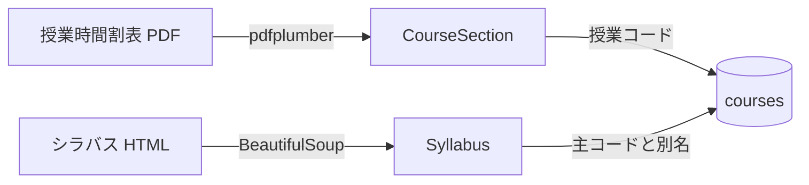

# データモデル

取り込み元は2系統(ADR 0012)。授業時間割表から科目の所属と開講情報を、シラバスから授業内容を取り、授業コードで結合する。

## CourseSection(domain/course.py)

時間割表の1行 = 1つの授業コード = 1クラス。

| 項目 | 型 | 元の列 | 意味 |
|---|---|---|---|
| code | str | 授業ＣＤ | 5桁。シラバスの科目コードと一致する結合キー |
| name | str | 科目名 | 「※」より前。同じ name で class_code が違う行は同一科目の別クラス |
| class_code | str \| None | クラス | A8, 6T など。学科や回生は表さない |
| term | Term \| None | 見出し【春学期】【秋学期】 | 【その他】の行は None。学期はシラバス側で補う |
| slots | tuple[TimeSlot, ...] | 曜日, 時限 | 時限 1-2 → 1限 … 11-12 → 6限。7-10 は 4限と5限。@ は空 |
| departments | frozenset[str] \| None | 学科 | 電, 情, 数, 物, 機, ロ, 環都, 建。「全」は None(全学科) |
| audiences | tuple[Audience, ...] | 区分, 入学年度, 回生 | 「/」区切りの変種を位置で対応させる |
| credits | int | 単位 | |
| instructors | tuple[str, ...] | 担当教員 | 「、」区切り |
| room | str \| None | 教室 | 「-」は None |
| registration | str | 登録方法 | 本, 抽選, 選考, 先着, 事務室, 別途指示 |
| note | str \| None | 科目名の「※」以降 | 受講条件などの注記 |

## Audience

| 項目 | 型 | 意味 |
|---|---|---|
| entry_year_from, entry_year_to | int | 入学年度の範囲(西暦)。26-16 → 2016〜2026 |
| eligible_grades | frozenset[int] | 履修できる回生。「2」は 2〜4、「1のみ」は 1、「1.2のみ」は 1 と 2、「1～4のみ」は 1〜4 |
| category | str | 区分。教養A〜E, 基礎専, 専門, 立命館, 自由 など |

## Syllabus(domain/syllabus.py)

シラバスの詳細ページ1枚 = 1つの Syllabus。合併科目(同じ授業を別の科目名・授業コードで開講するもの)はページが1つで、科目名欄に「§」区切りで全ての名前が並ぶ。先頭を主コードとし、残りを別名として持つ(ADR 0013)。

| 項目 | 型 | 元の場所 | 意味 |
|---|---|---|---|
| code, title | str | 科目名欄の先頭 | 主コードと科目名。ページの URL と保存ファイル名は主コード |
| aliases | tuple[CourseAlias, ...] | 科目名欄の2つ目以降 | 別名のコードと科目名。時間割表との結合は主コードと別名の両方で行う |
| year, term_label, slot_label, faculties, instructors, credits | | 見出し表 | 学期とコマは表示用の文字列のまま。道標の制約には時間割表の値を使う |
| campus, language, overview, objectives, preparation, class_format, self_study, grading_note, advice, remarks | str | 各項目 | 段落の空行を保持した本文 |
| schedule_note, sessions | str, tuple[Session, ...] | 授業スケジュール表 | 回が「-」の行は注記。回の列は自由記述なので文字列のまま |
| grading | tuple[GradingItem, ...] | 成績評価方法表 | 種別、割合、基準 |

## 道標での使い方

- 利用者の学科・入学年度・回生に合う CourseSection だけを候補にする(departments と audiences で絞る)
- 同じ name に複数の class_code があるときは、利用者にどのクラスかを問うて1つに決める
- コマの衝突判定は slots と term で行う。term が None の科目はシラバスの学期で補う
